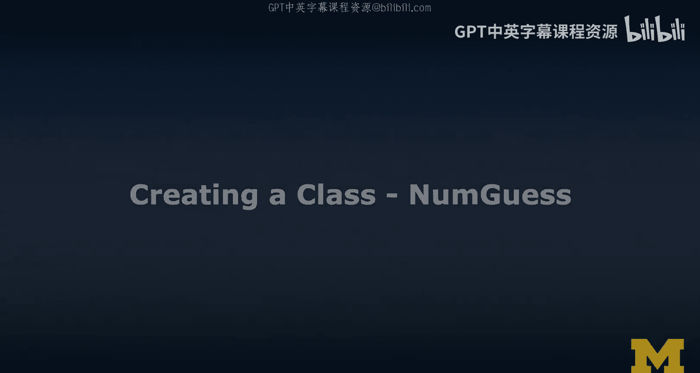
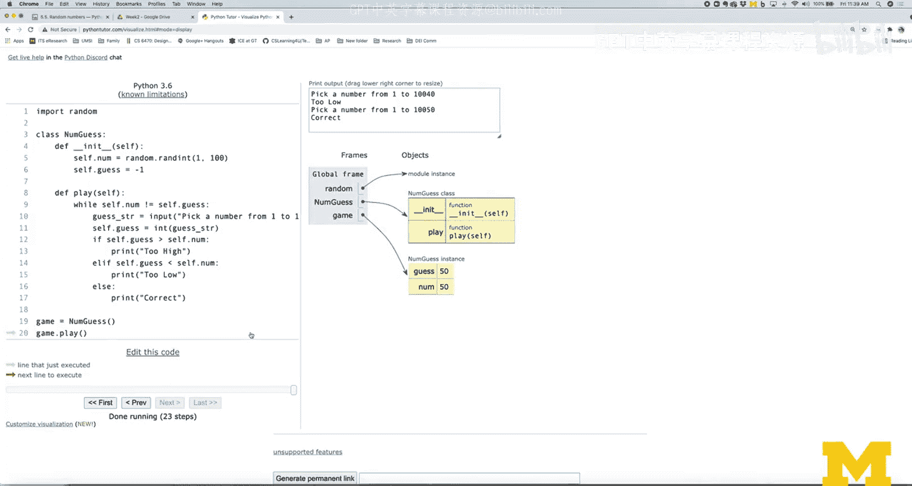
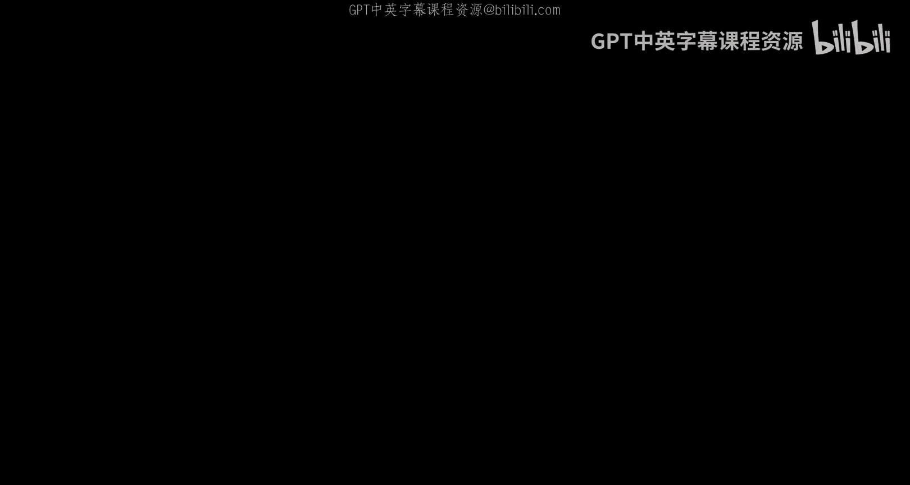

# 创造性编程：27：创建NumGuess类 🎲




在本节课中，我们将学习如何创建一个名为 `NumGuess` 的类，用于实现一个简单的猜数字游戏。我们将整合之前学过的用户输入和随机数生成知识，通过面向对象编程的方式构建一个结构清晰、可复用的游戏程序。

---

## 导入模块与类定义

首先，我们需要导入 `random` 模块，以便在游戏中生成随机数字。接着，我们将定义一个类。在Python中，定义类使用 `class` 关键字，而不是 `def`。类名通常以大写字母开头，如果包含多个单词，则采用驼峰命名法。我们将这个类命名为 `NumGuess`。

```python
import random

class NumGuess:
```

---

## 初始化方法（构造函数）

上一节我们定义了类，本节中我们来看看如何初始化它。我们将定义 `__init__` 方法，也就是构造函数。这个方法除了必需的 `self` 参数外，不需要其他参数。在构造函数中，我们将初始化两个属性：游戏随机选择的数字和玩家的当前猜测。

```python
    def __init__(self):
        self.num = random.randint(1, 100)
        self.guess = -1
```

*   `self.num`：使用 `random.randint(1, 100)` 生成一个1到100之间的随机整数。
*   `self.guess`：初始化为 `-1`。因为我们的有效猜测范围是1到100，所以 `-1` 可以表示玩家尚未进行有效猜测。

---

## 定义游戏主循环方法

现在，我们来定义游戏的核心逻辑——`play` 方法。这个方法也是一个对象方法，因此第一个参数必须是 `self`。游戏将在一个循环中运行，直到玩家猜中数字为止。

以下是 `play` 方法的基本结构：

```python
    def play(self):
        while self.num != self.guess:
            # 获取并处理用户输入
            # 判断猜测结果并给出提示
```

---

## 获取与处理用户输入

在循环内部，我们需要获取玩家的输入。使用 `input` 函数提示玩家输入一个数字，但请注意，`input` 返回的是字符串类型，我们需要将其转换为整数。

```python
            guess_str = input("Pick a number from 1 to 100: ")
            self.guess = int(guess_str)
```

---

## 判断猜测结果并给出提示

获取玩家的猜测后，我们需要将其与随机数 `self.num` 进行比较，并给出相应的提示：猜高了、猜低了还是猜对了。

以下是判断逻辑的代码：

```python
            if self.guess > self.num:
                print("Too high.")
            elif self.guess < self.num:
                print("Too low.")
            else:
                print("Correct.")
```

---

## 创建对象并运行游戏

类定义完成后，我们需要实际创建它的一个对象（实例）来运行游戏。创建对象的方法是使用类名后跟括号 `()`，这会自动调用类的 `__init__` 方法。然后，我们调用该对象的 `play` 方法来启动游戏。

```python
my_game = NumGuess()
my_game.play()
```

---

## 代码运行示例与调试

让我们运行一下代码。首先，导入模块并定义类。然后，创建游戏对象 `my_game`，这会触发 `__init__` 方法，生成随机数（例如50）并将初始猜测设为-1。接着，调用 `play` 方法。

游戏进入循环，提示用户输入。如果输入40，程序会判断为“Too low.”并再次提示输入。如果下一次输入50，程序会判断为“Correct.”。此时，循环条件 `self.num != self.guess` 不再成立，循环结束，游戏完成。

在开发过程中，如果遇到变量名拼写错误（例如将 `guess_str` 误写为 `gu_str`），程序会报错。这时需要检查并修正代码，然后重新运行。



---




本节课中我们一起学习了如何创建一个完整的 `NumGuess` 猜数字游戏类。我们涵盖了类的定义、构造函数的初始化、核心游戏循环的逻辑、用户输入的处理、条件判断以及对象的创建与使用。这是将基本编程概念整合到面向对象框架中的一个典型示例。