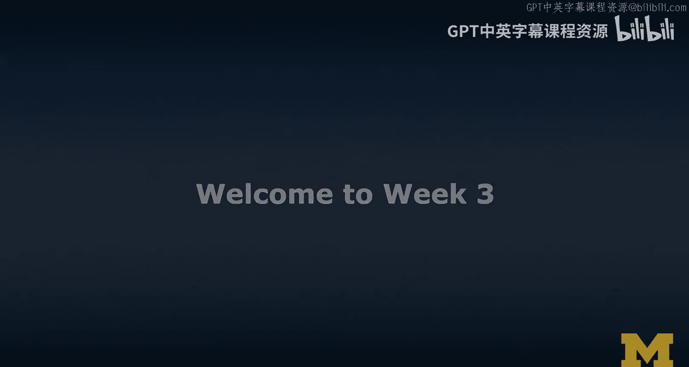
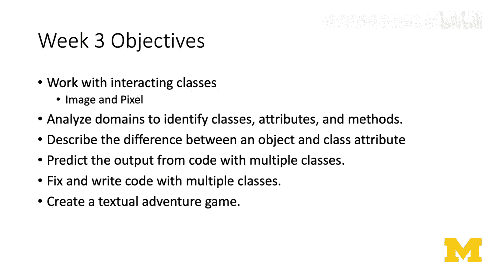
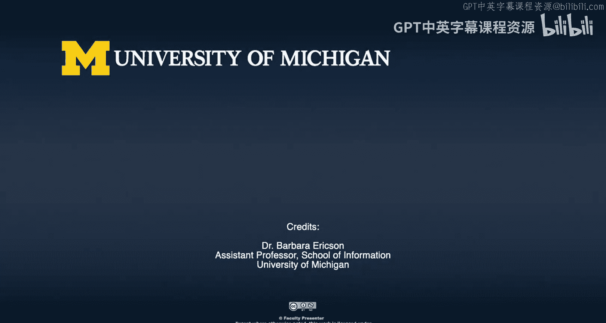

# 创造性编程：第三周：课程概述与目标 🎮

在本节课中，我们将要学习第三周的核心内容，重点是多类交互、图像处理以及面向对象编程的深入应用。

欢迎来到第三周。本周，你将学习如何处理交互的类，即多个类之间的协作。你将特别专注于处理图像和像素，进行图片或图像的操作。你还将学习如何分析问题领域，以识别其中的类、属性和方法。你将能够描述对象属性和类属性之间的区别，并能够预测包含多个类的代码的输出结果。此外，你将能够修复和编写包含多个类的代码。在本周结束时，你将创建一个文本冒险游戏。

---

## 创造性编程：第三周：核心学习目标 📋

上一节我们介绍了本周的总体方向，本节中我们来看看具体的学习目标。

以下是本周你需要掌握的核心技能列表：

*   **处理交互的类**：学习如何让多个类协同工作。
*   **图像与像素操作**：使用代码处理图像，进行各种变换。
*   **领域分析与类设计**：从实际问题中识别并设计出合适的类、属性和方法。
*   **区分对象与类属性**：理解 `self.attribute`（对象属性）与 `ClassName.attribute`（类属性）的不同。
*   **代码预测与调试**：阅读和理解多类代码，预测其行为，并修复其中的错误。
*   **项目实践**：综合运用所学知识，开发一个完整的文本冒险游戏。

---

## 创造性编程：第三周：实践项目 🏁

在掌握了上述核心概念后，我们将通过一个综合项目来应用它们。

本周的最终实践任务是创建一个**文本冒险游戏**。这个项目将要求你设计多个类（例如 `Player`、`Room`、`Item` 等），并让它们之间进行丰富的交互，从而巩固你对面向对象编程和多类协作的理解。

---

本节课中我们一起学习了第三周的课程概览。我们明确了本周将聚焦于多类交互、图像处理以及面向对象设计的深化，并最终通过构建一个文本冒险游戏来整合所有技能。希望你能在本周的学习中取得丰硕的成果。