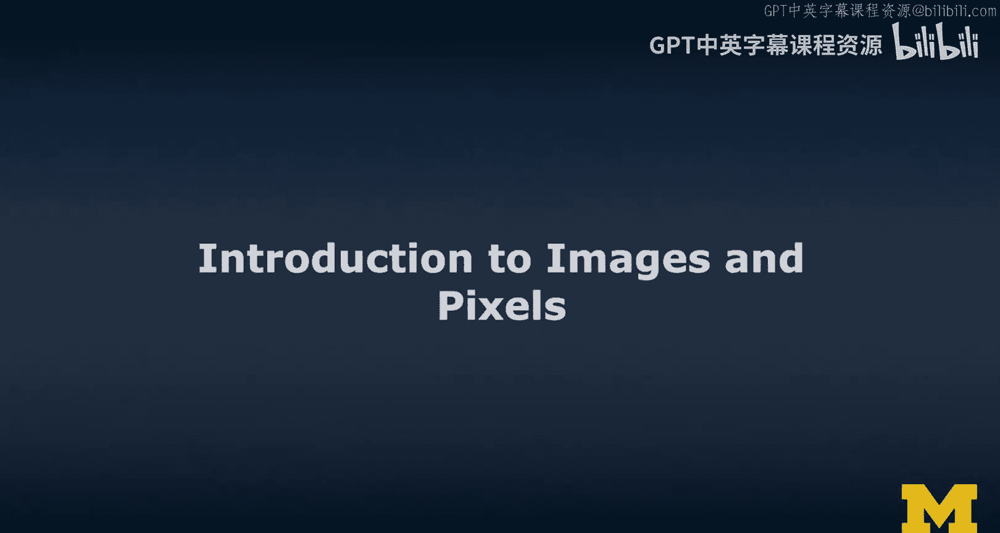
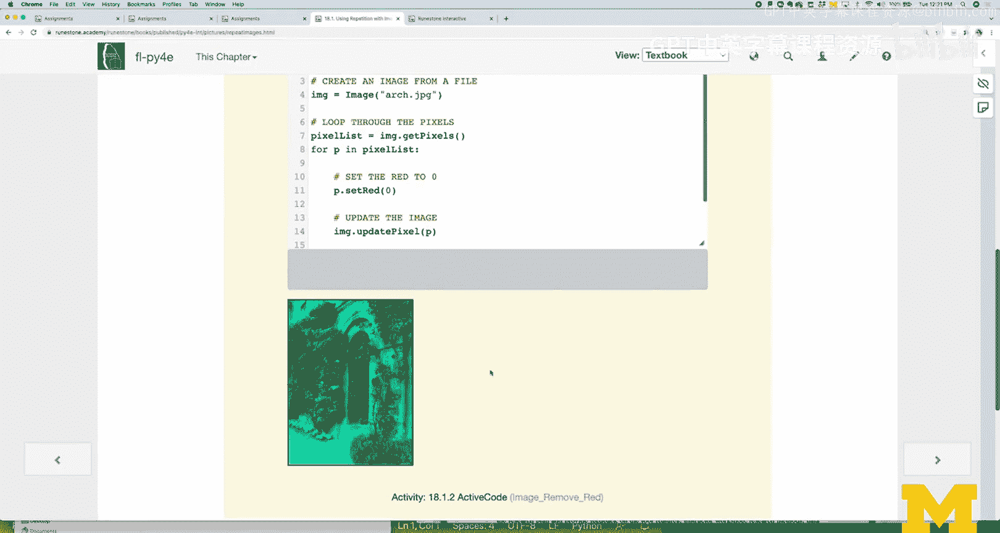
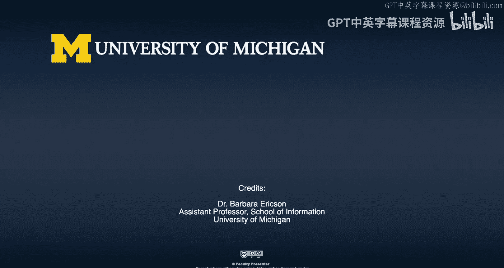

# 创造性编程：29：图像与像素基础 🖼️


在本节课中，我们将学习如何使用Python处理图像。我们将从导入图像库开始，然后学习如何加载图像、访问其像素、修改像素颜色，并最终显示处理后的结果。通过一个简单的例子，你将看到如何通过减少红色通道的值来模拟一个绿色滤镜效果。



## 导入图像库

首先，我们需要导入一个图像处理库。这个库提供了创建和处理图像所需的类和方法。

```python
import image
```

## 创建图像对象

导入库之后，我们可以从一个图像文件创建一个图像对象。这里我们以名为“arch.JPG”的文件为例。

```python
img = image.Image("arch.JPG")
```

## 获取与遍历像素列表

图像由像素组成。我们可以从图像对象中获取一个包含所有像素的列表，然后遍历这个列表来访问每一个像素。

```python
pixel_list = img.getPixels()
for p in pixel_list:
    # 在这里对每个像素进行操作
```

## 修改像素颜色

在遍历像素时，我们可以修改每个像素的颜色值。例如，下面的代码将每个像素的红色分量设置为0。

```python
    p.setRed(0)
```

## 更新图像并显示结果

修改像素后，我们需要更新图像对象以反映这些更改。最后，我们创建一个窗口并在其中绘制处理后的图像。

```python
    img.updatePixel(p)
win = image.ImageWin()
img.draw(win)
```

由于我们将红色分量设为了0，图像会呈现出一种蓝绿色调，类似于透过绿色滤镜观看的效果。这是因为水会吸收红光，所以水体看起来是蓝绿色的。




---



本节课中，我们一起学习了图像处理的基础知识。我们了解了如何导入图像库、加载图像、访问和修改像素，以及显示最终结果。通过将每个像素的红色分量设置为零，我们模拟了一个绿色滤镜效果，使图像呈现出蓝绿色调。