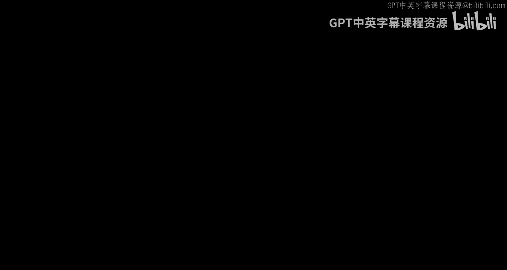
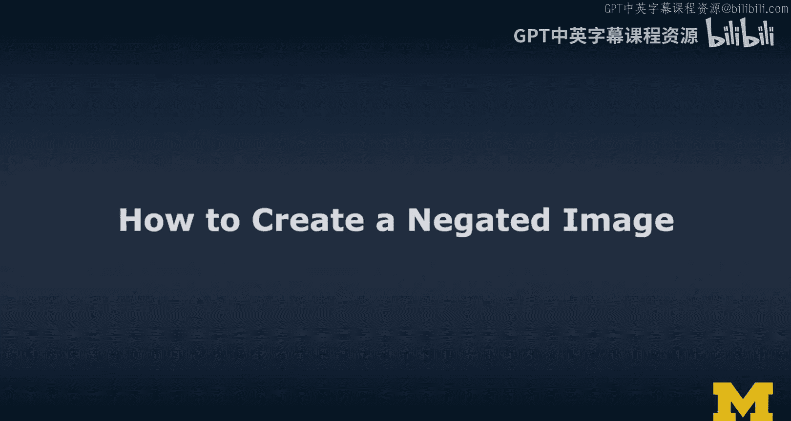
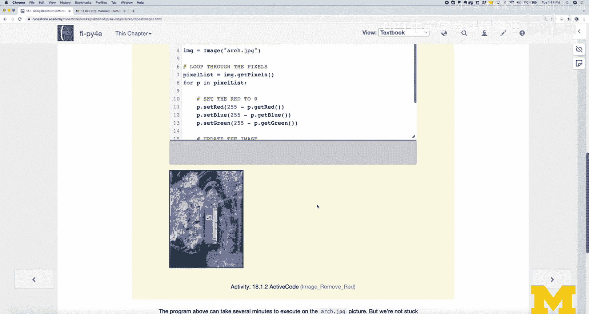
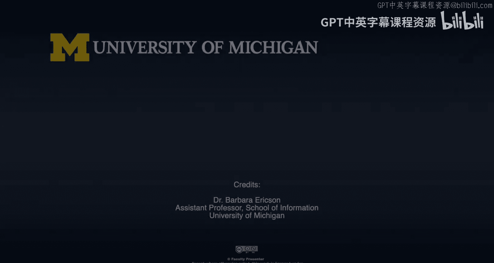
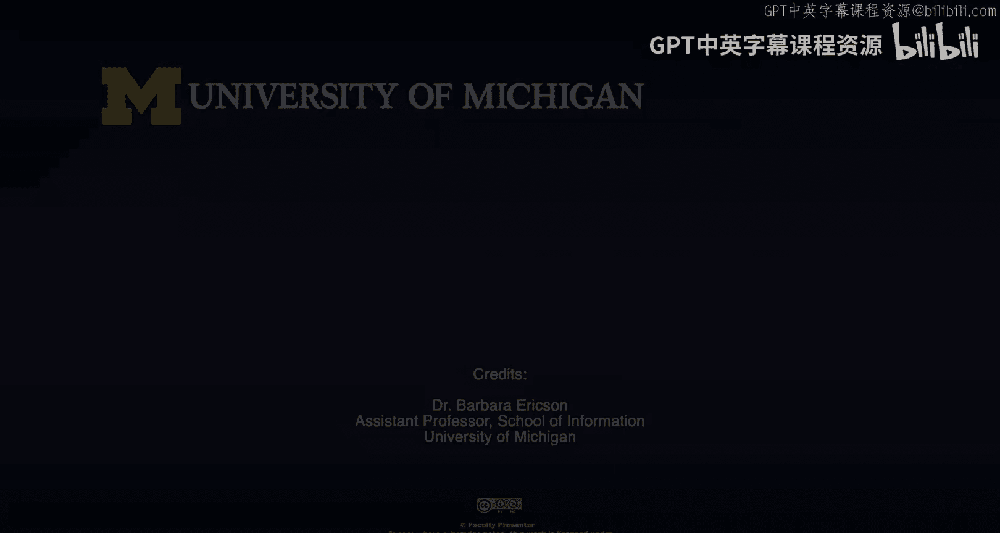

# 创造性编程：30：创建负片图像技术 🖼️



在本节课中，我们将学习如何通过编程将一张彩色图像转换为其负片效果。负片效果是传统胶片摄影中常见的现象，它反转了图像中的所有颜色。我们将通过操作图像中每个像素的红、绿、蓝（RGB）颜色通道值来实现这一效果。



---

## 负片效果的原理

在传统胶片摄影中，冲洗出来的底片（负片）颜色与实际照片的颜色是相反的。例如，实际照片中的黑色区域在负片上会显示为白色，红色会显示为青色。这种效果可以通过反转每个颜色通道的亮度值来实现。

具体来说，对于一个8位颜色通道（值范围从0到255），反转操作就是将当前值从255中减去。其核心公式可以表示为：

**新颜色值 = 255 - 原始颜色值**

这个公式适用于红、绿、蓝每一个独立的颜色通道。

---

## 实现负片效果的步骤

上一节我们介绍了负片效果的原理，本节中我们来看看如何在代码中具体实现它。我们将逐个像素地处理图像，并应用上述公式。

以下是实现负片效果的具体步骤：

1.  **遍历图像的每一个像素**。
2.  **获取该像素原始的红色（R）、绿色（G）、蓝色（B）值**。
3.  **对每个颜色通道应用反转公式**：
    *   新红色值 = 255 - 原始红色值
    *   新绿色值 = 255 - 原始绿色值
    *   新蓝色值 = 255 - 原始蓝色值
4.  **将计算出的新RGB值设置回当前像素**。

---

## 代码示例

假设我们使用一个支持像素操作的图像处理库（如PIL或OpenCV），核心代码逻辑如下所示：

```python
# 假设 image 是一个可以读取和修改像素的图像对象
for x in range(image.width):
    for y in range(image.height):
        # 获取原始像素的RGB值
        original_red, original_green, original_blue = image.getpixel((x, y))
        
        # 应用负片转换公式
        new_red = 255 - original_red
        new_green = 255 - original_green
        new_blue = 255 - original_blue
        
        # 将新颜色设置回像素
        image.putpixel((x, y), (new_red, new_green, new_blue))
```



运行这段代码后，原本的图像就会转变为它的负片。例如，原本偏红的区域会变为青色，原本明亮的区域会变暗，从而产生一种“幽灵般”的视觉效果，这正是原图像的色彩负片。

---



## 总结



本节课中我们一起学习了如何创建图像的负片效果。我们首先理解了负片是颜色通道值的反转，然后掌握了实现这一效果的核心公式 **`新值 = 255 - 原始值`**，最后通过遍历像素并应用该公式的代码实现了完整的转换过程。这是一种基础但强大的图像处理技术，是理解更复杂色彩操作的良好起点。