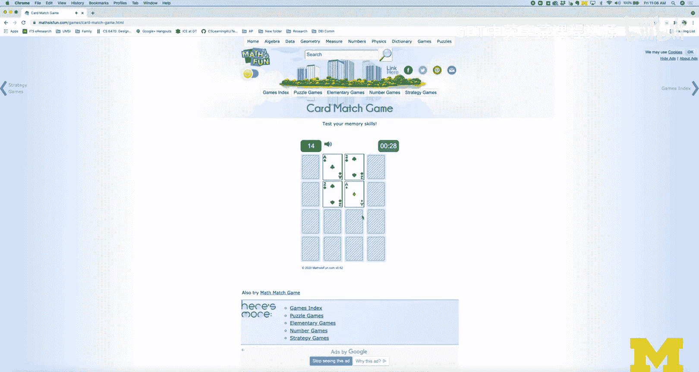

# 创造性编程：31：卡牌游戏分析 🃏

在本节课中，我们将学习如何分析一个简单的卡牌匹配游戏，并以此为例，探讨如何设计面向对象的程序。我们将识别游戏中的核心“事物”，并思考如何将它们转化为具有属性和行为的类。

---

## 游戏简介 🎮

上一节我们介绍了面向对象编程的基本概念。本节中，我们来看看一个具体的例子：一个名为“Aces and Twos”的卡牌匹配游戏。

游戏的目标是点击翻开卡牌，并找到所有花色和点数都匹配的卡牌对。当两张卡牌的点数和花色都相同时，它们就会保持翻开状态。

## 识别类与对象 🔍

在思考如何创建类来表示这个游戏时，我们首先要问：游戏中我们正在处理哪些“事物”？

这些“事物”被称为卡牌。一张卡牌具有花色和点数两个属性。例如，“Ace of Spades”的点数是“Ace”，花色是“Spades”。花色可能是黑桃、梅花、红心或方块。

这些是类的一个对象（一张具体的卡牌）应该知道的关于自身的数据。如果“我”是一张卡牌，“我”应该知道自己的花色和点数。在比较卡牌时，我们应该能够判断它们是否具有相同的花色和点数。

## 定义类的属性与方法 ⚙️

这同时也意味着对象需要具备行为。为了玩这个游戏，我们必须能够匹配卡牌，判断它们是否相等、是否是同一种卡牌。此外，我们还需要有选择或翻转卡牌的能力，点击后卡牌会翻开，如果匹配成功则保持翻开状态。

以下是我们在设计类时需要考虑的核心要素：

*   **属性**：一张卡牌对象所知道的数据。
    *   点数
    *   花色
*   **方法**：一张卡牌对象可以执行的行为。
    *   判断是否与另一张卡牌相等
    *   被选中时翻转（改变状态）

因此，我们开始思考类的命名、这些事物的分类、类的对象拥有哪些数据或属性，以及它们具有哪些行为或方法。

---

## 总结 📝

本节课中，我们一起学习了如何通过分析一个卡牌游戏来实践面向对象的设计思维。我们识别出游戏中的核心实体——“卡牌”，并定义了它的关键属性（点数和花色）以及必要的行为（匹配判断和状态翻转）。这个过程是构建任何面向对象程序的第一步：将问题域中的事物抽象为具有数据和行为的类。