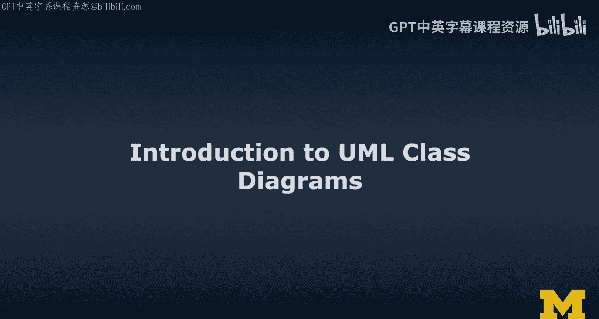
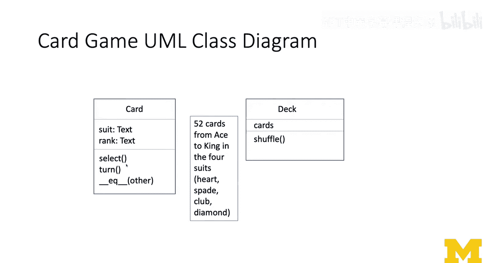

# 创造性编程：32：UML类图入门 🧩


在本节课中，我们将学习如何使用UML类图来设计和记录面向对象程序中的类。我们将以之前玩过的“Aces and Twos”纸牌游戏为例，分析其中的`Card`类和`Deck`类，并了解如何用标准化的图表来表示它们的属性与方法。



---

## 什么是UML类图？ 📊

UML类图是一种用于可视化软件系统中类、其属性（数据）和方法（行为）以及它们之间关系的标准图表。它帮助开发者在编写代码前清晰地规划程序结构。

上一节我们介绍了面向对象编程的基本概念，本节中我们来看看如何用UML类图来具体描述这些类。

## 分析“Aces and Twos”游戏中的类

在“Aces and Twos”游戏中，我们主要处理两种对象：单张的`Card`（纸牌）和整副的`Deck`（牌堆）。让我们逐一分析。

### Card类详解

`Card`类代表一张单独的纸牌。根据游戏逻辑，每张牌都有其特定的属性和可以执行的操作。

以下是`Card`类的关键组成部分：

*   **属性**
    *   `suit`：表示花色，例如红心（Hearts）、黑桃（Spades）、梅花（Clubs）、方块（Diamonds）。
    *   `rank`：表示牌面值，例如从A（Ace）到K（King）。

*   **方法**
    *   `select()`：在游戏中点击牌时，执行选择牌的操作。
    *   `turn()`：将牌翻面。这个方法可以控制牌是保持翻开状态还是翻回背面。
    *   `__eq__()`：这是一个特殊方法，用于比较两张牌是否相同。在Python中，`__eq__`方法定义了使用`==`运算符时的行为。对于纸牌，我们通过检查两张牌的`suit`和`rank`属性是否都相等来判断它们是否匹配。

**代码示例：`__eq__`方法**
```python
def __eq__(self, other_card):
    return self.suit == other_card.suit and self.rank == other_card.rank
```

### Deck类详解

`Deck`类代表一副完整的纸牌，它本质上是`Card`对象的一个有序集合。

以下是`Deck`类的关键组成部分：

*   **属性**
    *   `cards`：一个包含多张`Card`对象的列表。通常，一副标准的扑克牌包含52张牌，即4种花色，每种花色从A到K。

*   **方法**
    *   `shuffle()`：洗牌，即随机打乱`cards`列表中纸牌的顺序。

## 如何阅读UML类图 📖

现在，让我们将上面的分析对应到UML类图的表示方法上。

在UML类图中，每个类都用一个矩形框表示。这个框被水平线分为三个部分：

1.  **顶部区域**：填写**类名**（例如 `Card`、`Deck`）。
2.  **中部区域**：列出类的**属性**（例如 `suit`、`rank`、`cards`）。
3.  **底部区域**：列出类的**方法**（例如 `select()`、`turn()`、`shuffle()`）。

属性与方法之间通常用一条横线分隔，以增强可读性。

---



## 总结 🎯


本节课中我们一起学习了UML类图的基础知识。我们了解到UML类图是设计和记录类结构的强大工具，它通过一个标准的矩形框，清晰地展示了类的名称、属性（数据）和方法（行为）。我们以纸牌游戏为例，具体分析了`Card`和`Deck`两个类，并学会了如何将它们的组成部分对应到UML类图的相应区域。掌握阅读和绘制简单的UML类图，将有助于你在未来的编程项目中更好地进行规划和协作。