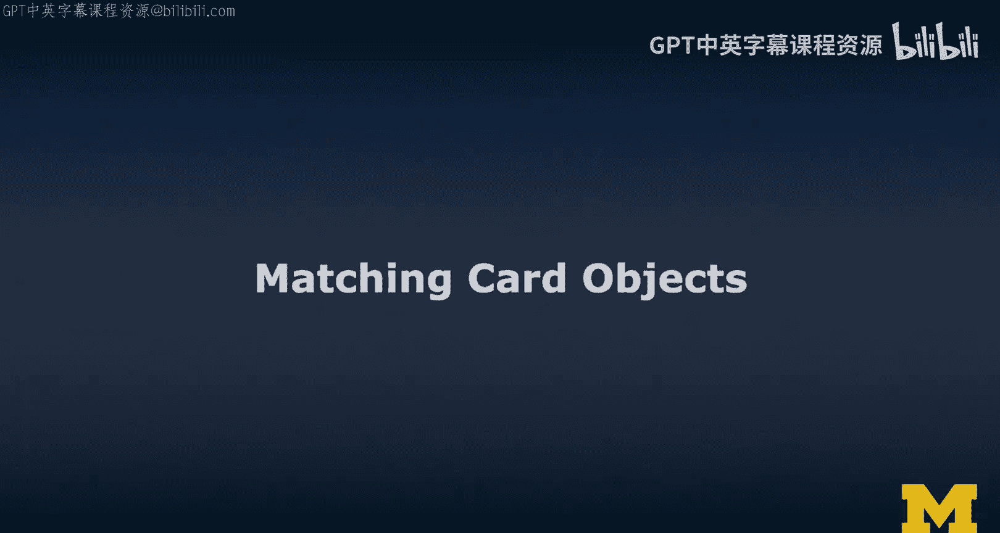
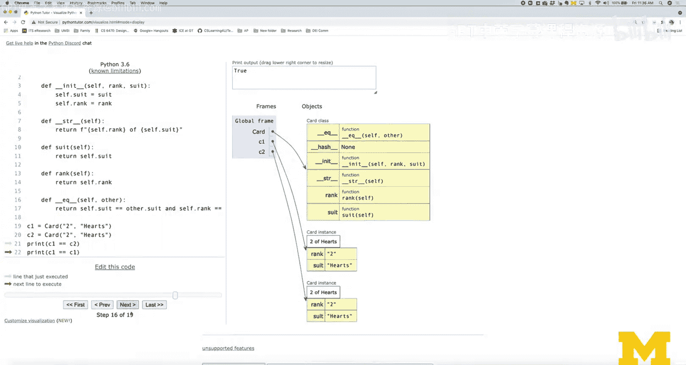

# 33：卡牌对象匹配实践 🃏




在本节课中，我们将学习如何用Python实现一个卡牌类，并重点探讨如何让两个内容相同但内存地址不同的卡牌对象能够被正确地判断为“相等”。我们将通过定义类的特殊方法来实现这一功能。

---

## 卡牌类的实现

上一节我们讨论了卡牌类的概念，本节中我们来看看如何在Python中具体实现它。

我们首先定义一个名为 `Card` 的类。它有一个初始化方法 `__init__`，用于接收花色和点数（或称为值），并将它们赋值给对象的属性。

```python
class Card:
    def __init__(self, suit, rank):
        self.suit = suit
        self.rank = rank
```

接下来，我们可以定义一个 `__str__` 方法，用于返回卡牌的字符串表示。这里我们使用F-string，它允许我们在字符串中直接嵌入变量值，无需手动转换类型。

```python
    def __str__(self):
        return f"{self.rank} of {self.suit}"
```

此外，我们还可以创建“获取器”方法，用于返回卡牌的花色和点数。

```python
    def get_suit(self):
        return self.suit

    def get_rank(self):
        return self.rank
```

---

## 对象相等性的问题

现在，我们创建两个内容相同的卡牌对象，比如都是“红心2”。

```python
c1 = Card("Hearts", 2)
c2 = Card("Hearts", 2)
```

如果我们使用 `==` 运算符来检查它们是否相等，结果会是 `False`。这是因为在默认情况下，Python的 `==` 运算符比较的是两个对象在内存中是否是同一个实例，而不是它们的内容是否相同。

例如，`c1 == c1` 会返回 `True`，但 `c1 == c2` 会返回 `False`。这在卡牌游戏中是不符合逻辑的，我们希望两张点数花色相同的牌被视为相等。

---

## 重写 `__eq__` 方法

为了解决这个问题，我们需要在 `Card` 类中重写 `__eq__` 方法。这个特殊方法定义了当使用 `==` 运算符时，对象应该如何进行比较。

以下是 `__eq__` 方法的实现：

```python
    def __eq__(self, other):
        return self.suit == other.suit and self.rank == other.rank
```

这个方法接收另一个对象 `other` 作为参数，然后比较当前对象（`self`）和 `other` 的花色与点数是否都相同。如果都相同，则返回 `True`，否则返回 `False`。

通过重写这个方法，我们“覆盖”了从父类继承来的默认相等性检查逻辑。现在，当我们执行 `c1 == c2` 时，Python会调用我们自定义的 `__eq__` 方法，并正确地返回 `True`。

---



## 总结


本节课中我们一起学习了如何构建一个功能完整的卡牌类。我们实现了初始化方法、字符串表示方法以及获取器方法。更重要的是，我们通过重写 `__eq__` 特殊方法，解决了对象内容相等但实例不同时，`==` 运算符判断错误的问题。这使得我们的 `Card` 类更符合卡牌游戏的逻辑需求。