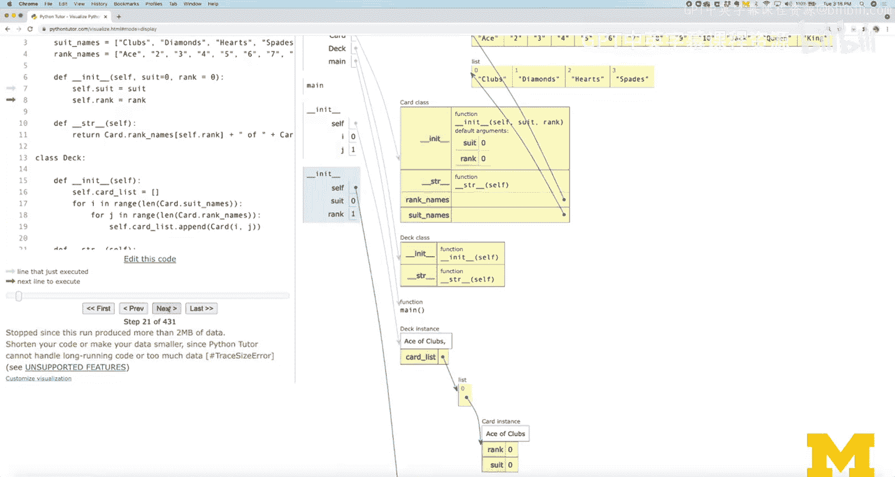

# 创造性编程：第34讲：Card类单步调试 🃏


在本节课中，我们将学习如何通过单步调试来理解`Card`类和`Deck`类的协同工作方式。我们将看到如何创建一副包含52张牌的扑克牌，并观察每个对象在内存中的创建过程。

---

## 类与对象的关系

上一节我们介绍了`Card`类的基本结构。本节中我们来看看`Card`类如何与`Deck`类结合，共同构建一副完整的扑克牌。

在Python中，一副牌（`Deck`）是52张`Card`对象的集合，包含了从A到K的所有点数以及四种花色。

以下是`Card`类和`Deck`类的核心代码结构：

```python
class Card:
    rank_names = ['Ace', '2', '3', '4', '5', '6', '7', '8', '9', '10', 'Jack', 'Queen', 'King']
    suit_names = ['Clubs', 'Diamonds', 'Hearts', 'Spades']

    def __init__(self, suit, rank):
        self.suit = suit
        self.rank = rank

    def __str__(self):
        return f"{self.rank_names[self.rank]} of {self.suit_names[self.suit]}"

class Deck:
    def __init__(self):
        self.card_list = []
        for suit in range(len(Card.suit_names)):
            for rank in range(len(Card.rank_names)):
                self.card_list.append(Card(suit, rank))

    def __str__(self):
        return '\n'.join(str(card) for card in self.card_list)
```

---

## 单步调试过程

现在，我们通过Python Tutor工具来单步执行代码，观察对象的创建过程。

1.  首先，定义了`Card`类。它包含`__init__`和`__str__`方法。
2.  `rank_names`和`suit_names`是**类属性**，而非对象属性。这意味着所有`Card`对象共享这两份列表，节省了内存空间。
3.  接着，定义了`Deck`类。
4.  执行主函数`main()`，其中创建了一个`Deck`对象。
5.  创建`Deck`对象时，会自动调用其`__init__`方法：
    *   将`card_list`初始化为空列表。
    *   使用嵌套循环遍历所有花色和点数。
    *   在循环内部，为每个花色和点数的组合创建一个`Card`对象。
6.  创建`Card`对象时，会调用`Card`类的`__init__`方法，为该对象设置`suit`和`rank`属性。
7.  创建的第一张牌是“梅花A”（Ace of Clubs），随后是“梅花2”（Two of Clubs），依此类推。
8.  代码会持续循环，直到创建完梅花花色的所有牌（从A到K），然后继续处理下一个花色（方块、红心、黑桃）。

---

## 核心机制总结

本节课中我们一起学习了`Card`类和`Deck`类如何协同工作来构建一副扑克牌。关键点在于：



*   **类属性**：`rank_names`和`suit_names`被定义为类属性，由所有实例共享，提高了效率。
*   **对象创建**：`Deck`的`__init__`方法通过嵌套循环系统地创建所有52张`Card`对象。
*   **组合关系**：`Deck`对象包含一个`Card`对象列表，这是面向对象编程中“组合”关系的典型例子。


通过单步调试，我们清晰地看到了从类定义到对象创建，再到最终组成完整牌堆的每一步过程。