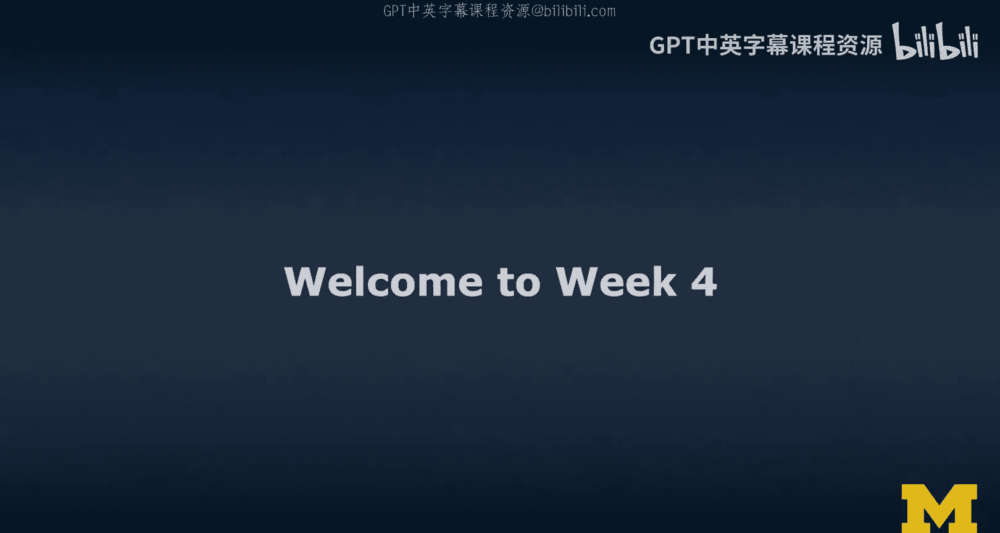
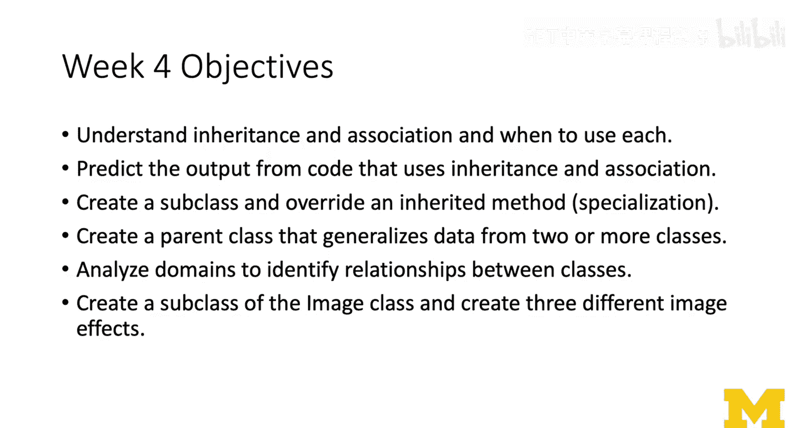
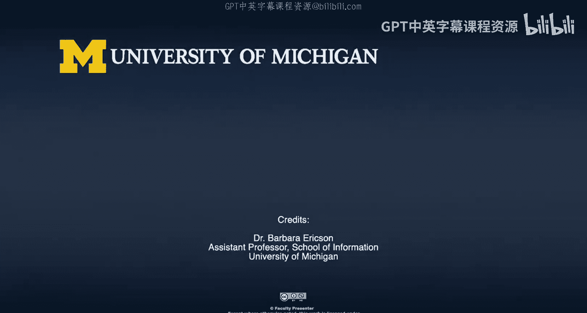
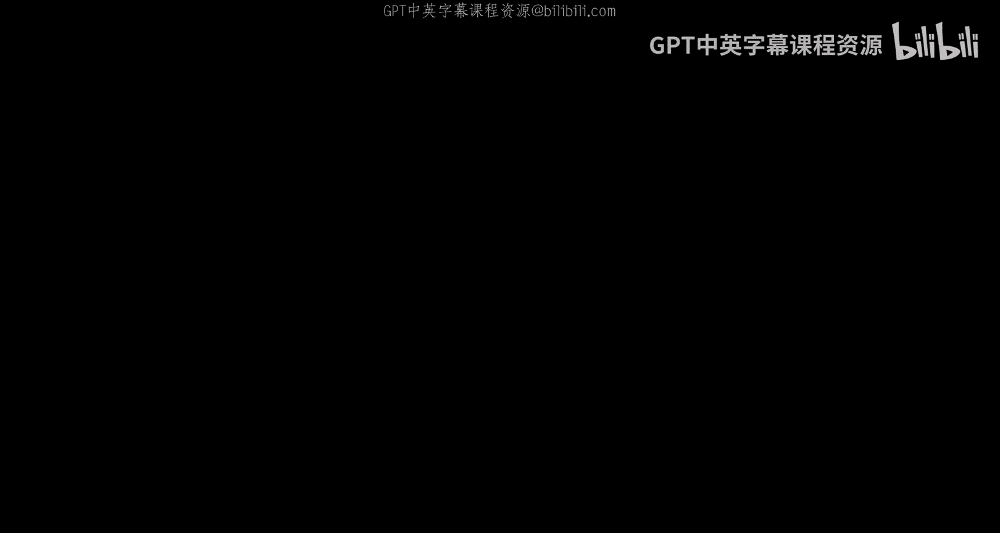

# 35：类之间的关系概述 🧩

在本节课中，我们将要学习面向对象编程中两个核心的类关系：继承与关联。理解这些关系是构建复杂、模块化程序的关键。

---

## 类之间的两种基本关系

上一节我们介绍了本周的学习主题。本节中我们来看看类之间存在的两种基本关系。

*   **继承**：这种关系可以描述为“是一个”或“是一种类型”。例如，“狗”**是一种**“动物”。
*   **关联**：这种关系可以描述为“有一个”。例如，“汽车”**有一个**“发动机”。

---

## 本周学习目标

以下是本周课程结束后，你将能够掌握的核心技能：

*   理解何时使用继承，何时使用关联。
*   能够预测包含继承和关联关系的代码的输出结果。
*   创建一个子类，并**重写**继承的方法（这也称为**特化**）。
*   创建一个父类，从两个或多个其他类中**抽象出**通用特性（这称为**泛化**），然后让子类继承这个父类。
*   分析问题领域，识别类之间的关系。
*   完成一项作业：创建一个`Image`类的子类，并实现三种不同的图像特效。

---

## 总结

本节课中我们一起学习了面向对象编程中类之间的两种核心关系：继承（“是一个”）和关联（“有一个”）。我们明确了本周的学习目标，包括创建子类、重写方法、进行泛化与特化，以及最终应用这些知识来创建图像处理特效。希望你能在本周的学习中有所收获。