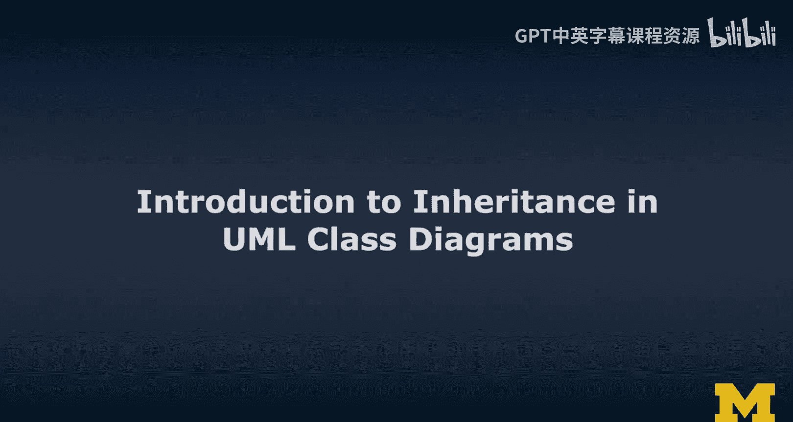
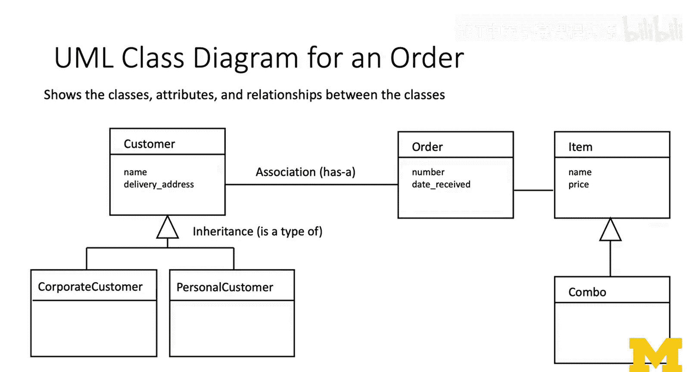
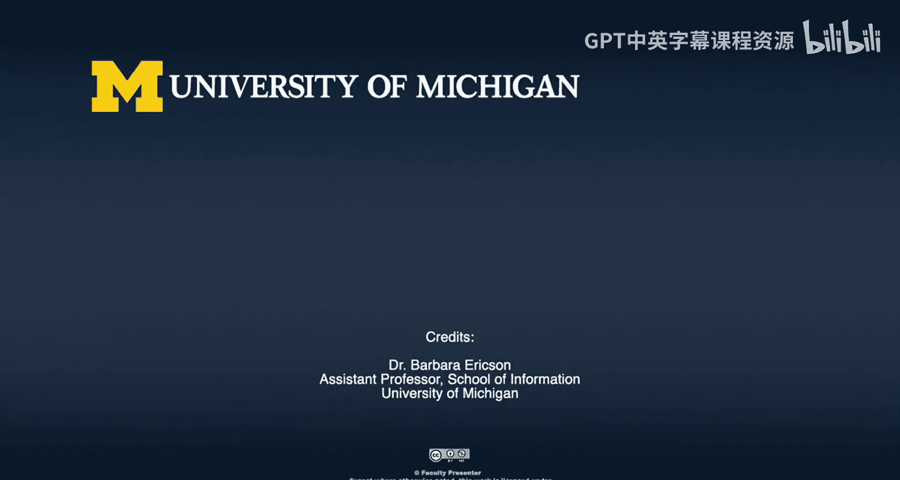

# 36：UML类图继承机制 🧩

在本节课中，我们将学习UML类图中两种基本的类关系：关联关系和继承关系。理解这些关系对于设计面向对象的程序至关重要。

## 关联关系

上一节我们介绍了UML类图的基本概念，本节中我们来看看第一种关系：关联关系。关联关系描述了一个类“拥有”另一个类，通常用一条直线连接两个类来表示。

以下是关联关系的几个例子：
*   一个航班（Flight）拥有一个机场（Airport）。实际上，它关联了两个机场：出发机场和到达机场。
*   一场电影放映（MovieShowing）关联一部电影（Movie）。电影放映指的是在特定日期和时间播放某部电影。
*   在示例UML图中，客户（Customer）拥有姓名和送货地址，并且通过一条直线与订单（Order）关联。这意味着一个客户拥有一个订单，一个订单也关联一个客户。
*   一个订单可能还拥有订单号、接收日期，以及一个订单项（Item）列表。每个订单项可能包含名称、ID或价格等信息。

## 继承关系

了解了类之间的“拥有”关系后，我们来看看另一种重要的关系：继承关系。继承关系通过一个空心三角形箭头表示，它指明一个类是另一个类的父类。

以下是继承关系的具体说明：
*   在图中，客户（Customer）是一个父类，它有两种子类：企业客户（Corporate Customer）和个人客户（Personal Customer）。
*   企业客户和个人客户可能享有不同的折扣，个人客户可能还有奖励计划。
*   图中的另一个继承关系是组合套餐（Combo）。当你去快餐店时，可能会点“套餐1”，它包含一个三明治、一杯饮料和薯条等。组合套餐是一种可以订购的订单项（Item），但它本身是多个物品的组合。
*   组合套餐的价格通过将其包含的每个物品的价格相加，再乘以某个折扣系数（例如0.9或0.8）来计算。其价格计算方式可以用以下公式表示：
    **`combo_price = discount_factor * (item1_price + item2_price + ...)`**

本节课中我们一起学习了UML类图中的两种核心关系。关联关系（直线连接）表示类之间的“拥有”关系，而继承关系（空心三角箭头）则表示类之间的“是一个”关系，即子类继承父类的特性。理解这两种关系是进行面向对象设计和分析的基础。