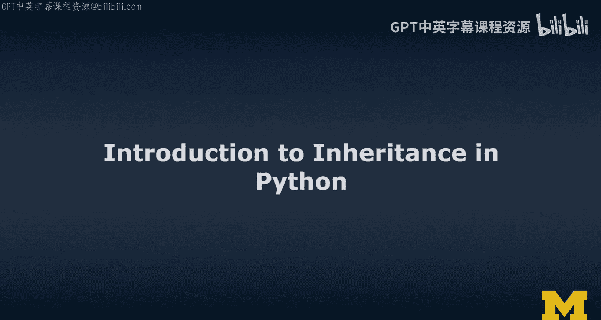
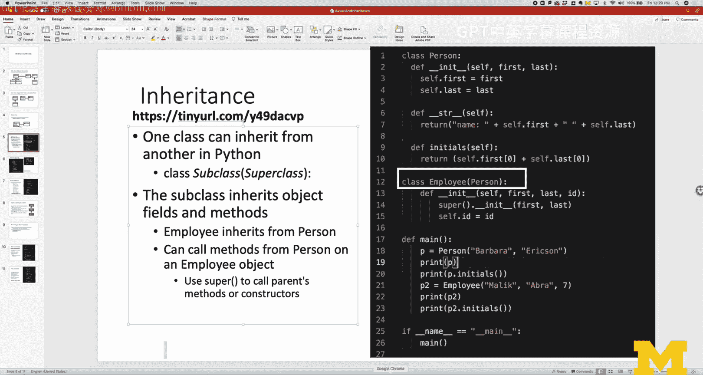
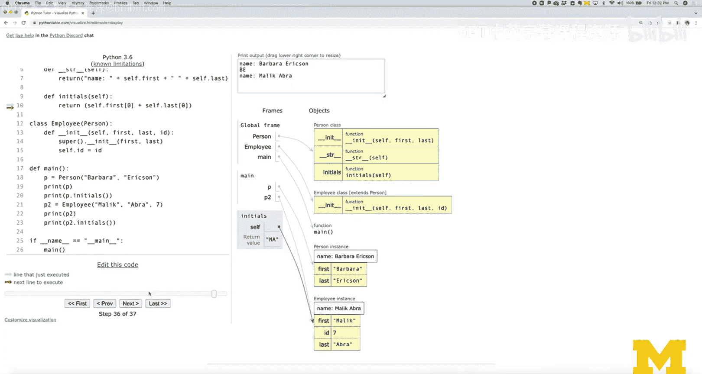
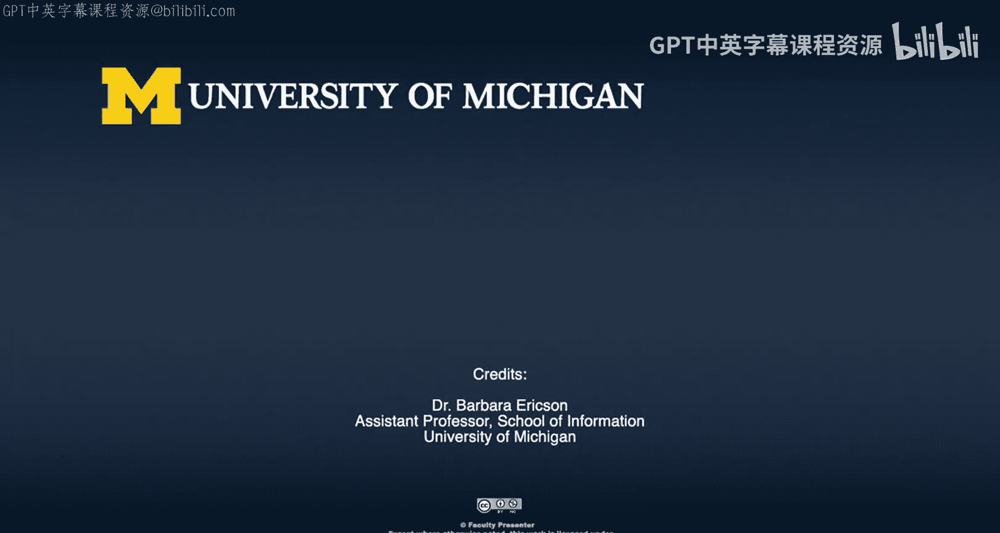

# 37：Python继承实现 🐍




在本节课中，我们将学习Python中**继承**的概念与实现方式。继承是面向对象编程的核心特性之一，它允许一个类（子类）获取另一个类（父类）的属性和方法，从而实现代码的重用和扩展。

---

## 继承的基本概念

上一节我们介绍了类的定义与使用，本节中我们来看看如何通过继承来建立类之间的关系。

在Python中，一个类可以通过在定义时指定父类来继承其特性。这意味着子类会自动拥有父类的所有属性和方法。

**公式**：`class ChildClass(ParentClass):`

---

## 代码示例解析

以下是本节课将使用的一个完整代码示例，它展示了`Person`类和继承自它的`Employee`类。

```python
class Person:
    def __init__(self, first, last):
        self.firstname = first
        self.lastname = last

    def __str__(self):
        return self.firstname + " " + self.lastname

    def initials(self):
        return self.firstname[0] + self.lastname[0]

class Employee(Person):
    def __init__(self, first, last, id):
        super().__init__(first, last)
        self.id = id

def main():
    p = Person("Bob", "Evans")
    print(p)
    print(p.initials())

    e = Employee("Mary", "Adams", 12345)
    print(e)
    print(e.initials())

if __name__ == "__main__":
    main()
```

---



## 执行流程详解

让我们逐步分析上述代码在Python Tutor中的执行过程，以理解继承的工作机制。

### 1. 定义父类 Person

首先，程序定义了`Person`类。它包含：
*   `__init__`方法：用于初始化`firstname`和`lastname`属性。
*   `__str__`方法：返回对象的字符串表示（全名）。
*   `initials`方法：返回姓名的首字母缩写。

### 2. 定义子类 Employee

接着，定义了`Employee`类，它继承自`Person`类。

**代码**：`class Employee(Person):`

这行代码意味着`Employee`是`Person`的子类，它将自动获得`Person`的所有方法和属性。

在`Employee`的`__init__`方法中，我们使用`super().__init__(first, last)`来调用父类`Person`的初始化方法。这样做可以避免重复编写设置姓名属性的代码。之后，我们再初始化子类特有的`id`属性。

### 3. 创建对象与调用方法

在`main`函数中，我们分别创建了`Person`和`Employee`的对象。

*   **创建Person对象**：`p = Person("Bob", "Evans")`
    *   调用`Person.__init__`，初始化`firstname`和`lastname`。
    *   `print(p)`会调用`Person.__str__`方法，输出“Bob Evans”。
    *   `p.initials()`调用`Person.initials`方法，返回并打印“BE”。

*   **创建Employee对象**：`e = Employee("Mary", "Adams", 12345)`
    *   调用`Employee.__init__`。
    *   `super().__init__(first, last)`将控制权转交给`Person.__init__`，为`e`对象设置`firstname`和`lastname`。
    *   返回`Employee.__init__`后，设置`e`对象特有的`id`属性。
    *   `print(e)`时，由于`Employee`类没有定义自己的`__str__`方法，Python会沿着继承链向上查找，最终执行父类`Person`的`__str__`方法，输出“Mary Adams”。
    *   `e.initials()`同样沿继承链找到并执行`Person.initials`方法，返回并打印“MA”。

---

## 方法重写与Super关键字

如果子类需要修改父类方法的行为，可以定义同名方法，这称为**方法重写**。

例如，如果`Employee`类需要不同的字符串表示，可以重写`__str__`方法：

```python
class Employee(Person):
    def __init__(self, first, last, id):
        super().__init__(first, last)
        self.id = id

    def __str__(self):
        # 调用父类方法获取姓名，再拼接ID
        return super().__str__() + ", ID: " + str(self.id)
```

**代码**：`super().__str__()`

`super()`函数返回一个代表父类的临时对象，允许子类调用已被重写的父类方法。

---

## 总结

本节课中我们一起学习了Python中继承的实现。



*   **继承**允许子类获取父类的属性和方法，促进代码重用。
*   定义子类时，在类名后的括号中指定父类。
*   子类可以**重写**父类的方法以提供特定实现。
*   `super()`函数用于在子类中调用父类的方法，特别是在初始化过程中。



通过继承，我们可以构建层次化的类结构，使代码更加清晰、模块化且易于维护。