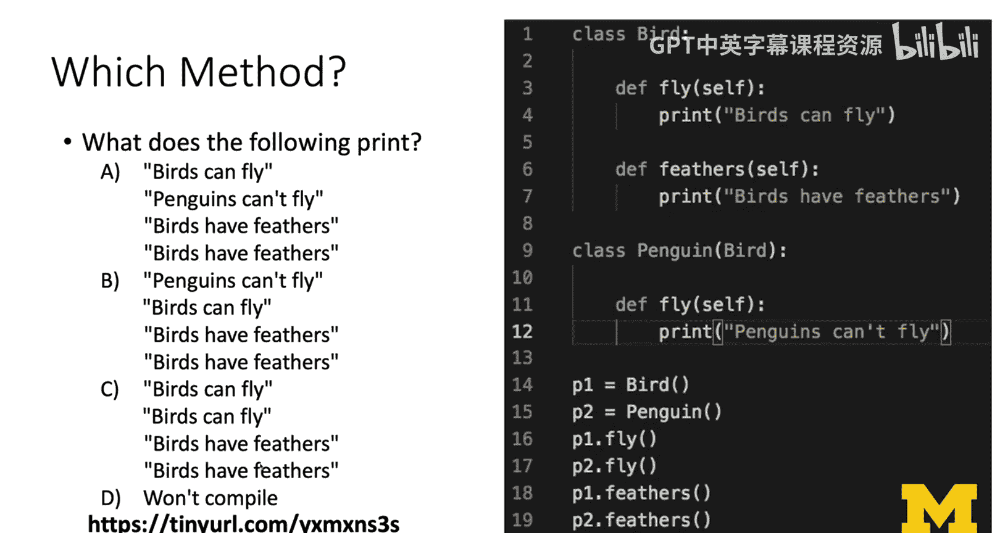
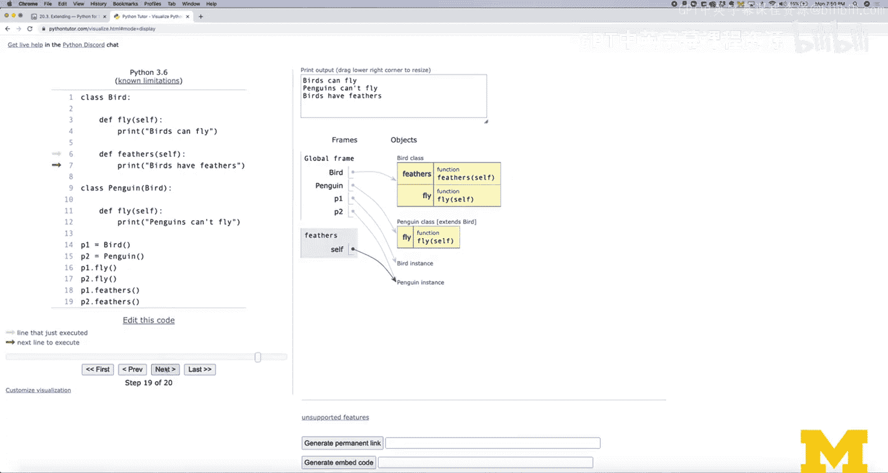

# 38：方法调用优先级 🐦


在本节课中，我们将要学习面向对象编程中一个重要的概念：**方法调用优先级**。具体来说，当一个对象调用一个方法时，Python 解释器是如何决定执行哪个类中的方法的。我们将通过一个关于鸟类和企鹅的生动例子来理解继承、方法重写以及方法查找的顺序。

---

## 概述

我们首先定义一个 `Bird` 类，它包含 `fly` 和 `feathers` 两个方法。然后，我们创建一个继承自 `Bird` 的子类 `Penguin`，并在其中重写 `fly` 方法。接着，我们将分别创建 `Bird` 和 `Penguin` 的实例对象，并调用它们的方法。通过观察输出结果，我们可以清晰地看到 Python 在查找和执行方法时的优先级规则。

## 代码结构分析



以下是示例代码的基本结构：

```python
class Bird:
    def fly(self):
        print("Birds can fly.")

    def feathers(self):
        print("Birds have feathers.")

class Penguin(Bird):
    def fly(self):
        print("Penguins can't fly. Penguins can swim.")

# 创建对象
p1 = Bird()  # Bird 类的实例
p2 = Penguin()  # Penguin 类的实例
```

上一节我们介绍了类和继承的基本概念，本节中我们来看看当调用 `p1.fly()` 和 `p2.fly()` 时，具体会发生什么。

## 方法调用过程详解

当一个对象（如 `p1` 或 `p2`）被要求执行一个方法时，Python 解释器会遵循一个特定的查找顺序来决定执行哪个方法。

以下是方法查找的核心步骤：

1.  **对象自省**：每个对象都保存着一个指向其创建类的引用。例如，`p1` 知道自己是 `Bird` 类的实例，`p2` 知道自己是 `Penguin` 类的实例。
2.  **查找起点**：当调用 `对象.方法()` 时，解释器首先在该对象所属的类中查找同名方法。
3.  **执行与向上查找**：
    *   如果在当前类中找到了该方法，则立即执行它。
    *   如果在当前类中没有找到，解释器会转向其父类进行查找，并沿着继承链向上追溯，直到找到该方法为止。
    *   如果最终在继承链中都未找到该方法，程序将抛出 `AttributeError` 异常。

## 实例演练与输出

让我们按照代码执行顺序，一步步分析每个方法调用的结果。

以下是每一步的调用与对应的输出解释：



*   **`p1.fly()`**：`p1` 是 `Bird` 的实例。解释器直接在 `Bird` 类中找到 `fly` 方法并执行。
    *   **输出**：`Birds can fly.`
*   **`p2.fly()`**：`p2` 是 `Penguin` 的实例。解释器首先在 `Penguin` 类中查找，并找到了重写的 `fly` 方法，因此执行子类中的版本，而非父类的。
    *   **输出**：`Penguins can't fly. Penguins can swim.`
*   **`p1.feathers()`**：`p1` 是 `Bird` 的实例。解释器在 `Bird` 类中找到 `feathers` 方法并执行。
    *   **输出**：`Birds have feathers.`
*   **`p2.feathers()`**：`p2` 是 `Penguin` 的实例。解释器首先在 `Penguin` 类中查找 `feathers` 方法，但没有找到。于是，它向上到父类 `Bird` 中查找，找到了该方法并执行。
    *   **输出**：`Birds have feathers.`

这个过程清晰地展示了 **方法重写** 的效果：子类中定义的同名方法会覆盖（Override）父类中的方法。同时，对于子类没有重写的方法，则会继承并使用父类中的实现。

## 核心概念总结

本节课中我们一起学习了面向对象编程中方法调用的优先级机制。我们可以将其核心规则总结为以下公式：

**方法解析顺序 = 对象所属类 -> 父类 -> 更上层父类 -> ...**

这意味着：
1.  **优先查找当前类**：解释器总是首先尝试在对象**自身所属的类**中寻找方法。
2.  **支持方法重写**：如果子类定义了与父类同名的方法，则调用子类对象时会执行子类的方法，这实现了功能的定制与扩展。
3.  **继承备用方法**：如果子类没有某个方法，则会自动沿继承链向上查找并使用找到的第一个匹配方法。


理解这一优先级是掌握继承和多态行为的关键，它确保了代码既能复用父类的通用逻辑，又能通过子类进行特定功能的修改。