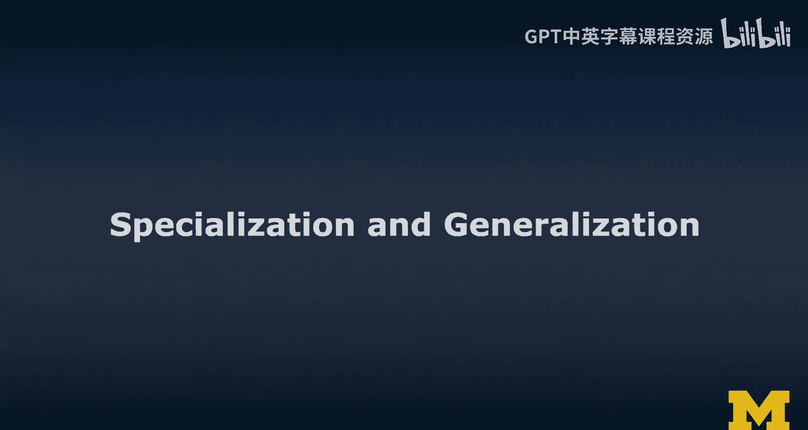
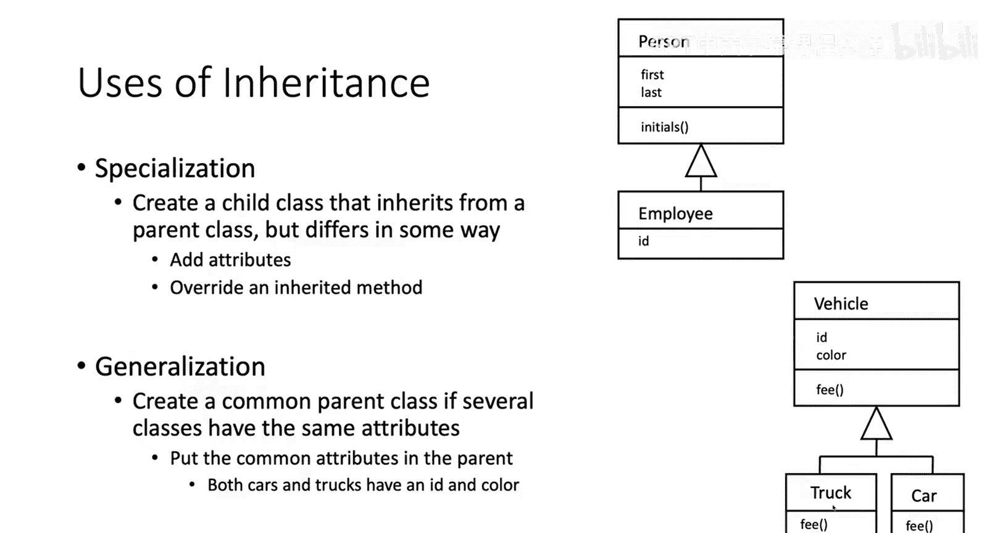
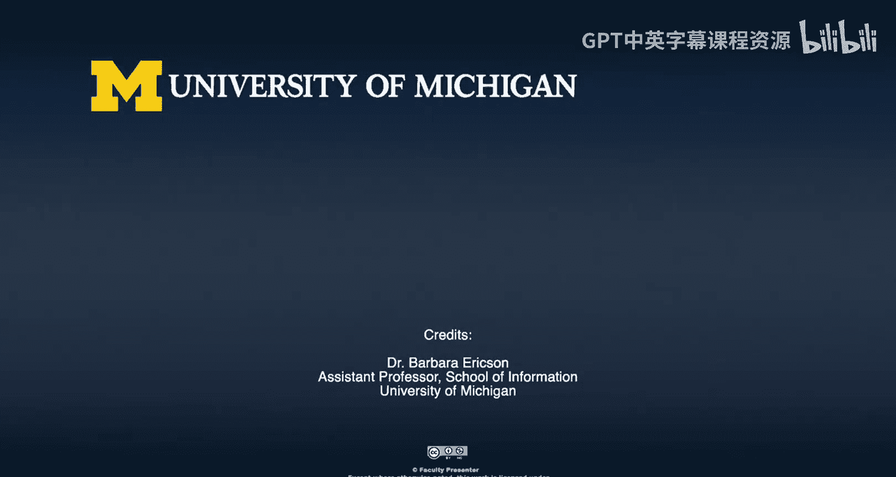

# 39：特化与泛化技术 🧬


在本节课中，我们将学习面向对象编程中继承的两种主要应用方式：特化与泛化。这两种技术帮助我们更高效地组织和管理代码，实现代码的复用和扩展。



---

## 特化：继承并扩展父类

上一节我们介绍了继承的基本概念，本节中我们来看看如何通过特化来扩展父类的功能。特化是指子类继承父类后，在某些方面进行修改或增强，使其更具体、更特殊。

例如，假设我们有一个 `Person` 类，它包含 `first_name` 和 `last_name` 属性，以及一个用于获取姓名缩写的方法 `get_initials()`。我们可以创建一个 `Employee` 类来继承 `Person` 类，因为员工是一种特定类型的人。在 `Employee` 类中，我们可以添加额外的属性，如 `ID`，并可以重写继承的方法以满足特定需求。

以下是特化的代码示例：

```python
class Person:
    def __init__(self, first_name, last_name):
        self.first_name = first_name
        self.last_name = last_name

    def get_initials(self):
        return f"{self.first_name[0]}.{self.last_name[0]}."

class Employee(Person):
    def __init__(self, first_name, last_name, ID):
        super().__init__(first_name, last_name)
        self.ID = ID

    # 可以重写父类方法或添加新方法
    def get_employee_info(self):
        return f"ID: {self.ID}, Name: {self.first_name} {self.last_name}"
```

---

## 泛化：提取公共属性到父类

接下来，我们看看泛化技术。泛化是指将多个子类中相同的属性和方法提取出来，形成一个更通用的父类。这样做可以减少代码重复，提高代码的可维护性。

例如，假设我们正在为交通部门管理车辆收费系统。我们可能有 `Car` 和 `Truck` 两个类，它们都有 `ID` 和 `color` 属性，以及计算费用的方法 `fees()`。我们可以将这些公共部分提取到一个通用的 `Vehicle` 父类中，然后让 `Car` 和 `Truck` 继承这个父类，并根据各自的特点重写 `fees()` 方法。

以下是泛化的代码示例：

```python
class Vehicle:
    def __init__(self, ID, color):
        self.ID = ID
        self.color = color

    def fees(self):
        # 基础费用
        return 100

class Car(Vehicle):
    def fees(self):
        # 汽车的费用计算方式
        return super().fees() + 50

class Truck(Vehicle):
    def fees(self):
        # 卡车的费用计算方式，可能更贵
        return super().fees() + 150
```

---

## 特化与泛化的核心区别

以下是特化与泛化的主要区别：

- **特化**：子类继承父类并添加或修改功能，使其更具体。
- **泛化**：从多个子类中提取公共部分，形成更通用的父类。

这两种技术相辅相成，特化用于扩展和定制，泛化用于抽象和复用。

---



## 总结



本节课中我们一起学习了继承的两种主要应用方式：特化与泛化。特化允许我们通过继承父类并添加或修改功能来创建更具体的子类；泛化则帮助我们将多个子类中的公共部分提取到父类中，减少代码重复。掌握这两种技术，可以让我们更高效地设计和组织面向对象的代码结构。