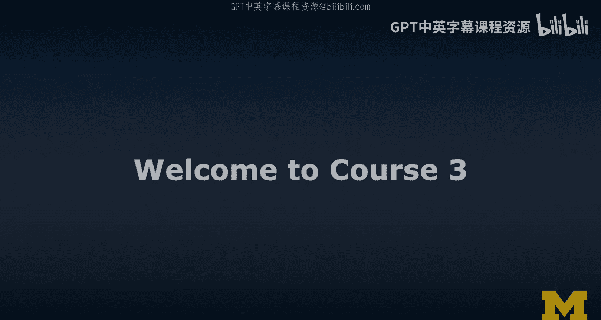
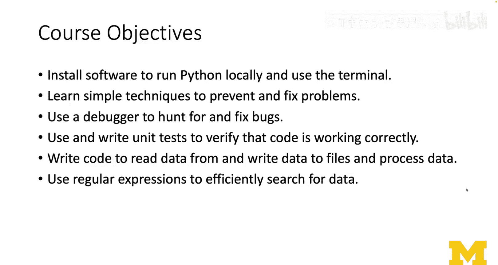
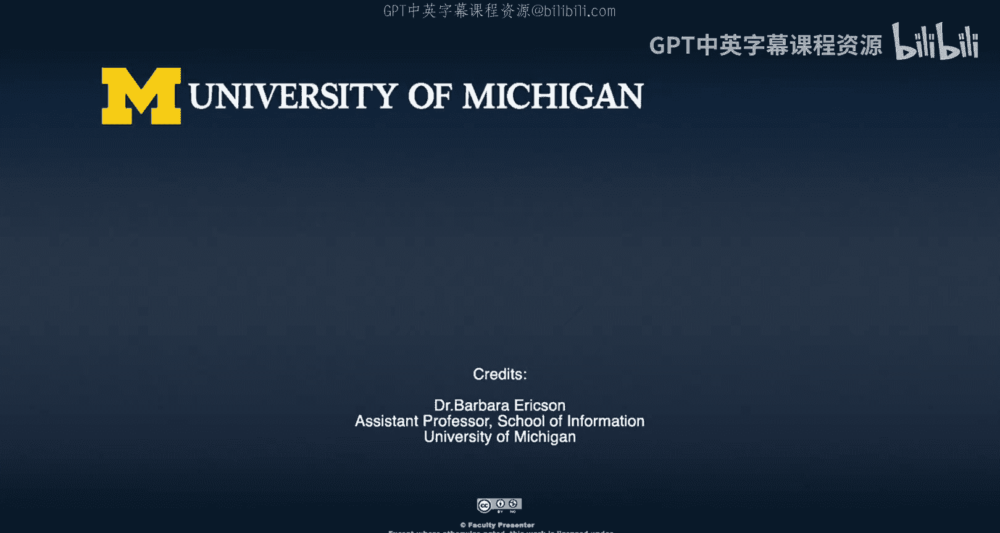

# 0：欢迎与课程概述 🎉

在本课程中，我们将学习如何搭建本地Python开发环境，掌握使用终端窗口的基本方法，并学习一系列预防和修复代码问题的实用技术。我们将涵盖调试、单元测试、文件数据处理以及正则表达式等核心主题，旨在帮助你更高效、更可靠地进行编程。

## 课程内容概览 📋

以下是本课程将要学习的主要内容：

*   **安装软件与使用终端**：你将安装必要的软件，以便在本地计算机上运行Python。同时，你将学习使用终端窗口，这是一种向计算机发出指令的传统而强大的方式。
*   **问题预防与修复技巧**：你将学习简单的技术，用于预防和修复代码中可能出现的问题。
*   **使用调试器**：你将学习使用调试器来追踪和修复程序中的错误（bug）。
*   **编写与使用单元测试**：你将学习使用和编写单元测试，以验证代码是否按预期正确运行。
*   **文件数据读写与处理**：你将编写代码来从文件中读取数据、将数据写入文件，并对这些数据进行处理。
*   **使用正则表达式**：你将学习使用正则表达式，以便高效地在文本中搜索和匹配特定模式的数据。

## 总结

本节课中，我们一起了解了第三课程的整体框架和学习目标。从下一节开始，我们将首先动手安装Python并熟悉终端操作，为后续的编程实践打下坚实的基础。祝你学习愉快！