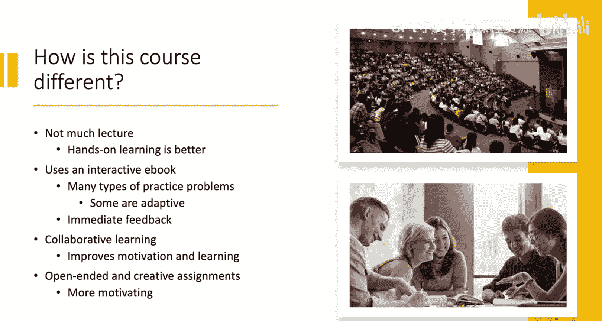
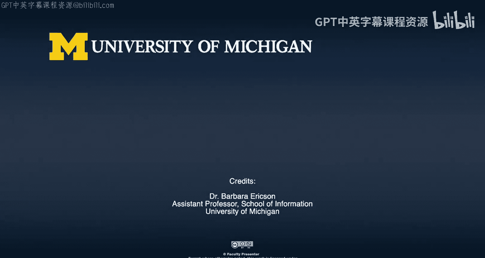

# 1：本课程的独特之处 🎨

在本节课中，我们将了解这门课程与其他在线课程的不同之处，并介绍其核心的教学理念与学习方式。

## 概述

欢迎来到这门课程。它将与许多在线课程有所不同。本课程不会包含大量讲座，而是更侧重于动手实践学习。

## 核心教学理念

上一节我们提到了课程的实践导向，本节中我们来看看其背后的核心理念。

我们将鼓励你与他人合作、以小组形式学习，因为这能提升你的学习效果和动力。人类是社会性生物，我们可以通过观察他人和与他人讨论来学习。

## 学习资源与练习

了解了合作学习的重要性后，接下来我们看看课程提供的具体学习工具。

电子书中包含大量互动练习。此外，如果你需要复习，可以回顾前面的章节或完成更多练习题。部分练习题具有**自适应**特性，这意味着它们会帮助你逐步找到正确的解决方案。

以下是练习的主要类型：

*   **互动练习**：在电子书中直接完成。
*   **复习与拓展练习**：可随时返回之前章节进行。
*   **自适应练习题**：系统会根据你的回答提供引导。

## 作业与项目设计

除了常规练习，课程作业的设计也别具一格，旨在激发创造力。

课程还包含开放式编辑和创意作业。因此，不同于编程入门课程中常见的练习类型（例如计算销售税或将摄氏温度转换为华氏温度），你将绘制艺术作品或创作个性化故事。希望这能让你感觉更有趣、更有动力。

## 总结

本节课中，我们一起学习了这门课程的独特之处：它强调**动手实践**与**小组合作**的学习模式，提供**自适应**的互动练习，并通过**创意性项目**（如绘图和故事创作）来替代传统的编程练习题，旨在让学习过程更加有趣和富有动力。