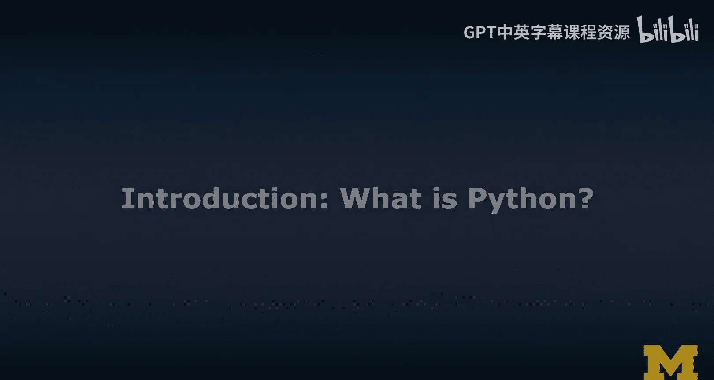
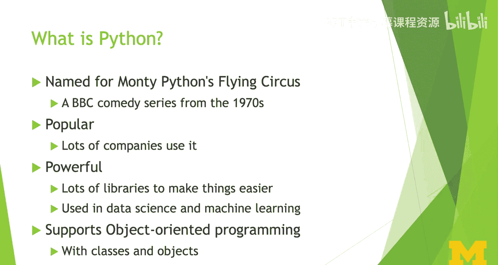
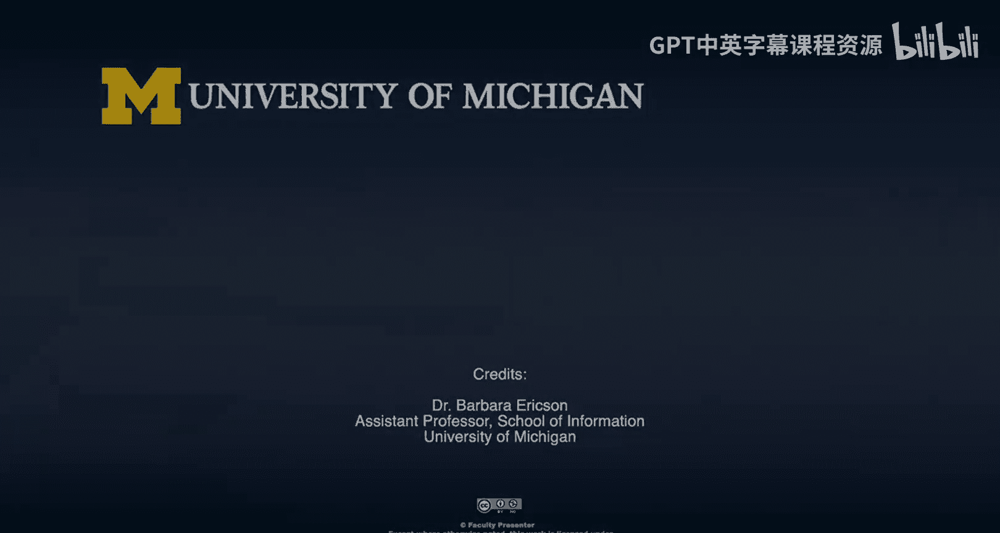

# 创造性编程：1：Python是什么 🐍




在本节课中，我们将要学习Python编程语言的基本概念，了解它的起源、特点以及在现代编程中的应用。

大家好，我是Barbar Erickson。我是信息学院的助理教授。我很高兴能带领大家开启学习Python的旅程。

那么，Python到底是什么呢？它是一条巨蟒吗？不，Python是以《蒙提·派森的飞行马戏团》命名的，这是一部20世纪70年代的BBC喜剧系列。如果你没看过，可以去看看。😊

它是一种非常流行的编程语言，许多公司都在使用它。它的流行部分原因在于它非常强大。有大量的库可以让事情变得更简单，并且它被广泛应用于数据科学和机器学习领域。

与许多其他文本型语言相比，它也相对容易学习一些。它还支持面向对象编程，这是当今人们开发程序最常用的方式。这意味着它支持“类”（即事物的分类）和实际执行程序工作的“对象”。

## Python的特点与优势

上一节我们介绍了Python的起源和基本定位，本节中我们来看看它的一些核心特点和优势。

以下是Python的几个关键特性：

*   **强大且功能丰富**：Python拥有一个庞大的标准库和第三方库生态系统，可以轻松处理各种任务，从网页开发到科学计算。
*   **易于学习**：Python的语法清晰、简洁，类似于英语，这使得它成为编程初学者的理想选择。
*   **支持面向对象编程（OOP）**：这是一种组织代码的流行范式。在Python中，你可以定义`class`（类）来创建`object`（对象）。例如，一个“汽车”类可以生成具有颜色、品牌等属性的具体汽车对象。
    ```python
    class Car:
        def __init__(self, brand, color):
            self.brand = brand
            self.color = color

    my_car = Car("Toyota", "red")
    print(my_car.brand)  # 输出：Toyota
    ```
*   **应用广泛**：Python在数据科学、人工智能、网络开发、自动化脚本等领域占据主导地位。

## 开始使用Python

了解了Python是什么以及它的优势后，接下来我们就可以准备开始实际使用它了。

所以，让我们开始吧。😊




---



本节课中我们一起学习了Python编程语言的基础知识。我们了解到Python名称的趣味起源，它并非指代蟒蛇，而是源于一部喜剧。更重要的是，我们认识到Python是一种强大、易学且支持面向对象编程的流行语言，这些特性使其成为初学者和专业开发者的绝佳选择。在接下来的课程中，我们将动手编写我们的第一个Python程序。