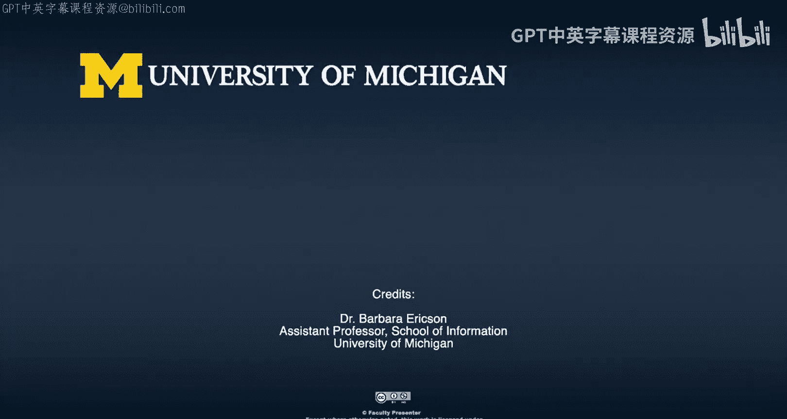

# 创造性编程：3：为何分组协作 👥


在本节课中，我们将探讨在编程课程中采用分组协作模式的原因与价值。我们将了解团队合作如何提升学习效果、增强动力，并培养对职业生涯至关重要的软技能。

上一节我们介绍了课程的基本框架，本节中我们来看看为何鼓励大家进行分组协作。

研究表明，分组协作既能提升学习动力，也能改善学习效果。部分原因在于，向他人解释自己的想法这一过程，本身就能帮助你更好地理解概念。用代码来描述，这个过程类似于将模糊的想法转化为清晰的逻辑：

```python
# 个人思考可能模糊不清
vague_idea = "大概是这样..."

# 向他人解释时，必须使其清晰、结构化
clear_explanation = """
1. 定义问题。
2. 拆解步骤。
3. 用代码实现每一步。
"""
```

通常，与他人协作也更有趣，并能帮助你在遇到困难时——尤其是在编程过程中——避免陷入僵局。

总体而言，研究表明，**多元化的团队表现优于个人**。团队往往能解决个人无法独立解决的问题。例如，在密室逃脱游戏中，与他人的合作可能使你成功逃脱，而这或许是你独自一人无法完成的。

以下是分组协作带来的主要益处列表：
*   **提升理解**：通过解释巩固知识。
*   **增强动力与乐趣**：社交互动使学习过程更愉快。
*   **解决问题**：汇集多元视角，突破个人思维局限。
*   **避免卡壳**：及时获得反馈与帮助。

此外，团队协作、沟通、自我管理与团队管理的能力对雇主而言非常重要。因此，掌握这类技能在工作场所中也极具价值。




本节课中我们一起学习了分组协作在教育与职业发展中的重要性。它不仅是高效学习的手段，也是培养未来所需核心软技能的关键途径。