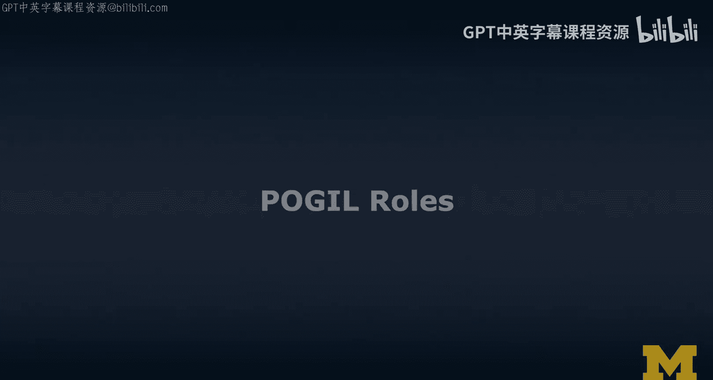
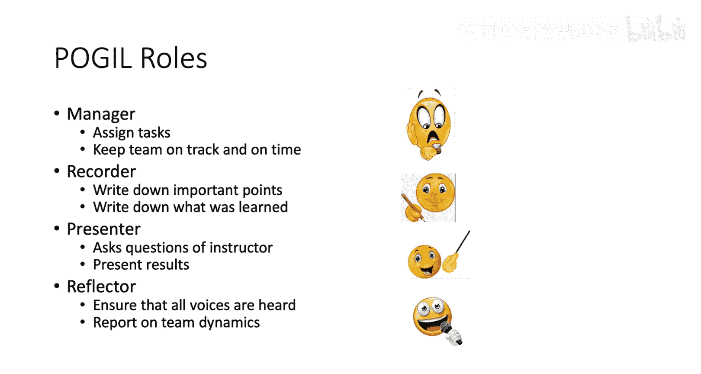
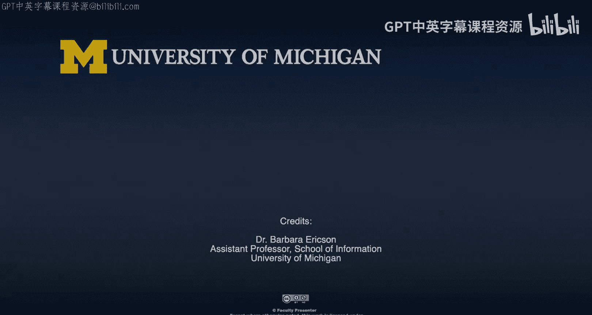

# 创造性编程：4：POGIL角色解析 🧩

在本节课中，我们将学习一种名为POGIL的协作学习方法，并详细解析其团队中的四个核心角色。理解这些角色有助于在小组编程项目中更高效、更有组织地工作。

---

## 概述

POGIL代表“过程导向的引导式探究学习”。这是一种在小组中进行的协作学习模式，其特点是团队中的每个成员都承担一个定义明确的特定角色。通过角色分工，团队可以更有效地管理任务、记录进展、沟通问题并反思协作过程。

上一节我们介绍了协作学习的重要性，本节中我们来看看POGIL模式如何通过具体的角色分工来实现高效的团队合作。

## POGIL的四个核心角色

在POGIL活动中，通常有四个不同的角色。每个角色都有其独特的职责，共同确保小组活动的顺利进行。

以下是POGIL活动的四个核心角色及其职责：

1.  **管理者**
    *   向小组成员分配任务。
    *   帮助确保整个团队按计划、按时完成任务。
    *   确保团队在解决问题。如果团队在某处卡住，管理者可以鼓励大家继续前进。

2.  **记录员**
    *   负责写下重要的观点。
    *   记录团队所学到的内容。

3.  **演示者/提问者**
    *   如果对活动说明有任何不清楚的地方，负责向指导者提问。
    *   负责展示团队的成果。

4.  **反思者**
    *   确保团队中每个人的声音都被听到，避免只有一个人做出贡献。
    *   可以汇报团队的动态，例如团队合作是否良好，以及哪些方面可以改进。

---

## 总结

本节课中我们一起学习了POGIL协作学习法中的四个关键角色：**管理者**、**记录员**、**演示者/提问者**和**反思者**。每个角色都像齿轮一样，在团队机器中发挥着不可替代的作用。明确的分工不仅能提升效率，还能促进更公平的参与和更深入的团队反思。在接下来的小组编程实践中，尝试分配这些角色，体验结构化的团队协作带来的益处。