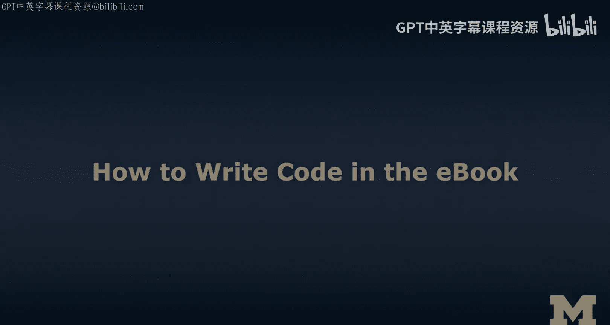
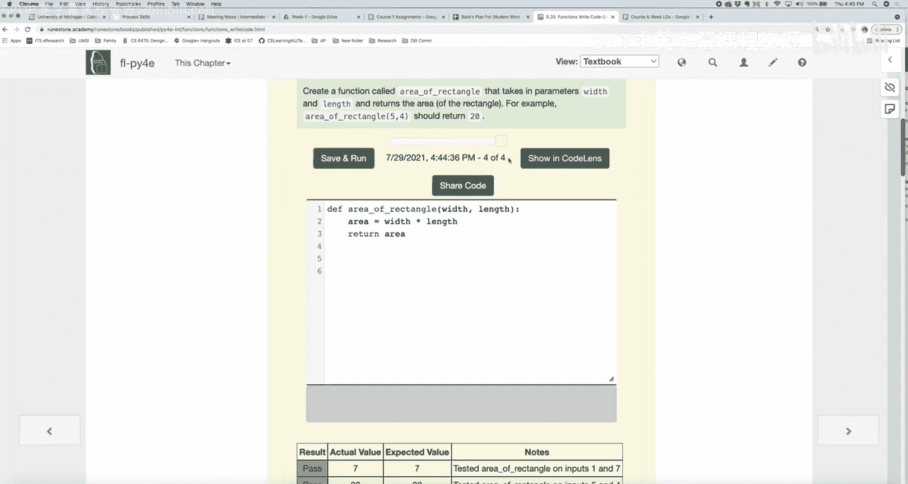

# 创造性编程：5：电子书中编写代码的方法 📖


在本节课中，我们将学习如何在电子书中直接编写、运行和调试Python代码。这是一种便捷的学习方式，允许你即时实践并查看结果。



## 概述

使用电子书的一个显著优点是，你可以直接在书中编写代码。本节将演示如何操作，包括创建函数、运行测试、查看历史记录以及使用辅助工具。

## 在电子书中编写与运行代码

上一节我们了解了电子书的环境，本节中我们来看看如何具体地编写代码。

假设我们需要创建一个计算矩形面积的函数。该函数接收宽度和长度作为参数，并返回面积。例如，输入 `area_of_rectangle(5, 4)` 应返回 `20`。

以下是在电子书中实现此功能的步骤：

1.  **定义函数**：首先，我们定义一个名为 `area_of_rectangle` 的函数。
    ```python
    def area_of_rectangle(width, length):
    ```

2.  **计算面积**：在函数体内，我们计算面积。
    ```python
        area = width * length
    ```

3.  **返回结果**：最初，我们可能忘记返回计算结果。运行测试后会发现这个问题，因此需要添加返回语句。
    ```python
        return area
    ```

完成这些步骤后，函数 `area_of_rectangle(5, 4)` 就能正确返回 `20` 了。

## 使用代码透镜与分享功能

代码编写完成后，你可以利用电子书提供的工具进行验证和协作。

*   **代码透镜**：你可以通过代码透镜功能直观地看到测试用例的运行结果，确认代码是否正确。
*   **分享代码**：如果你在团队中工作，可以将代码分享给其他成员，方便协作。

## 辅助工具：Python代码窗口

如果你对某些操作（例如乘法运算符 `*`）不确定，可以使用辅助工具进行快速测试。

在电子书右上角有一个铅笔图标，点击它可以打开一个独立的Python代码窗口。

在这个窗口中，你可以输入简单的代码进行测试，例如：
```python
print(5 * 4)
```
执行后会输出 `20`，这有助于你验证逻辑。测试完成后，可以关闭这个窗口。

## 查看代码历史记录

最后，还有一个重要的功能是查看代码历史。为了使用此功能，请确保你已登录。

登录后，你会看到一个历史滑块控件。通过拖动这个滑块，你可以回溯查看代码在不同时间点的状态。

例如，你可以看到：
*   代码最初的样子。
*   第二次修改后的版本。
*   最终解决问题的版本。



这让你能够回顾自己的思考和改进过程。


## 总结


本节课中我们一起学习了在电子书中编写代码的完整流程。我们实践了如何定义函数、运行测试、使用代码透镜和分享功能。我们还介绍了用于快速测试的Python代码窗口，以及用于回顾学习过程的代码历史记录功能。这些工具共同为初学者提供了一个友好且功能强大的编程练习环境。