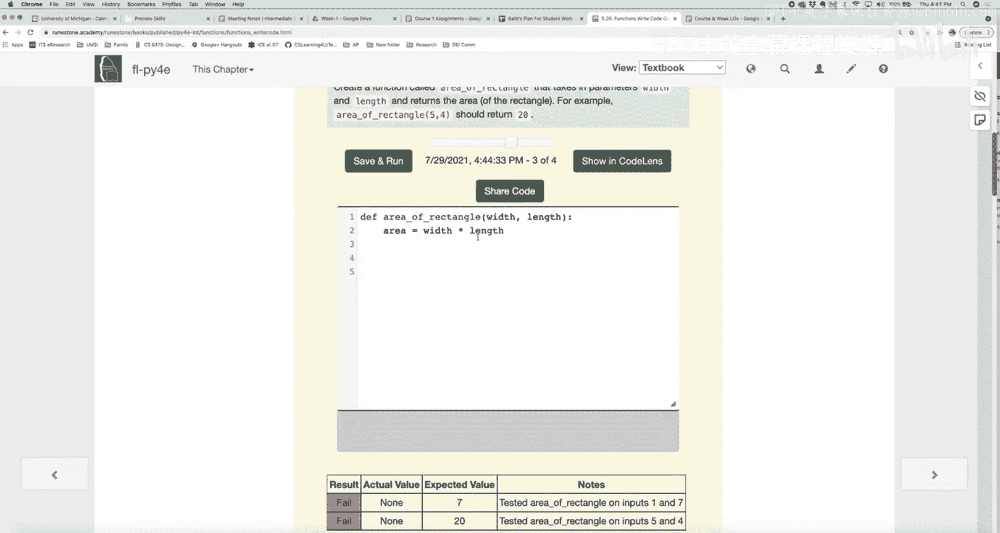

# 创造性编程：6：重载代码历史记录 📚

在本节课中，我们将学习如何在编程环境中找回之前保存的代码。如果你曾经离开后又返回，可能会担心代码丢失。实际上，只要你登录了，代码就会被保存。本节将向你展示如何找回这些代码。

---

上一节我们介绍了编程环境的基本操作，本节中我们来看看如何利用“加载历史记录”功能。

如果你曾离开书本或编程环境后又返回，可能会惊讶地发现代码似乎不见了。但只要你之前是登录状态，代码实际上已被保存。下面演示如何找回它们。

当你返回环境并发现“哦不，我已经解决过这个问题了”时，请注意这个“加载历史记录”按钮。务必点击它。

如果你上次运行代码时处于登录状态，该功能将加载你所有的历史记录。现在，我可以清晰地看到上次运行时所写的代码，甚至可以回溯到更早的版本来查看当时的操作。

所以，无需惊慌。只要你登录时所做的操作都会被保存，但请确保点击“加载历史记录”按钮。

以下是操作的核心步骤：

1.  确认返回编程环境。
2.  在界面中找到并点击“加载历史记录”按钮。
3.  系统将自动加载你保存的所有代码历史版本。
4.  你可以查看或选择恢复任意一个历史版本。

---

本节课中我们一起学习了“加载历史记录”功能的重要性与操作方法。关键在于记住：在登录状态下，你的工作会被自动保存；返回后，只需主动点击“加载历史记录”按钮即可找回所有历史代码，避免重复劳动或丢失进度。