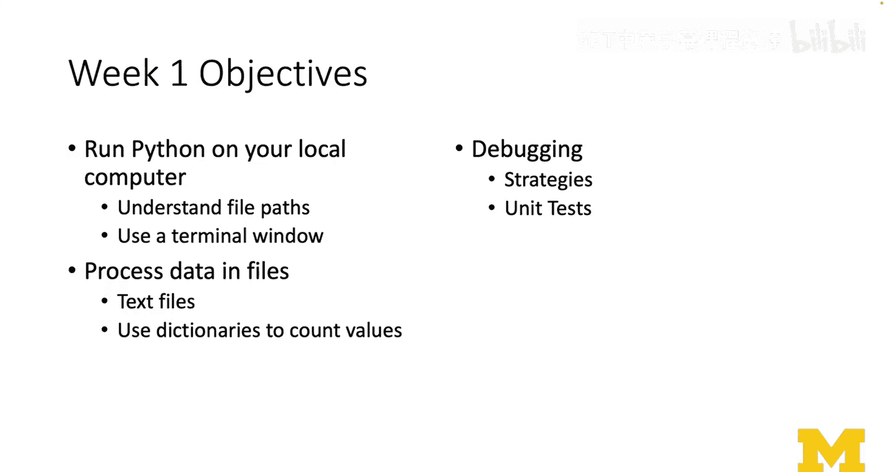
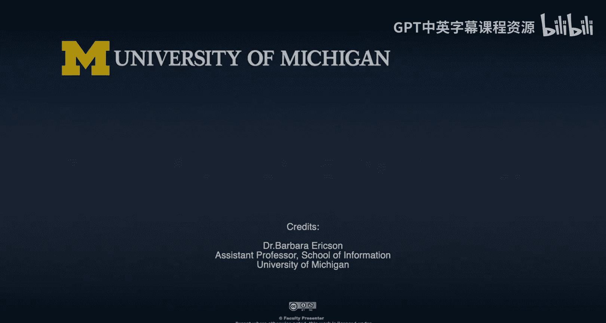

# 创造性编程：第一周：课程概述 🎯


在本节课中，我们将要学习第一周课程的核心内容。第一周的目标是为你搭建一个坚实的Python编程基础，涵盖从环境配置到代码调试的完整流程。


## 环境配置与工具使用 💻

上一节我们介绍了本周的学习目标，本节中我们来看看具体需要掌握哪些工具和概念。

你将学习如何在本地计算机上运行Python。这意味着你需要理解**文件路径**的工作原理，以及如何使用**终端窗口**。

此外，我们将安装**Anaconda**和**Visual Studio Code**。你将学习如何使用一个**集成开发环境**来运行你的代码。集成开发环境是一个集成了代码编辑、运行和调试功能的软件。

## 数据处理与文件操作 📁

掌握了基础工具后，我们将进入实践环节。你将能够处理来自文件的数据。

具体来说，你将学习读取文本文件，并使用**字典**来统计文件中的值。字典是Python中一种非常实用的数据结构，用于存储键值对。例如，统计一段文本中每个单词出现的次数。

以下是使用字典进行计数的基本代码示例：
```python
word_count = {}
for word in text.split():
    if word in word_count:
        word_count[word] += 1
    else:
        word_count[word] = 1
```

## 代码调试与测试 🐛

编写代码难免会遇到问题，因此掌握调试技能至关重要。我们将学习一些调试策略。

首先，我们将探讨如何预防问题的发生，从而减少调试的需要。但一旦出现问题或“Bug”，你将学习如何定位并解决它。

最后，我们将学习如何编写**单元测试**来自动化测试你的代码，确保其按预期工作。单元测试是针对程序模块的最小可测试单元进行的验证工作。




---



本节课中我们一起学习了第一周的课程安排。核心内容包括：配置本地Python开发环境、理解文件路径与终端、使用Anaconda和VS Code、通过字典处理文件数据，以及学习调试和编写单元测试的基本策略。