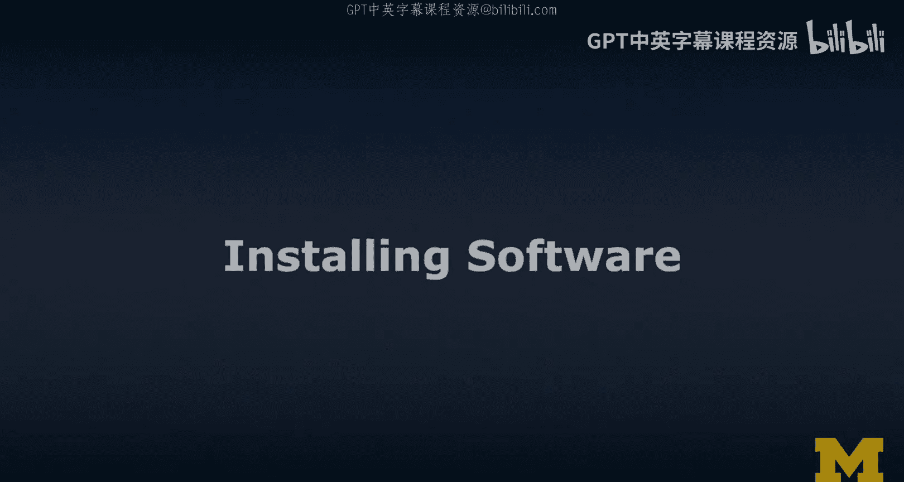
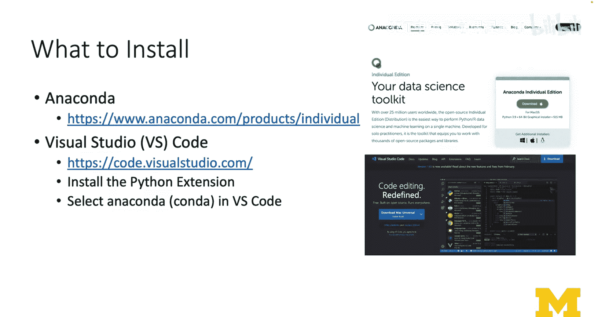

# 创造性编程：第8章：软件安装指南 🛠️

在本节课中，我们将学习如何在本地计算机上搭建Python编程环境。这包括安装Python发行版和一个集成开发环境（IDE），以便你能顺利开始编写和运行代码。

---

## 概述

为了在本地计算机上运行Python，你需要安装两个核心软件：**Anaconda**（一个包含Python及其常用库的发行版）和**Visual Studio Code**（一个免费的、跨平台的集成开发环境）。本节将详细介绍这两个软件的下载、安装和基本配置步骤。

---

## 安装Anaconda

Anaconda是一个集成了Python和众多常用科学计算库的发行版，它简化了环境管理过程。

首先，访问Anaconda官方网站：[www.anaconda.com](https://www.anaconda.com)。在网站上，找到“Products”部分，选择“Individual Edition”进行下载。当前版本默认提供Python 3，未来版本可能会更新。Anaconda的优势在于它预装了数据分析、机器学习等领域常用的库，省去了逐一安装的麻烦。

下载完成后，运行安装程序。在安装过程中，请务必勾选“Add Anaconda to my PATH environment variable”选项（尤其是在Windows系统上），这能确保系统在任意位置都能识别Anaconda的命令。

---

## 安装Visual Studio Code

上一节我们安装了Python环境，本节中我们来看看如何安装一个强大的代码编辑器。我们将使用Visual Studio Code（VS Code），因为它免费、功能强大且在Windows和Mac系统上表现一致。

访问Visual Studio Code官方网站：[code.visualstudio.com](https://code.visualstudio.com)。网站会根据你的操作系统自动显示对应的下载按钮，点击下载并运行安装程序。

安装完成后，启动VS Code。为了使其能更好地支持Python开发，我们需要安装一个扩展。

以下是安装Python扩展的步骤：

1.  在VS Code左侧活动栏中，找到并点击扩展图标（形状像四个方块）。
2.  在扩展市场的搜索框中，输入“Python”。
3.  在搜索结果中找到由Microsoft发布的“Python”扩展，点击“Install”按钮进行安装。

---

## 配置VS Code使用Anaconda环境

软件安装完毕后，需要进行简单配置，将两者关联起来。

核心步骤是确保VS Code使用Anaconda提供的Python解释器。当你用VS Code打开一个Python文件（`.py`文件）时，注意编辑器窗口底部状态栏的右侧。那里会显示当前使用的Python解释器版本。

点击这个版本信息，会弹出一个选择列表。请从列表中选择标有“Conda”或“Anaconda”的选项。这确保了你的代码将在Anaconda环境中运行，能够访问所有已安装的库。

配置完成的标志是状态栏显示类似 `Python 3.x.x (‘conda’: conda)` 的信息。

---

## 总结

本节课中我们一起学习了搭建本地Python开发环境的完整流程。我们首先安装了**Anaconda**来获取Python及其科学计算库，然后安装了**Visual Studio Code**作为代码编辑器，并通过安装Python扩展和选择Conda解释器完成了环境配置。现在，你的计算机已经准备好进行创意编程了。