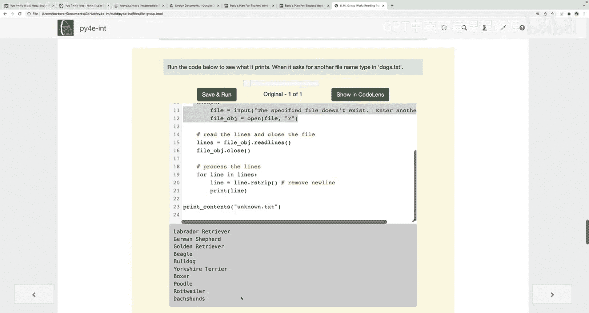
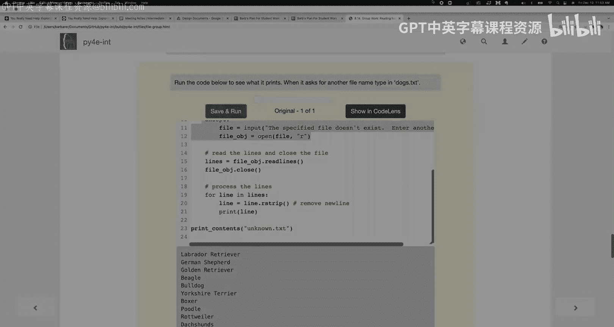

# 9：文件操作入门 📂


在本节课中，我们将要学习如何处理文件读取时可能遇到的错误，特别是当程序试图打开一个不存在的文件时。我们将介绍如何使用 `try` 和 `except` 语句来优雅地处理这类错误，确保程序不会意外崩溃，而是能够给用户提供友好的提示并继续运行。

## 文件读取错误与异常处理

上一节我们介绍了基本的文件读写操作。本节中我们来看看，当程序尝试读取一个不存在的文件时会发生什么。

如果尝试读取一个文件，但程序找不到该文件（即文件不存在），程序会抛出一个错误。

例如，运行以下代码：
```python
file = open("unknown.txt", "r")
```
我们会得到一个 `IOError`，提示“No such file or directory”。这可能是因为文件名错误（例如 `unknown.txt`），或者程序在错误的目录中寻找该文件。

## 使用 Try-Except 处理错误

如果不希望代码因此直接崩溃，该如何解决这个问题呢？

一种方法是使用 `try` 和 `except` 语句。你可以将任何可能引发错误的代码包裹在 `try` 代码块中。

以下是具体做法：

首先，使用 `try:` 开始一个代码块，并将可能引发问题的代码（例如 `open` 函数）缩进放在这个块内。

然后，使用 `except` 子句来指定当特定类型的错误发生时应执行的操作。

例如，以下代码尝试打开一个文件。如果文件不存在，它会捕获错误并提示用户输入另一个文件名，从而更优雅地从错误中恢复，并允许程序继续执行。

```python
try:
    file = open("unknown.txt", "r")
except IOError:
    print("The file doesn‘t exist. Enter another name.")
    # 此处可以添加代码让用户重新输入文件名
```

使用 `try` 和 `except` 是保护代码的一种方式，它能确保程序不会直接崩溃，而是能够优雅地处理错误。





## 总结


本节课中我们一起学习了文件操作中的一个重要概念：异常处理。我们了解到，当尝试打开不存在的文件时，程序会抛出 `IOError`。通过使用 `try-except` 语句，我们可以捕获这个错误，并向用户提供友好的反馈，从而使程序更加健壮和用户友好。这是编写可靠代码的关键一步。