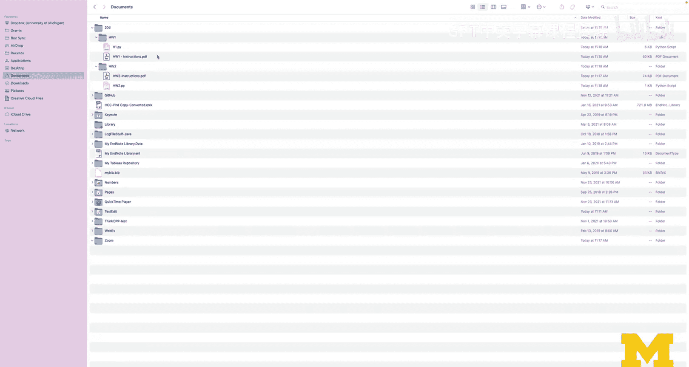
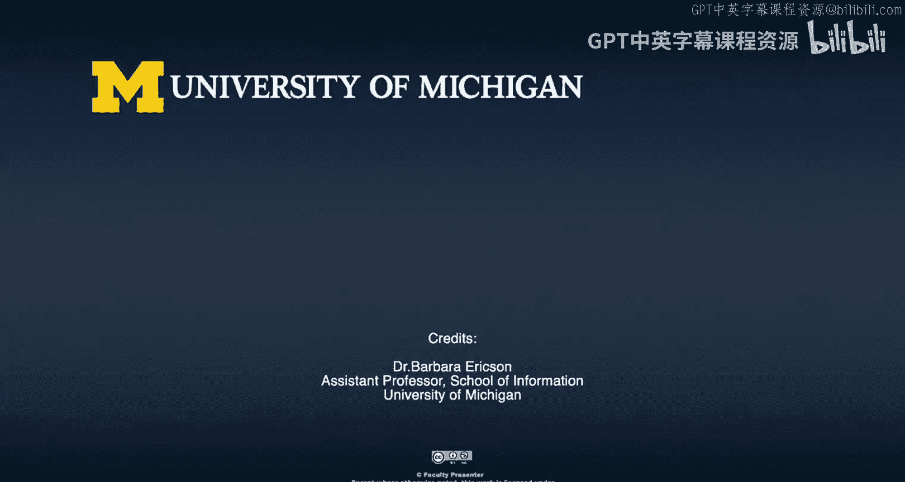

# 创造性编程：10：GUI文件查找方法 🗂️


在本节课中，我们将学习计算机中文件和目录的组织结构，并了解如何使用图形用户界面（GUI）和命令行两种方式来查找和访问文件。

## 目录的树形结构 🌳

上一节我们介绍了编程的基本概念，本节中我们来看看计算机如何组织文件。你可能已经习惯了使用图形用户界面来浏览计算机上的文件和目录。计算机中的目录结构类似于一棵倒置的树。

*   **根目录**：位于树的顶部。
*   **分支**：目录可以包含文件，也可以包含其他目录（子目录），这些子目录又可以包含更多文件或目录，形成向下的分支。

## 图形界面导航示例 🖱️

让我们通过一个具体例子来理解。假设我们位于“文档”目录中，里面有一个名为“206”的目录（这代表我在密歇根大学教授的一门课程）。

如果打开“206”目录，会看到里面有一个名为“homework1”的子目录。进入“homework1”目录，可以看到文件 `homework1.py` 和 `homework1_instructions`。

同样，“206”目录下还有一个“HW2”目录。打开它，可以看到文件 `HW2_instructions` 和 `H2.py`。

以下是使用图形界面操作文件的典型步骤：
1.  使用鼠标在文件夹图标间点击，导航到目标文件。
2.  找到文件后，通常可以通过双击来打开它。

## 命令行操作简介 ⌨️

在图形用户界面普及之前，人们通常通过键入命令来操作计算机。这种方式在某些情况下更为高效和强大。

例如，在命令行中，你可以使用 `cd` 命令来切换目录，使用 `ls`（Linux/macOS）或 `dir`（Windows）命令来列出当前目录下的文件和子目录。



```bash
# 示例：切换到“文档”目录下的“206”子目录
cd Documents/206
# 示例：列出“206”目录下的所有内容
ls
```




本节课中我们一起学习了计算机文件的树形组织结构，并对比了通过图形用户界面和命令行查找、访问文件的两种基本方法。理解这两种方式将帮助你在不同环境下更有效地管理你的代码和项目文件。