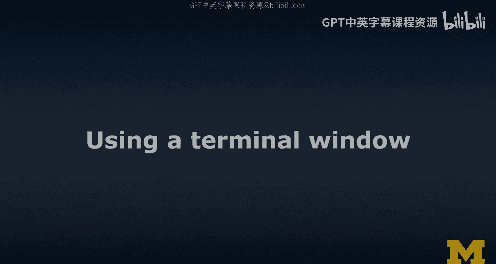
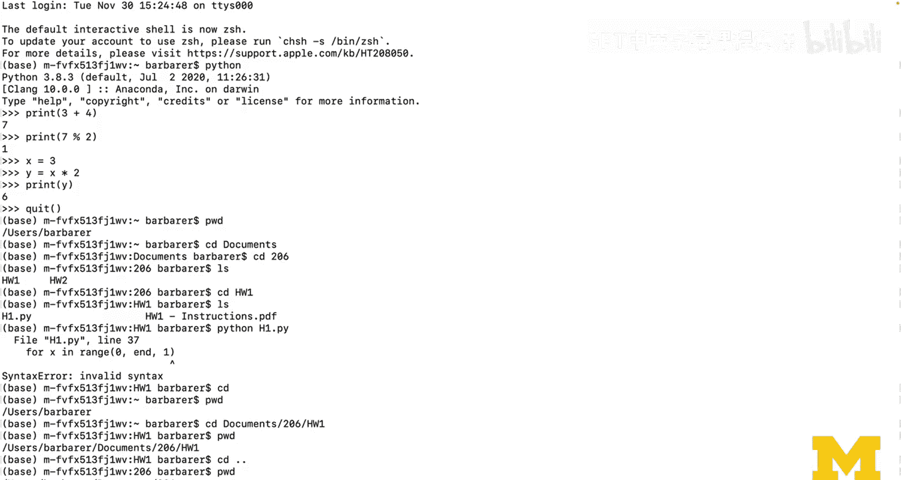

# 11：终端窗口使用技巧 💻




在本节课中，我们将学习如何使用终端窗口。终端窗口是一个强大的工具，它允许我们通过输入命令来与计算机交互、执行Python代码以及管理文件系统。掌握终端的基本操作对于编程和文件管理至关重要。

## 概述

在图形用户界面普及之前，人们主要通过终端窗口输入命令来操作计算机。如今，终端窗口依然是一个非常有用的工具。本节将介绍终端窗口的基本用法，包括如何启动Python解释器、执行Python文件以及浏览和管理文件系统。

## 启动Python解释器

终端窗口的一个主要用途是启动并直接运行Python代码。安装Python后，你可以在终端中启动一个交互式解释器，逐行输入并执行Python代码。

例如，你可以输入以下命令来启动Python解释器：
```bash
python
```
启动后，你会看到提示符变为 `>>>`，表示你已进入Python交互模式。在此模式下，你可以直接输入Python代码并立即看到结果。

以下是几个在Python解释器中操作的例子：
*   计算 `3 + 4`，结果是 `7`。
*   计算 `7 % 2`（7除以2的余数），结果是 `1`。
*   你可以设置变量，例如 `x = 3`，然后计算 `y = x * 2`，最后使用 `print(y)` 输出结果。

在Python解释器中，你可以执行任何常规的Python代码，只是一次执行一行。当你想要退出解释器时，输入 `quit()` 即可。请注意，退出后，命令提示符会从 `>>>` 变回常规的终端提示符（在Mac/Linux上通常是 `$`，在Windows上可能是 `>` 或路径）。

## 浏览文件系统

终端窗口的另一个重要功能是浏览计算机的文件系统。你可以使用命令在不同的目录（文件夹）之间导航。

以下是一些常用的文件导航命令：
*   `pwd`（Print Working Directory）：显示你当前所在的目录路径。在Windows上，对应的命令是 `chdir`。
*   `cd [目录路径]`（Change Directory）：用于切换目录。例如，`cd Documents` 可以进入“文档”文件夹。
*   `ls`（List）：列出当前目录下的所有文件和子目录。在Windows上，对应的命令是 `dir`。
*   `cd ..`：返回上一级目录（父目录）。在Mac和Windows上此命令相同。
*   `cd` 或 `cd ~`：直接返回用户的主目录。

例如，你可以通过连续使用 `cd` 命令进入深层目录，如 `cd Documents/course_206/hw1`。使用 `cd ..` 可以逐级返回。

## 执行Python文件

当你位于包含Python脚本的目录时，可以直接在终端中运行该文件。这是测试和运行你编写的程序的主要方式。

运行Python文件的命令格式是：
```bash
python 文件名.py
```
例如，如果有一个名为 `hw1.py` 的作业文件，你可以输入 `python hw1.py` 来执行它。如果程序中有语法错误，终端会显示相应的错误信息，帮助你进行调试。

## 总结




本节课我们一起学习了终端窗口的基本使用技巧。我们了解了如何启动Python交互式解释器来逐行执行代码，如何使用 `cd`、`ls`、`pwd` 等命令在文件系统中导航，以及如何通过 `python 文件名.py` 的命令来运行编写好的Python脚本。熟练使用终端是每个程序员的基础技能，它能极大地提升你的工作效率。