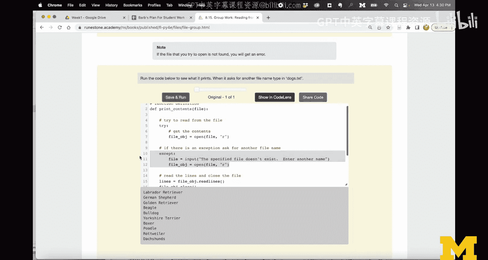

# 12：try-except异常处理 🛡️


在本节课中，我们将要学习如何使用 `try-except` 语句来处理程序运行中可能出现的错误，使程序能够更优雅地应对意外情况，而不是直接崩溃。


## 为什么需要异常处理？ 🤔

上一节我们介绍了文件读取的基本操作。本节中我们来看看，当程序试图执行一个可能失败的操作时会发生什么。

如果你试图读取一个不存在的文件，程序会直接报错并停止运行。例如，运行以下代码：

```python
file = open("unknown.txt", "r")
```

程序会抛出一个 `FileNotFoundError` 错误，提示“No such file or directory”。这可能意味着文件名拼写错误，或者文件不在当前目录下。这种直接崩溃的方式对用户不友好。

## 使用 try-except 捕获异常 🧤

为了使程序更健壮，我们可以使用 `try-except` 语句来捕获并处理这类异常。

`try` 块用于包裹可能引发异常的代码。`except` 块则定义了当异常发生时要执行的操作。其基本结构如下：

```python
try:
    # 可能引发异常的代码
except:
    # 异常发生时的处理代码
```

以下是处理文件不存在错误的具体步骤：

1.  将打开文件的操作放入 `try` 块中。
2.  在 `except` 块中，提示用户文件不存在，并请求输入一个新的文件名。
3.  获取新文件名后，再次尝试打开文件。

## 实践：优雅地处理文件读取错误 📝

以下是实现上述逻辑的完整代码示例：

```python
try:
    # 尝试打开一个可能不存在的文件
    file = open("unknown.txt", "r")
except:
    # 如果发生异常（如文件不存在），执行以下代码
    print("指定的文件不存在，请输入另一个文件名。")
    filename = input("请输入新文件名：")
    file = open(filename, "r")

# 如果文件成功打开，可以继续执行其他操作
# ... 例如读取文件内容
```

运行这段代码时，如果 `unknown.txt` 不存在，程序不会崩溃，而是会提示你：“指定的文件不存在，请输入另一个文件名。” 在你输入一个存在的文件名（例如 `dogs.txt`）后，程序会继续执行。




## 总结 📚


本节课中我们一起学习了 `try-except` 异常处理机制。我们了解到，将可能出错的代码放在 `try` 块中，并在 `except` 块中提供备选方案，可以使程序在面对错误时更加稳定和友好。这是编写健壮、用户友好程序的重要技巧。