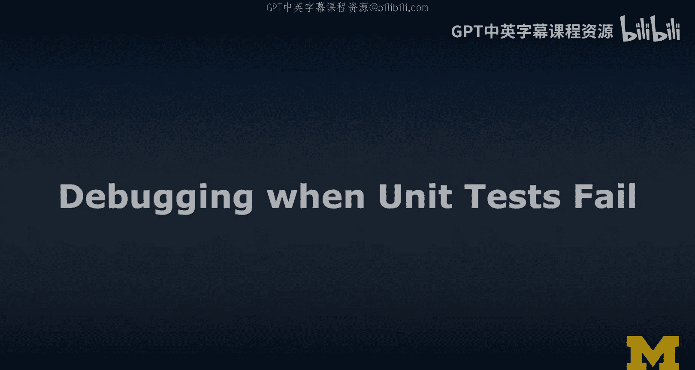
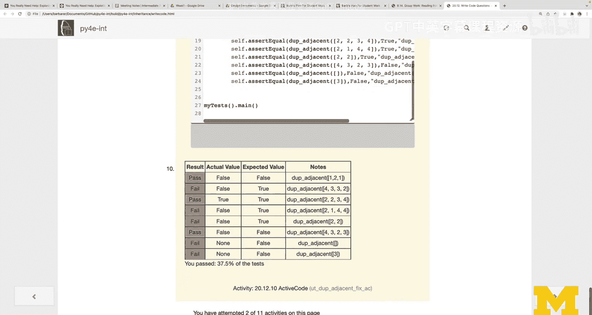

# 13：单元测试失败调试 🔍




在本节课中，我们将学习当单元测试用例失败时，如何进行调试。我们将通过一个具体的代码示例，逐步分析问题所在，并尝试修复它。

---

## 概述

当运行单元测试时，如果某个测试用例失败，我们需要找出代码中的错误。本节课将通过一个实际案例，演示如何定位和修复由单元测试失败所揭示的问题。

## 调试失败的测试用例

假设我们有一段代码需要修复。运行测试后，我们发现大部分测试用例都失败了。查看测试说明，我们了解到测试的目标是检查列表中是否存在相邻的重复元素。例如，对于列表 `[1, 2, 1]`，由于没有相邻的重复数字，预期结果应为 `False`。然而，我们的代码却返回了 `True`，这显然存在问题。

为了深入分析，我们可以暂时移除单元测试框架的调用，直接运行有问题的函数片段。在Python中，方法必须被显式调用才会执行。因此，我们直接调用该函数并观察其行为。

以下是核心的代码逻辑片段：

```python
def has_adjacent_duplicate(nums):
    if len(nums) == 2:
        # 初始条件判断
        pass
    for i in range(len(nums)):
        cur = nums[i]
        previous = nums[i - 1]
        if cur == previous:
            return True
    return False
```

通过代码逐步执行，我们发现当 `i` 为 0 时，`nums[i - 1]` 变成了 `nums[-1]`，即列表的最后一个元素。在Python中，索引 `-1` 表示列表的最后一个项。因此，代码实际上是在比较第一个元素和最后一个元素，而非相邻的两个元素。当首尾元素恰好相同时，函数就会错误地返回 `True`。

## 修复代码逻辑

找到了问题根源，我们就可以进行修复。我们不应该从索引 0 开始循环，而应该从索引 1 开始，以确保 `previous` 始终是当前元素的前一个相邻元素。

以下是修复后的代码逻辑：

```python
def has_adjacent_duplicate(nums):
    for i in range(1, len(nums)):  # 从索引1开始循环
        cur = nums[i]
        previous = nums[i - 1]
        if cur == previous:
            return True
    return False
```

修复后再次运行测试，我们发现情况有所改善，但仍存在一些错误。剩下的问题就留给大家尝试分析和解决。

## 总结




本节课我们一起学习了如何调试失败的单元测试。我们通过一个具体案例，演示了如何定位代码逻辑错误——特别是循环起始索引设置不当导致的问题——并进行了修复。调试是编程中至关重要的技能，需要耐心和细致的观察。