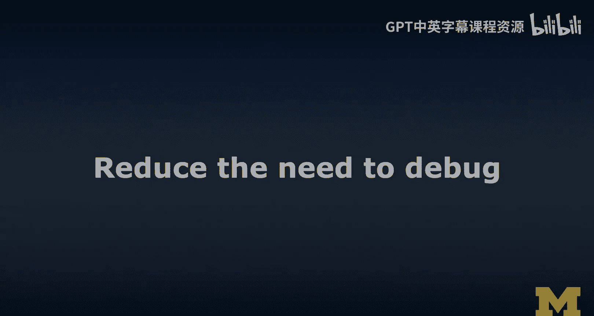
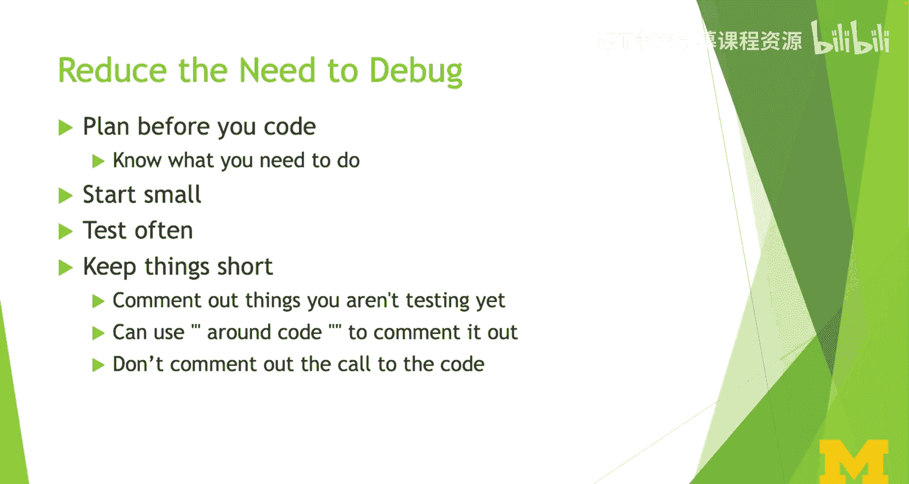
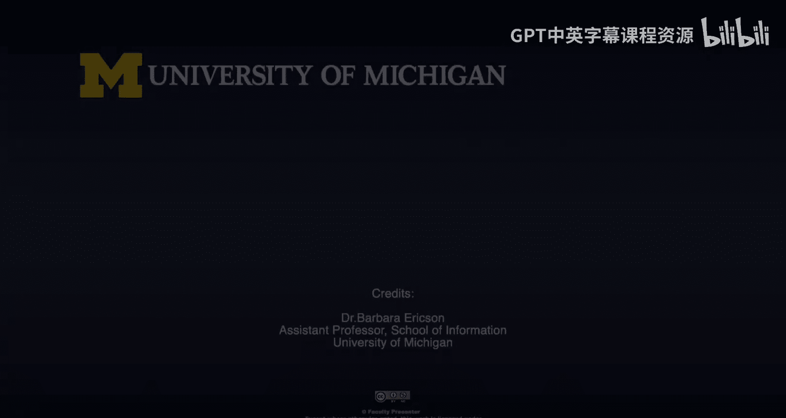
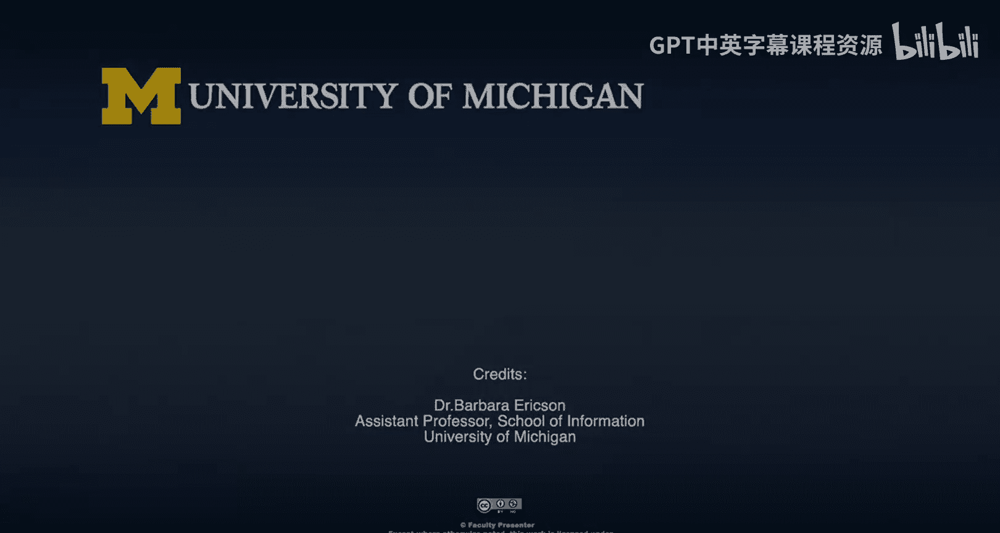

# 创造性编程：14：减少调试需求的方法 🐛




在本节课中，我们将学习如何通过减少代码中的错误数量，来从根本上避免繁琐的调试工作。核心思想是“预防胜于治疗”，通过良好的编程习惯来降低对调试的依赖。

上一节我们讨论了调试的基本方法，本节中我们来看看如何从源头减少错误。

## 理解任务与规划

减少错误的第一步是确保你完全理解自己要做什么。在开始编写代码之前，你需要明确以下几点：

*   **输入是什么？** 你的程序需要接收什么样的数据。
*   **输出是什么？** 你的程序最终应该产生什么样的结果。
*   **代码如何工作？** 程序从输入到输出的逻辑流程是怎样的。

一个有效的方法是，先用自然语言（如英语或中文）写下你打算实现的算法。这被称为“先规划，后编码”。明确对于给定的输入，预期的输出应该是什么。这种方法也常被称为“测试驱动开发”，即先编写测试用例。因为如果你不知道代码应有的输入和输出，就无法判断它是否正确工作。

## 增量开发与频繁测试

理解了任务之后，不要试图一次性写完所有代码。相反，应该采用增量式开发。

以下是实施增量开发的具体步骤：

1.  **从小处着手**：先只写几行核心功能的代码。
2.  **立即测试**：运行这几行代码，确保它们按预期工作。
3.  **逐步添加**：在此基础上，再添加一小部分新功能。
4.  **持续测试**：每添加一点新代码，就立即进行测试。

通过这种方式，你能确保每一小段代码在集成前都是正确的。如果某个复杂功能暂时不需要测试，可以将其注释掉，专注于当前正在开发的部分。

## 使用多行注释隔离代码

在Python中，你可以使用三引号（`'''` 或 `"""`）来创建多行字符串，这常用于临时注释掉大段的代码块。

```python
'''
# 这段代码功能复杂，暂时不需要测试
def complex_function(data):
    # ... 很多行代码 ...
    return result
'''

# 先测试这个简单的函数
def simple_function(x):
    return x * 2

print(simple_function(5))  # 输出应为 10
```

**重要提示**：使用此方法时，务必确保你没有注释掉任何对要测试代码的**调用语句**。因为被注释的代码不会被执行。在完成测试后，记得取消这些注释。





## 总结



本节课中我们一起学习了三种减少调试需求的核心方法：**充分理解任务并先规划后编码**、**采用增量开发并频繁测试**、以及**合理使用注释来隔离未完成的代码**。记住，编写易于理解和测试的简短代码片段，远比写完一大段复杂代码后再去查找隐藏的错误要高效得多。养成良好的编程习惯，是成为优秀程序员的关键一步。