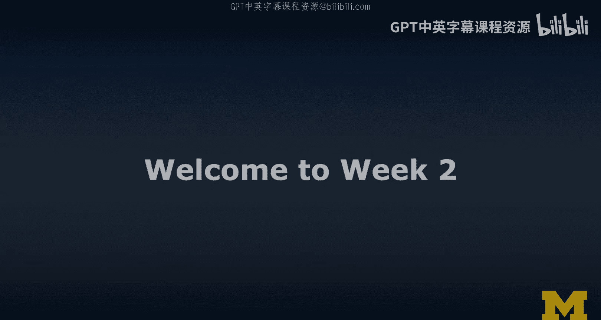
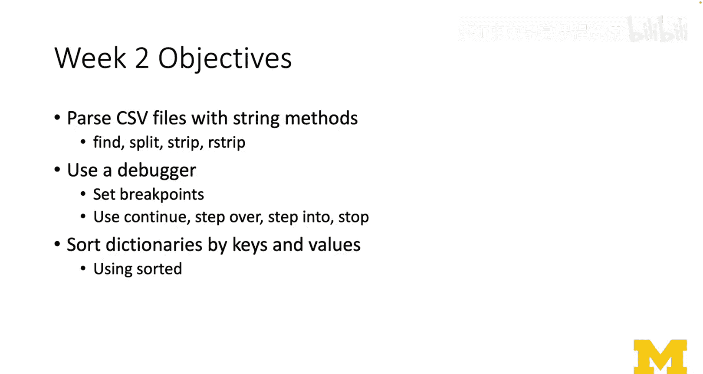
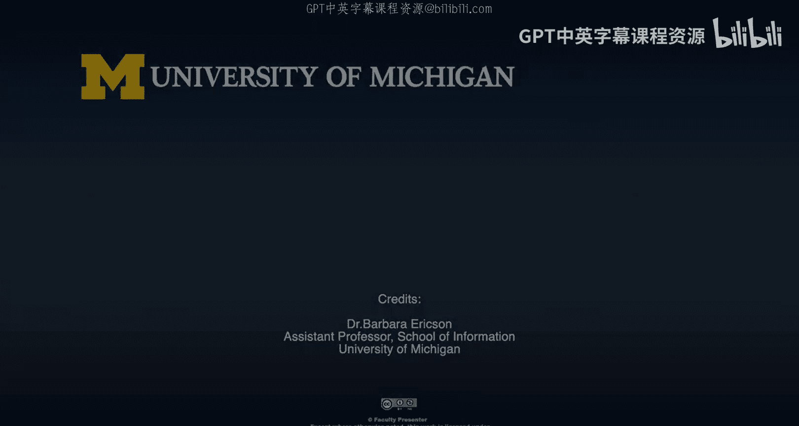

# 15：课程概述与目标 🎯

在本节课中，我们将要学习第二周的核心内容。本周的重点是处理数据、掌握调试技巧以及学习如何对数据进行排序。我们将从一种常见的数据格式开始。

## 本周学习内容 📚

上一节我们介绍了本周的整体目标，本节中我们来看看具体要掌握的技能。

以下是本周你将学习到的几个关键主题：

*   **处理CSV文件**：学习使用逗号分隔值文件，这是一种标准的数据交换格式。
*   **解析文件**：学习如何使用字符串方法（如 `find`、`split`、`strip`、`rstrip`）来解析这些文件。
*   **使用调试器**：学习如何设置断点，以及如何使用“继续”、“步入”、“步过”或“停止”命令来逐步执行你的代码。
*   **字典排序**：学习如何使用 `sorted` 函数，根据键或值对字典进行排序。

## 总结 ✨

本节课中我们一起学习了第二周的计划。我们将接触实际的数据文件，掌握分析和调试代码的工具，并学会如何整理数据。这些技能对于构建更复杂、更有趣的程序至关重要。