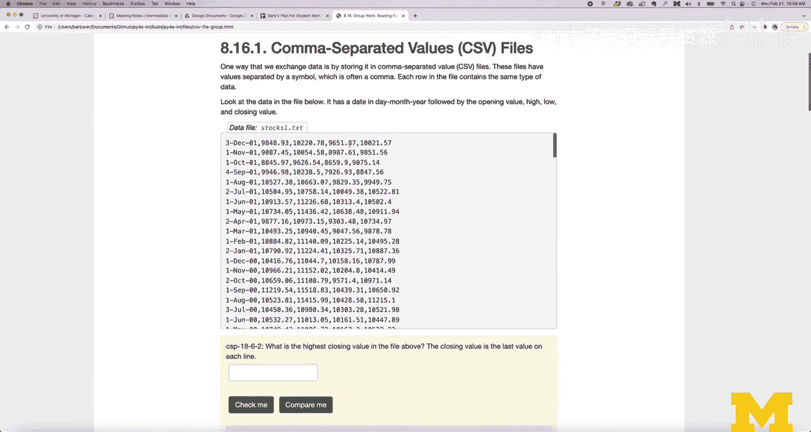

# 创造性编程：16：CSV文件解析 📊


在本节课中，我们将学习什么是CSV文件，以及如何读取和处理其中的数据。CSV文件是一种常见的数据存储格式，广泛用于存储表格数据，如电子表格或数据库导出。通过解析CSV文件，我们可以提取信息并回答关于数据的问题。


## 什么是CSV文件？

CSV代表“逗号分隔值”。它是一种文件格式，其中包含一系列值，通常每行代表一条记录，而每个值之间由特定的分隔符（通常是逗号）隔开。

例如，一个名为 `stock.txt` 的文件可能包含以下格式的数据：
```
01-Jan-2021,150.25,155.30,148.50,152.75
02-Jan-2021,152.80,157.45,151.20,156.00
```
在这个例子中，每一行包含日期、开盘价、最高价、最低价和收盘价，这些值由逗号分隔。

## 如何解析CSV文件？

解析CSV文件涉及读取文件内容，并将每行数据分割成独立的值。在Python中，我们可以使用内置的 `split()` 方法或专门的 `csv` 模块来实现。

以下是使用 `split()` 方法解析CSV文件的基本步骤：
```python
with open('stock.txt', 'r') as file:
    for line in file:
        values = line.strip().split(',')
        print(values)
```
这段代码会读取文件的每一行，去除首尾空白字符，然后按逗号分割成列表。

## 处理CSV数据

一旦我们将CSV文件解析为列表，就可以进一步处理数据。例如，我们可以计算股票的平均收盘价，或找出最高和最低的股价。

以下是计算平均收盘价的示例代码：
```python
closing_prices = []
with open('stock.txt', 'r') as file:
    for line in file:
        values = line.strip().split(',')
        closing_price = float(values[4])  # 假设收盘价在第5列
        closing_prices.append(closing_price)



average_close = sum(closing_prices) / len(closing_prices)
print(f"平均收盘价: {average_close}")
```


## 总结


本节课中，我们一起学习了CSV文件的基本概念和解析方法。我们了解到CSV文件是一种以逗号分隔值的文件格式，常用于存储表格数据。通过Python的 `split()` 方法或 `csv` 模块，我们可以轻松读取和处理这些数据，从而进行各种分析和计算。掌握CSV文件解析是数据处理的基础，对于后续学习更复杂的数据操作至关重要。