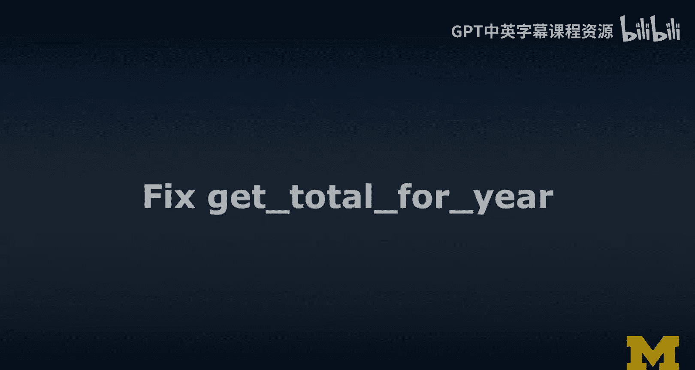
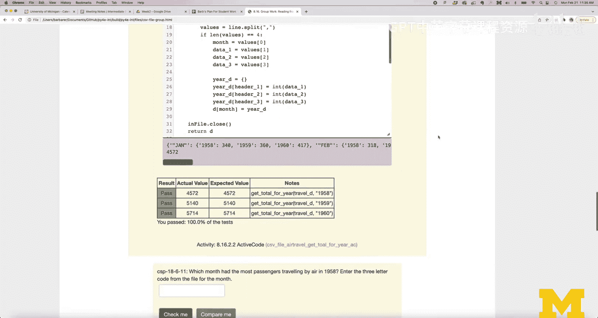

# 创造性编程：17：修复get_total_for_year函数 🛠️




在本节课中，我们将学习如何调试一个处理数据的Python程序。具体任务是修复一个名为`get_total_for_year`的函数，该函数用于计算特定年份的航空旅行数据总和。我们将通过识别和解决数据读取、字符串处理以及类型转换中的常见错误来完成这个任务。

---

## 问题背景与目标

上一节我们介绍了数据处理的基本概念，本节中我们来看看一个具体的调试案例。程序需要读取包含多年份、多月份航空旅行数据的文本，并计算指定年份的数据总和。初始代码运行时出现了错误，我们的目标是找出并修复这些错误。

## 初始代码与错误分析

首先，我们运行初始代码，观察出现的错误。

```python
# 示例：尝试计算1958年数据总和的代码片段
# 此处省略了数据读取和循环的具体代码
total = total + data[year]  # 第38行，发生错误
```

运行后，程序在第38行报错，提示“KeyError”。这意味着代码试图访问字典中不存在的键。此外，后续还会遇到“无法将整数与字符串相加”的类型错误。

## 调试步骤与解决方案

以下是修复这些问题的具体步骤。

### 步骤一：清理数据键名

第一个错误是键错误。打印出读取的原始数据后，我们发现键名（年份）被多余的**双引号**和**空格**包围。例如，数据中的键是`"1958 "`，而不是我们期望的`1958`。

**解决方案**：在将字符串作为键存入字典前，使用`.strip()`方法去除首尾的指定字符。

```python
# 清洗头部字符串，去除双引号和空格
header1 = header1.strip('\" ')
header2 = header2.strip('\" ')
header3 = header3.strip('\" ')
```

`.strip('\" ')`会移除字符串开头和结尾的所有双引号和空格字符。

### 步骤二：转换数据类型

修复键名后，再次运行程序，出现了新的类型错误：“TypeError: unsupported operand type(s) for +: 'int' and 'str'”。这是因为从文件读取的数据值是字符串类型，无法直接与整数相加。

**解决方案**：在将数据值加入总和前，使用`int()`函数将其转换为整数。`int()`函数会自动处理字符串中的空格。

```python
# 将字符串数据转换为整数后相加
total = total + int(data_value)
```

### 步骤三：处理换行符问题

完成上述两步后，1958和1959年的计算正常了，但1960年仍然出错。检查发现，1960年的数据键末尾还有一个**换行符**`\n`，导致`.strip('\" ')`未能完全清理干净。

**解决方案**：将换行符也加入`.strip()`需要移除的字符列表中。

```python
# 清洗头部字符串，去除双引号、空格和换行符
header1 = header1.strip('\" \n')
header2 = header2.strip('\" \n')
header3 = header3.strip('\" \n')
```

## 最终代码与验证

应用所有修复后，完整的`get_total_for_year`函数（或相关数据处理循环）应能正确运行，计算出各年份的数据总和。

```python
# 修复后的关键逻辑示例
for line in file_lines[1:]:  # 跳过标题行
    parts = line.split(',')
    year_key = parts[0].strip('\" \n')  # 彻底清理键
    month_data = int(parts[1].strip())  # 清理并转换值
    if year_key == target_year:
        total += month_data
```

运行程序，现在它应该能成功输出1958、1959和1960各年份的正确总和。

---



## 总结


本节课中我们一起学习了如何系统地调试一个数据处理程序。我们遇到了三个主要问题：**多余的字符导致键错误**、**字符串与整数类型不匹配**以及**隐藏的换行符**。通过使用`.strip()`方法清理字符串和使用`int()`函数进行类型转换，我们逐一解决了这些问题。记住，在处理外部数据时，仔细检查数据的实际格式并进行适当的清洗和转换是至关重要的。