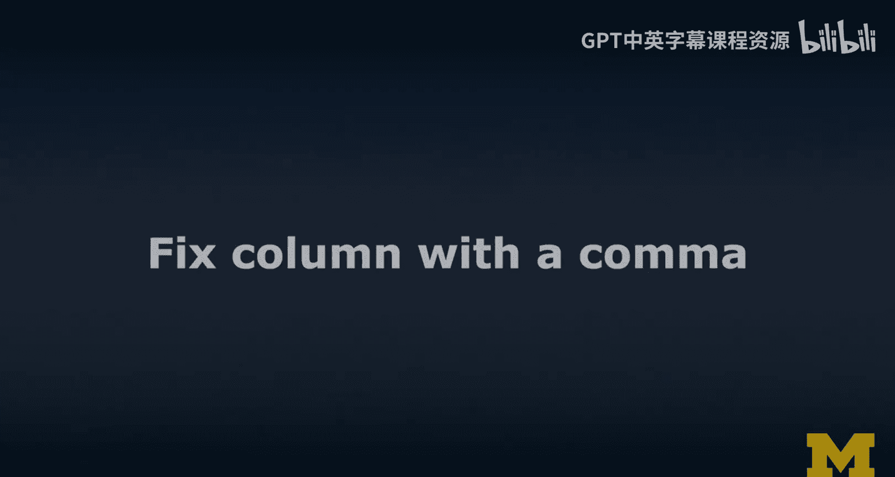
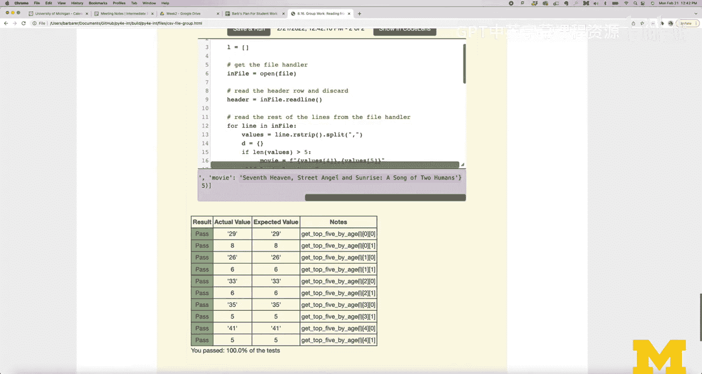

# 18：修复含逗号的列数据

在本节课中，我们将要学习如何处理CSV文件中包含逗号的列数据。当数据列本身包含逗号时，简单的按逗号分割会导致数据解析错误。我们将探讨如何识别并修复这类问题。

## 问题背景

我们一直在通过按逗号分割的方式来处理CSV文件。但是，如果某个列本身包含一个或多个逗号，会发生什么情况呢？以下是一个例子。

我们有一些关于奥斯卡最佳女主角的数据。数据包含年份、获奖者年龄、获奖者姓名和电影片名。请注意，这里的电影片名中包含了一个逗号。

## 识别问题

在处理CSV文件时，你可以做的一件事是检查列数是否正确。如果某行的列数超出预期，你可能需要打印出该行以查看发生了什么。

以下是我打印出的问题行。可以看到，电影片名中确实包含了一个逗号。目前我们的程序只是简单地退出。但如果我们想实际处理这个问题，就需要采取不同的方法。

## 初步解决方案

当我们按逗号分割时，电影片名被错误地分成了两部分。我们需要将其重新组合起来。

对于电影片名，我们原本将其赋值为 `values[4]`。现在，我们需要将其修改为使用F字符串将两部分重新组合。具体做法是，将 `values[4]` 和一个逗号以及 `values[5]` 拼接起来。

否则，如果分割后的 `values` 列表长度等于5，我们再将电影片名设置为 `values[4]`。然后，我们设定一个条件：只有当 `values` 的长度大于或等于5时，才执行后续的处理逻辑。这样，我们仍然可以处理数据的其余部分。

通过这种方法，我们解决了第一个电影片名的问题。现在，包含逗号的完整电影片名被正确显示，一切看起来都正常了。

## 方法的局限性

这是一种解决问题的方法。但是，如果多个列中都包含多个逗号呢？显然，我们需要一个更好的方法。

## 总结

本节课中，我们一起学习了如何处理CSV文件中因数据列包含逗号而导致的解析问题。我们首先通过检查列数来识别问题行，然后尝试通过手动拼接被错误分割的字段来进行修复。虽然这种方法在简单情况下有效，但它无法应对更复杂的情况，例如多个列都包含逗号。这提示我们需要寻找更健壮、通用的解决方案，例如使用Python内置的 `csv` 模块。