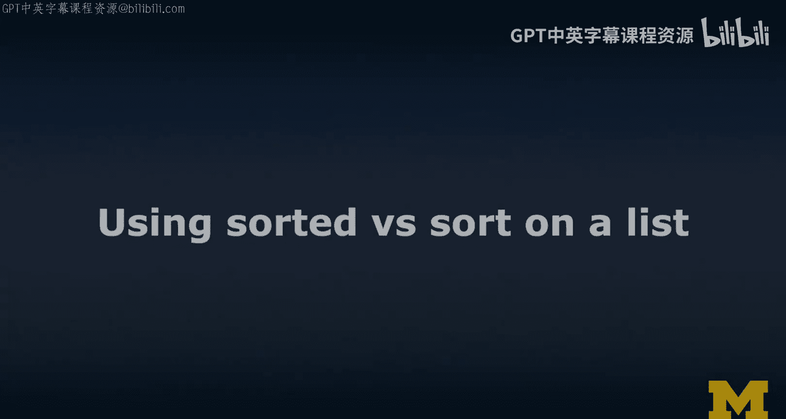
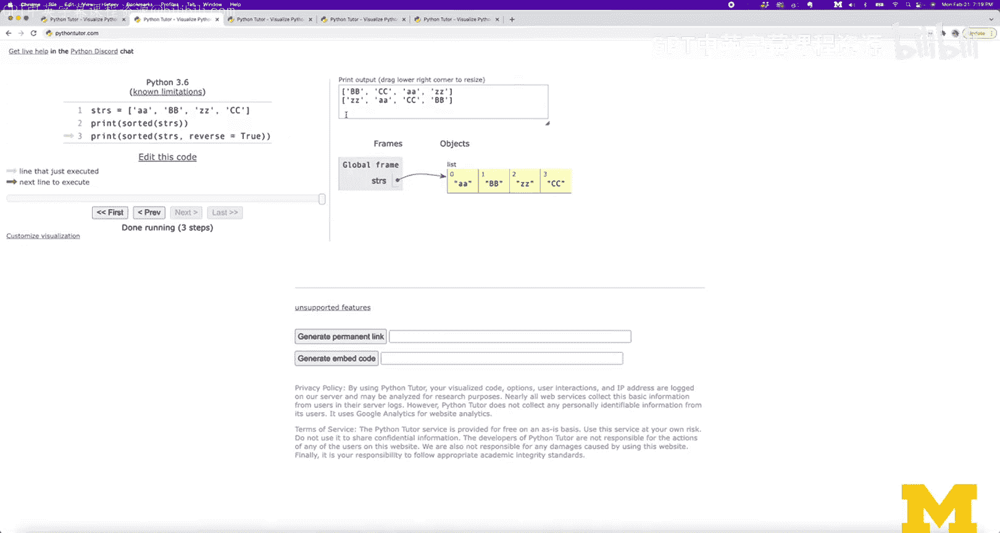

# 19：sorted()与sort()方法对比 📊




在本节课中，我们将学习Python中两种对列表进行排序的方法：内置函数`sorted()`和列表方法`.sort()`。我们将通过对比它们的行为、用法和区别，来理解何时该使用哪一种。

## 概述

排序是编程中常见的操作。Python提供了两种主要方式来实现排序：一种是`sorted()`函数，它返回一个新的已排序列表；另一种是`.sort()`方法，它直接在原列表上进行排序。理解两者的区别对于编写高效、清晰的代码至关重要。

## sorted()函数

`sorted()`是一个内置函数，它可以对任何可迭代对象（如列表、字符串、元组）进行排序，并**返回一个新的已排序列表**。重要的是，它**不会改变原始数据**。

以下是`sorted()`函数的基本语法：
```python
sorted(iterable, key=None, reverse=False)
```

让我们通过一个例子来理解它的工作方式。

```python
a = [5, 1, 4, 3]
print(sorted(a))  # 输出：[1, 3, 4, 5]
print(a)          # 输出：[5, 1, 4, 3] （原列表未改变）
```

如你所见，`sorted(a)`返回了排序后的新列表`[1, 3, 4, 5]`，但变量`a`本身的值仍然是`[5, 1, 4, 3]`。

## .sort()方法

上一节我们介绍了不改变原数据的`sorted()`函数，本节中我们来看看`.sort()`方法。`.sort()`是列表对象的一个方法，它**直接修改原列表**，使其变为有序状态，并且**不返回任何值**（返回`None`）。

以下是`.sort()`方法的基本语法：
```python
list.sort(key=None, reverse=False)
```

让我们用同样的列表来演示：

```python
a = [5, 1, 4, 3]
print(a.sort())   # 输出：None
print(a)          # 输出：[1, 3, 4, 5] （原列表已被改变）
```

调用`a.sort()`后，`a`本身被永久地排序了。方法调用返回`None`，这是需要特别注意的地方。

## 控制排序顺序：升序与降序

无论是`sorted()`函数还是`.sort()`方法，都允许我们通过`reverse`参数来控制排序是升序还是降序。默认情况下`reverse=False`，即升序排序。将其设置为`True`即可实现降序排序。

以下是使用`sorted()`进行降序排序的例子：

```python
strings = [‘a‘, ‘B‘, ‘z‘, ‘C‘]
print(sorted(strings, reverse=True))
```

以下是使用`.sort()`进行降序排序的例子：

```python
strings = [‘a‘, ‘B‘, ‘z‘, ‘C‘]
strings.sort(reverse=True)
print(strings)
```

关于字符串排序，有一个重要的细：在Python的默认排序规则中，**大写字母的ASCII码值小于小写字母**。因此，在升序排序时，所有大写字母会排在小写字母之前。

## 核心区别总结

为了帮助你清晰地选择，以下是两种方法的核心区别对比：

*   **返回值**：`sorted()`返回一个新的已排序列表。`.sort()`返回`None`（不返回新列表）。
*   **对原数据的影响**：`sorted()`不修改原始可迭代对象。`.sort()`直接修改原列表。
*   **适用对象**：`sorted()`适用于任何可迭代对象（列表、元组、字符串等）。`.sort()`仅适用于列表对象。

## 如何选择？

选择使用`sorted()`还是`.sort()`，取决于你的具体需求：
*   当你需要保留原始数据不变，或者需要对非列表的可迭代对象（如元组）进行排序时，使用 **`sorted()`**。
*   当你明确想要改变原列表，并且不需要保留其原始顺序时，使用 **`.sort()`**。这种方式通常更节省内存，因为它不需要创建列表的副本。




## 总结


本节课中我们一起学习了Python中两种排序方式。`sorted()`函数返回排序后的新列表而不影响原数据，而`.sort()`方法则直接修改原列表。记住`sorted()`适用于更多数据类型，而`.sort()`仅用于列表。根据你是否需要改变原始列表以及处理的数据类型，可以明智地选择使用哪一种方法。