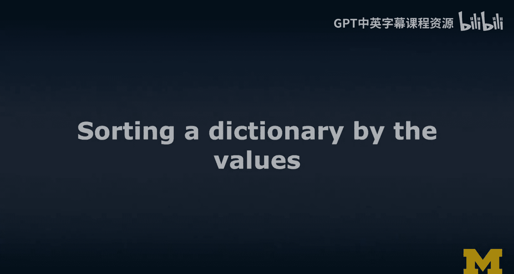
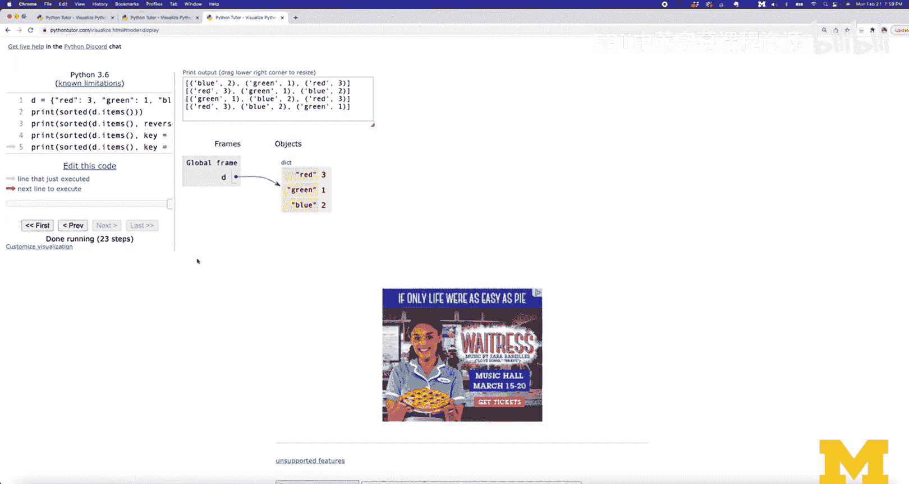
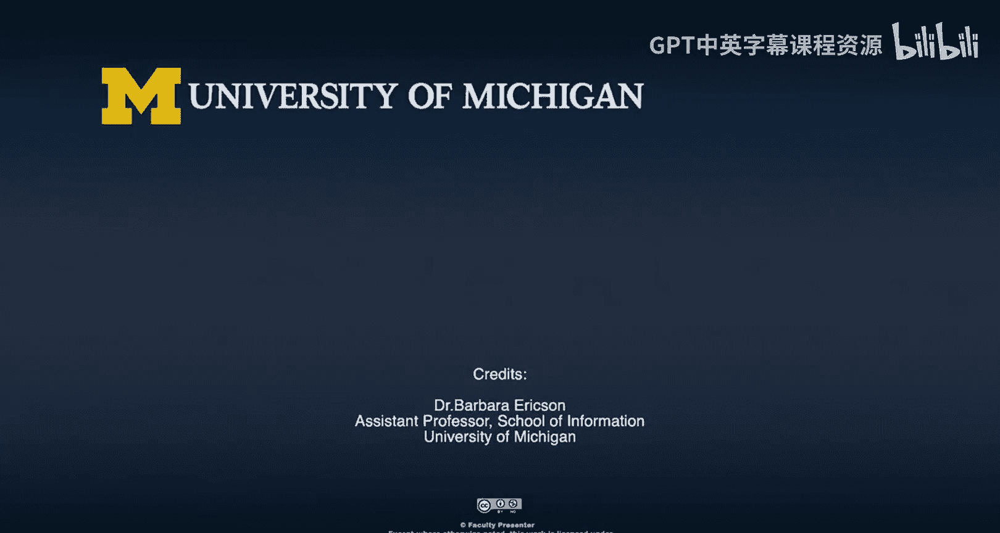

# 创造性编程：20：按值排序字典技巧 📊




在本节课中，我们将学习如何对Python字典进行排序。字典本身是无序的数据结构，但我们可以通过一些技巧，根据其键或值来获取一个有序的列表。本节将重点介绍如何根据字典的**值**进行排序。

---

## 直接对字典排序

首先，我们来看看如果直接对字典使用 `sorted()` 函数会发生什么。

假设我们有一个字典，记录了颜色及其对应的数值：

```python
my_dict = {'red': 3, 'green': 1, 'blue': 2}
```

如果我们直接打印 `sorted(my_dict)`：

```python
print(sorted(my_dict))
```

输出结果将是字典**键**的升序列表：`['blue', 'green', 'red']`。

如果加上 `reverse=True` 参数：

```python
print(sorted(my_dict, reverse=True))
```

则会得到键的降序列表：`['red', 'green', 'blue']`。

这种方法只对键排序，无法看到对应的值，通常不是我们想要的结果。

---

## 对字典项（键值对）排序

为了同时获取键和值，我们需要先使用 `.items()` 方法获取字典的键值对列表，每个键值对是一个元组。

```python
print(sorted(my_dict.items()))
```

输出是一个元组列表，但排序依据仍然是**键**（元组的第一个元素）：
`[('blue', 2), ('green', 1), ('red', 3)]`

同样，使用 `reverse=True` 会按键降序排列。

这仍然不是按值排序。如果我们想根据字典的**值**（元组的第二个元素）来排序，就需要使用一个关键函数来指定排序依据。

---

## 使用Lambda函数按值排序

为了按值排序，我们需要在 `sorted()` 函数中使用 `key` 参数，并传入一个 **lambda函数**。Lambda函数是一种临时、简洁的函数定义方式。

我们的目标是告诉Python：请根据每个元组的第二个元素（即值）进行排序。

以下是具体做法：

```python
print(sorted(my_dict.items(), key=lambda item: item[1]))
```

*   `my_dict.items()`: 生成一个如 `[('red', 3), ('green', 1), ('blue', 2)]` 的列表。
*   `key=lambda item: item[1]`: 这是一个lambda函数。它接收一个参数 `item`（即每个元组），并返回 `item[1]`，也就是元组的第二个元素——字典的值。

执行这行代码后，输出为：`[('green', 1), ('blue', 2), ('red', 3)]`。列表已经根据值 `1, 2, 3` 升序排列。

如果想要按值降序排列，只需添加 `reverse=True` 参数：

```python
print(sorted(my_dict.items(), key=lambda item: item[1], reverse=True))
```

输出将变为：`[('red', 3), ('blue', 2), ('green', 1)]`。

---

### 理解Lambda函数

在上面的代码中，`lambda item: item[1]` 是一个临时函数。你可以这样理解它：

```python
def get_value(item):
    return item[1]
```

然后这样调用：`key=get_value`。Lambda函数只是将这个定义和调用过程浓缩成了一行。

它指导排序算法在比较两个元组时，不是比较元组本身（默认比较第一个元素），而是比较它们各自通过lambda函数返回的值（即 `item[1]`）。

---

## 总结

本节课中我们一起学习了如何对Python字典进行排序。



1.  直接对字典使用 `sorted()` 会返回**键**的排序列表。
2.  使用 `.items()` 方法可以获取键值对元组列表，但默认仍按**键**排序。
3.  要按**值**排序，需在 `sorted()` 函数中使用 `key` 参数，并借助 **lambda函数**（如 `key=lambda item: item[1]`）来指定根据元组的第二个元素（值）进行排序。
4.  结合 `reverse=True` 参数可以实现降序排列。




通过掌握 `sorted()` 函数与 `lambda` 表达式的结合使用，你就能灵活地根据需要对字典内容进行各种排序了。