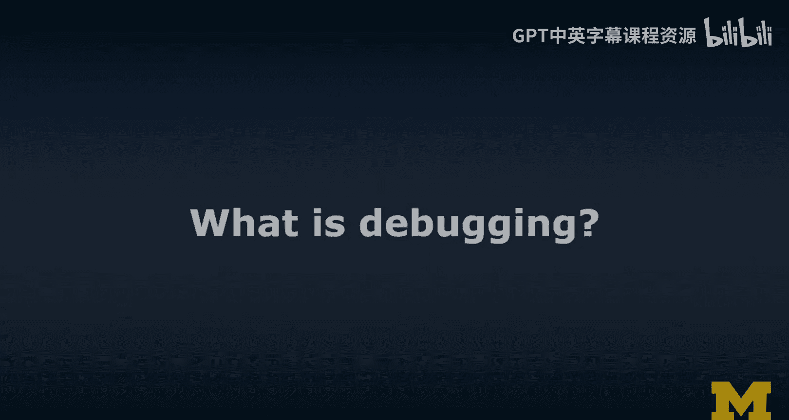
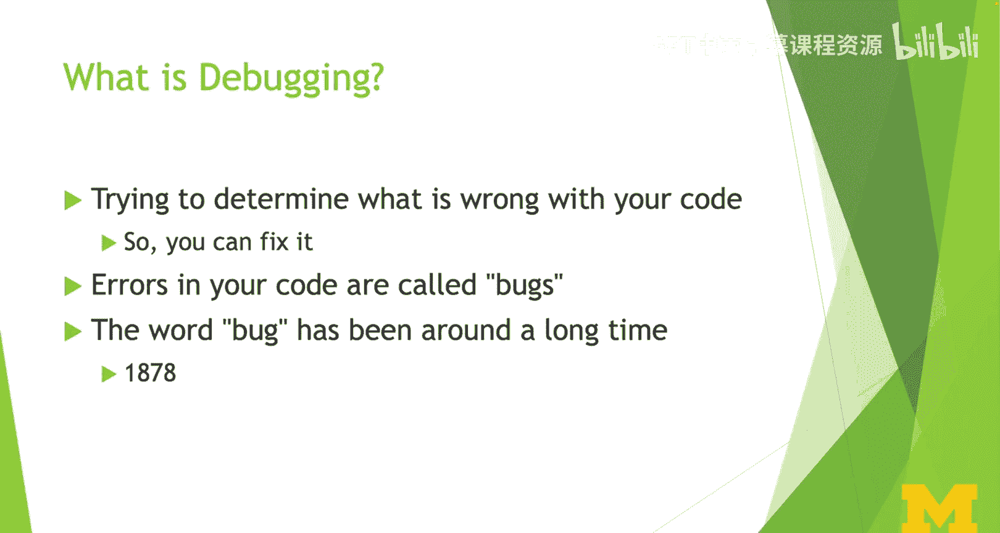
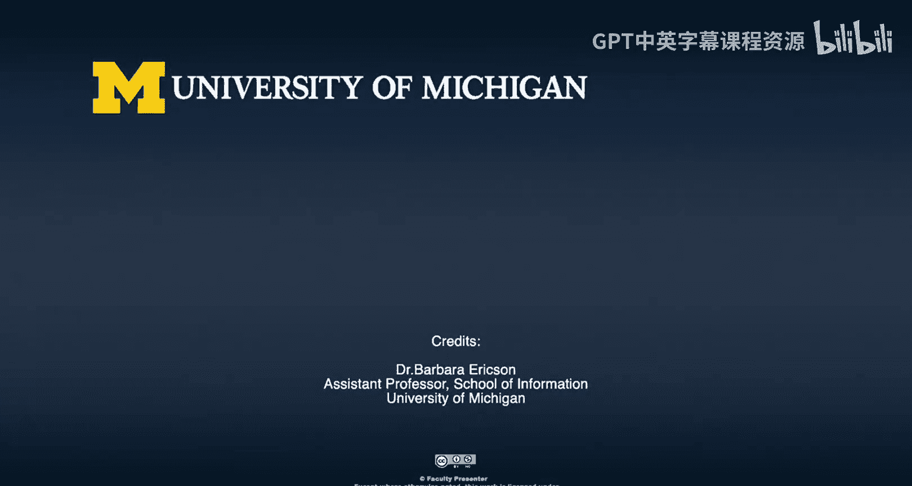

# 21：调试技术解析 🐛

在本节课中，我们将学习什么是调试，以及如何系统地找出并修复代码中的错误。

## 什么是调试？

调试是指尝试找出代码中存在的问题并加以解决的过程。当代码存在“漏洞”或无法正常工作时，我们就需要进行调试。这可能意味着代码无法编译，也可能意味着代码虽然能运行，但产生的结果与预期不符。

在代码中发现的错误通常被称为“漏洞”或“Bug”。这个术语由来已久，至少可以追溯到1878年。偶尔会有人误以为“Bug”一词源于20世纪40年代格蕾丝·霍珀在计算机中发现一只真正的虫子，但这个故事并不准确。实际上，“Bug”这个术语在那之前早已存在。不过，当时确实有人将那只导致计算机故障的虫子粘在日志本上，以示这是第一个被发现的、引发实际问题的“真虫子”。

## 调试的本质

通常，我们要找的并非真正的虫子，而是代码中的某种逻辑或语法错误，并试图修复它。

上一节我们介绍了调试的基本概念，本节中我们来看看一些常见的调试场景和基本思路。

## 调试的常见场景

以下是代码可能出现问题的几种典型情况：

1.  **编译错误**：代码无法通过解释器或编译器的语法检查，无法运行。
2.  **运行时错误**：代码可以运行，但在执行过程中崩溃或抛出异常。
3.  **逻辑错误**：代码可以顺利运行，但产生的结果或行为与程序员的预期不符。

## 总结

本节课中我们一起学习了调试的核心概念。我们了解到，调试是定位和修复代码错误的过程，这些错误可能阻止代码运行，也可能导致程序行为异常。理解“Bug”这一术语的历史，有助于我们认识到寻找和修复代码问题是软件开发中一项长期且基础的工作。

记住，调试不仅是一项技术，更是一种系统化解决问题的思维方式。在后续课程中，我们将学习更多具体的调试工具和技巧。