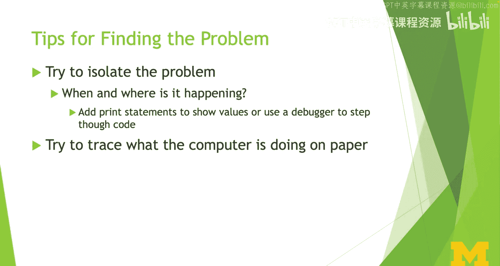

# 创造性编程：22：问题定位方法 🐛


在本节课中，我们将学习当代码出现错误或缺陷（Bug）时，如何进行定位和诊断。我们将介绍两种核心方法：使用打印语句和利用调试器。

当代码出现错误时，首要任务是**隔离问题**，即确定错误在代码中的位置、发生的原因以及触发的时机。

以下是两种常用的定位方法。

## 使用打印语句

一种直接的方法是添加打印语句。你可以通过注释掉部分代码，仅运行你想要测试的部分，然后在关键位置添加打印语句来查看特定变量的值。

例如，在Python中：
```python
def calculate_total(price, quantity):
    print(f"[DEBUG] 进入函数，price={price}, quantity={quantity}") # 打印输入值
    total = price * quantity
    print(f"[DEBUG] 计算出的 total={total}") # 打印计算结果
    return total
```
这种方法通过输出中间状态来帮助你理解程序的执行流程。

## 使用调试器

上一节我们介绍了通过修改代码来打印信息的方法，本节中我们来看看另一种更强大的工具：调试器。

调试器是一种允许你在一个或多个点暂停程序执行，并查看变量值的工具。它的原理类似于添加打印语句，但优势在于**无需修改你的源代码**。




在大多数集成开发环境（IDE）中，你可以通过设置断点来使用调试器。程序运行到断点时会暂停，此时你可以检查所有变量的当前状态。


本节课中我们一起学习了两种定位代码问题的方法：使用打印语句进行手动检查，以及利用调试器进行交互式调试。掌握这些技能将帮助你更高效地发现和修复程序中的错误。