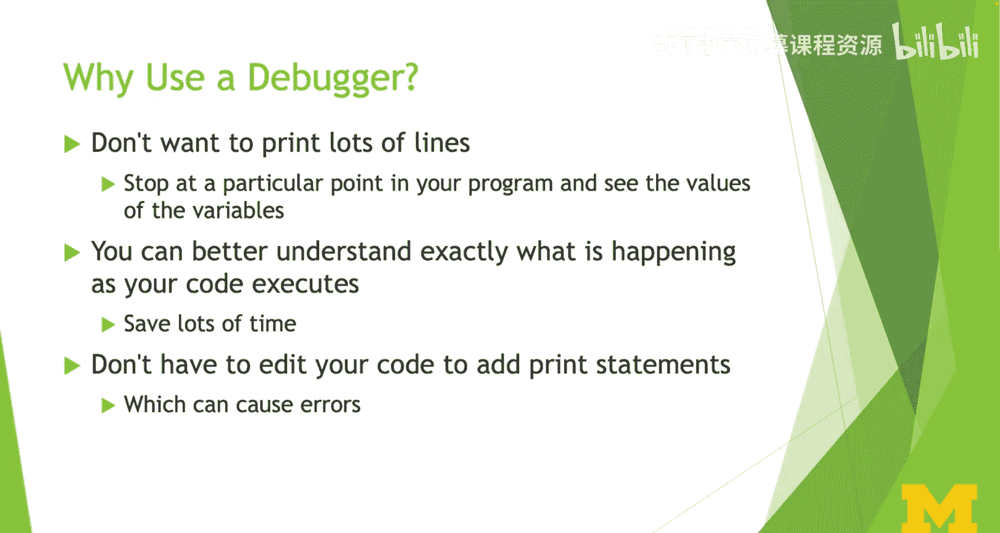

# 23：调试器使用优势 🐛

在本节课中，我们将探讨为什么在调试代码时，使用调试器（Debugger）比单纯使用 `print` 语句更具优势。我们将通过对比两者的工作方式，帮助你理解调试器如何提升你的开发效率和代码理解深度。

## 概述

调试是编程中不可或缺的一环。初学者常常依赖插入 `print` 语句来查看变量值，但这种方法存在诸多局限。本节将详细介绍调试器的核心优势，它能让你在不修改代码的情况下，更精确、更高效地洞察程序的运行状态。

## 为何选择调试器而非 `print` 语句？

上一节我们介绍了调试的基本概念，本节中我们来看看调试器相较于 `print` 语句的具体优势。主要理由有以下几点：

### 1. 避免信息过载

当你使用 `print` 语句进行调试，并且代码涉及大量循环（例如读取一个很长的文件）时，控制台会输出海量的信息。你并不想查看所有的 `print` 输出，那会非常繁琐。

**调试器的优势在于**：你可以在程序的特定点设置断点并暂停，然后只查看该点的变量值。这样你就不必一直坐在那里打印每一个值。

### 2. 深入理解代码执行流程

调试器能帮助你更好地理解程序。你可以单步执行代码，精确观察每一行代码执行时发生了什么。

以下是调试器帮助你理解的关键方面：
*   **变量的变化**：你可以实时观察每个变量的值如何随着代码执行而改变。
*   **控制流的跳转**：当代码调用一个函数时，你可以看到执行点跳转到该函数内部。这让你能清晰地跟踪程序的执行路径。

通过这种方式，你能真正地、更深入地理解代码执行时究竟在发生什么。如果你理解了正在发生的事情，这将为你节省大量时间。

### 3. 保持代码纯净，避免引入错误

使用 `print` 语句调试需要你编辑源代码。这可能会带来风险：
*   你可能意外地破坏了一些不想改动的内容。
*   你可能在发布代码时忘记删除调试用的 `print` 语句，而正式代码中通常不希望包含这些语句。

**调试器解决了这个问题**：它允许你在想要的地方暂停，而**无需修改代码**。你可以精确地查看正在发生的情况，并单步执行以观察细节。

## 总结

本节课中我们一起学习了调试器相对于 `print` 语句的三大核心优势：**避免输出信息过载**、**深入理解代码执行细节**以及**无需修改源代码，保持代码纯净**。因此，我推荐你在调试时积极使用调试器。掌握这个工具将显著提升你排查问题和理解代码的能力。