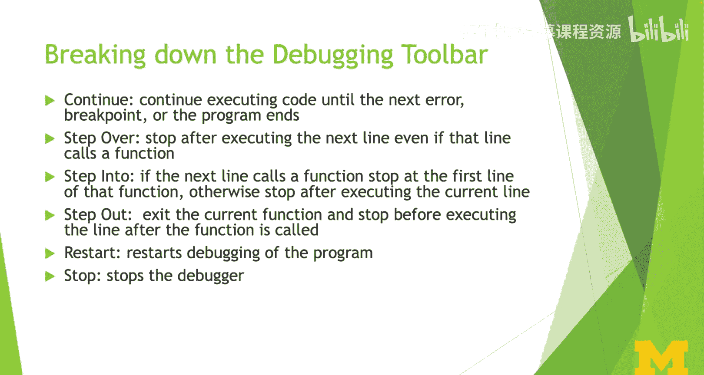
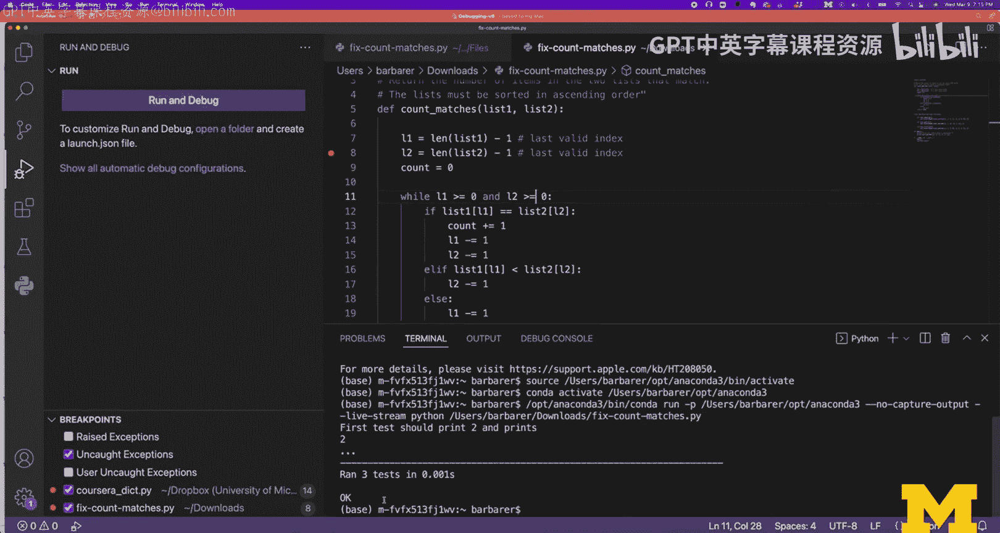

# 创造性编程：24：VS Code调试实践 🐛

在本节课中，我们将学习如何在VS Code中使用调试器来查找和修复代码中的错误。调试是编程中至关重要的技能，它能帮助我们理解代码的执行流程，并定位问题所在。

## 概述

我们将通过一个具体的例子，演示在VS Code中设置断点、启动调试器、以及使用各种调试控制命令（如继续、单步跳过、单步进入等）来逐步分析代码的执行过程。目标是修复一个存在逻辑错误的函数。

## 设置断点

调试的第一步是设置断点。断点会告诉调试器在代码的特定位置暂停执行。

在VS Code中，设置断点的方法是在代码行号的左侧区域点击。点击后会出现一个红色圆点，表示断点已设置。若要清除断点，再次点击该红点即可。你可以在代码的多个位置设置断点。

## 启动调试器

设置好断点后，下一步是启动调试器。

点击VS Code侧边栏的“运行和调试”图标（虫子图标），然后点击“运行和调试”按钮。代码将开始执行，并在遇到第一个断点时暂停。

当程序在断点处暂停时，你会看到断点红点周围有一个黄色箭头，表示当前执行暂停在此行之前。此时，左侧的“变量”面板会显示当前已定义的所有变量及其值，方便你检查程序状态。

## 调试控制命令

当程序在断点处暂停后，你可以使用顶部的一排控制按钮来决定下一步如何执行。以下是这些按钮的含义：

*   **继续 (Continue)**：继续执行程序，直到遇到下一个断点、发生错误或程序自然结束。
*   **单步跳过 (Step Over)**：执行当前行代码。如果该行包含函数调用，会直接执行完整个函数，然后停在下一行。这是最常用的调试步骤。
*   **单步进入 (Step Into)**：执行当前行代码。如果该行包含函数调用，调试器会进入该函数内部，并停在函数的第一行。
*   **单步跳出 (Step Out)**：如果当前在某个函数内部，此命令会执行完该函数剩余的所有代码，并返回到调用该函数的位置。
*   **重启 (Restart)**：重新启动整个调试会话。
*   **停止 (Stop)**：终止当前的调试会话。

## 调试实践示例

现在，我们通过一个实际的例子来应用这些知识。假设我们有一个函数 `count_matches`，用于计算两个已排序列表中相同元素的数量，但它存在一些错误。

首先，我们直接运行代码，发现了一个断言错误：函数返回了 `None`，而不是预期的数字 `0`。这通常意味着函数忘记返回一个值。我们修复了这个问题，添加了 `return count` 语句。

修复后再次运行，又出现了新的断言错误：预期匹配数为 `2`，但函数返回了 `1`。这表明我们的逻辑还存在问题。此时，使用调试器来逐步分析就非常合适。

我们启动调试器，并在函数的关键循环处设置断点。程序在断点处暂停后，我们开始使用“单步跳过”命令逐行执行。

通过观察变量值的变化，我们发现了一个“差一错误”：循环条件 `while L1 > 0 and L2 > 0` 导致我们漏掉了索引为 `0` 的元素比较。我们将循环条件修改为 `while L1 >= 0 and L2 >= 0`。

保存修改并重新运行所有测试，这次所有测试都通过了。这个例子清晰地展示了如何使用调试器定位并修复一个逻辑错误。

## 总结

本节课中，我们一起学习了VS Code调试器的基本使用方法。我们掌握了如何设置断点、启动调试会话，以及使用“继续”、“单步跳过”、“单步进入”等控制命令来逐步跟踪代码执行。通过一个实际的调试案例，我们实践了如何利用这些工具来观察程序状态、分析逻辑错误，并最终成功修复代码。熟练使用调试器将极大地提升你解决问题的效率和代码质量。