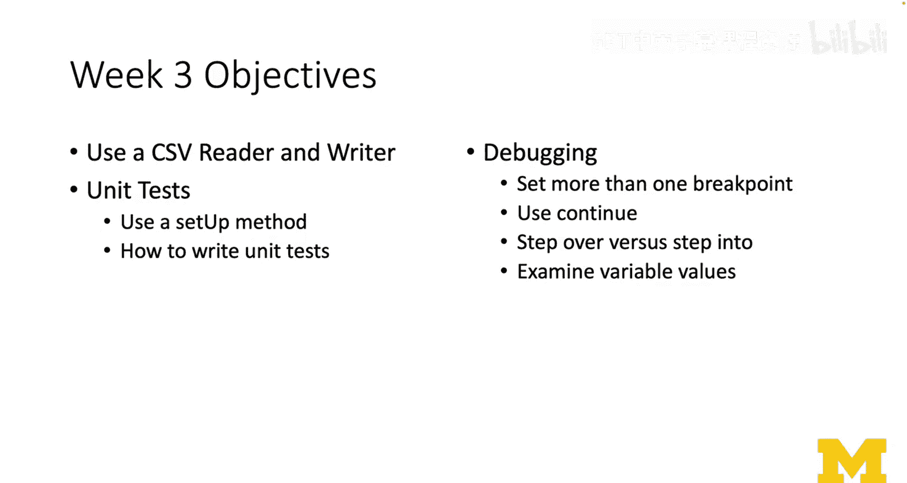

# 25：课程概述 🎯

在本节课中，我们将要学习第三周的核心内容。本周我们将重点探讨如何使用CSV文件的读取器和写入器，深入理解单元测试中的`setup`方法，并掌握更高级的调试技巧，包括设置多个断点以及区分“单步跳过”与“单步进入”操作。


---


## CSV文件的读写操作 📄

上一节我们介绍了本周的学习目标，本节中我们来看看CSV文件的操作。CSV文件非常常见且实用，Python提供了一个专门的类来简化其处理，尤其是在某个字段本身包含逗号时，可以避免错误地分割数据。

以下是使用Python内置`csv`模块处理文件的核心概念：

**代码示例：使用csv.reader**
```python
import csv
with open('data.csv', 'r') as file:
    csv_reader = csv.reader(file)
    for row in csv_reader:
        print(row)
```

**代码示例：使用csv.writer**
```python
import csv
data = [['Name', 'Age'], ['Alice', 30], ['Bob', 25]]
with open('output.csv', 'w', newline='') as file:
    csv_writer = csv.writer(file)
    csv_writer.writerows(data)
```

---

## 深入单元测试：setup方法 🧪

了解了CSV操作后，我们将更深入地学习单元测试。本节重点介绍`setup`方法，该方法会在每个测试用例运行前被调用，用于预先设置测试所需的数据。

以下是使用`unittest`框架中`setUp`方法的示例：

**代码示例：使用setUp方法**
```python
import unittest

class TestExample(unittest.TestCase):
    def setUp(self):
        # 该方法在每个测试方法前运行
        self.data = [1, 2, 3, 4, 5]

    def test_sum(self):
        self.assertEqual(sum(self.data), 15)

    def test_length(self):
        self.assertEqual(len(self.data), 5)

if __name__ == '__main__':
    unittest.main()
```

---

## 高级调试技巧：断点与步进 🔍

掌握了测试数据准备后，我们进入调试环节。本周我们将学习更深入的调试器使用技巧，包括设置多个断点，并使用“继续”命令在断点间跳转。

以下是调试过程中的核心操作概念：

**关键概念：**
*   **设置断点**：在代码的特定行暂停执行。
*   **继续 (Continue)**：从当前断点运行到下一个断点。
*   **单步跳过 (Step Over)**：执行当前行，但不进入该行调用的函数内部。
*   **单步进入 (Step Into)**：执行当前行，并进入该行调用的函数内部。
*   **观察变量 (Watch Variables)**：在调试过程中监视变量的值如何变化。

在调试时，理解何时使用“单步跳过”与“单步进入”至关重要。通常，当你信任某个函数本身的正确性，只想关注当前流程时，使用“单步跳过”。当你需要深入检查某个函数的具体实现时，则使用“单步进入”。



---


## 总结 📝


本节课中我们一起学习了第三周的核心技能。我们掌握了如何使用`csv`模块安全高效地读写CSV文件，了解了如何在单元测试中使用`setUp`方法为每个测试用例准备数据，并实践了设置多个断点、使用“继续”命令以及区分“单步跳过”和“单步进入”等高级调试技术。希望你能享受本周的学习，并灵活运用这些工具来提升编程效率与代码质量。