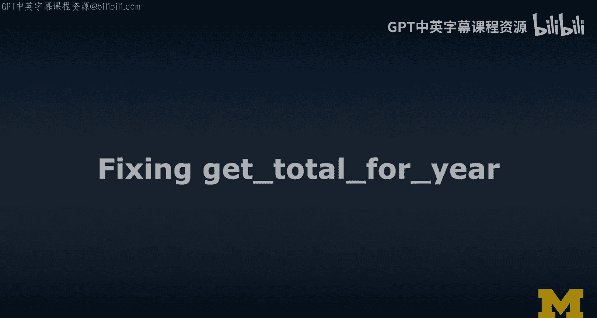
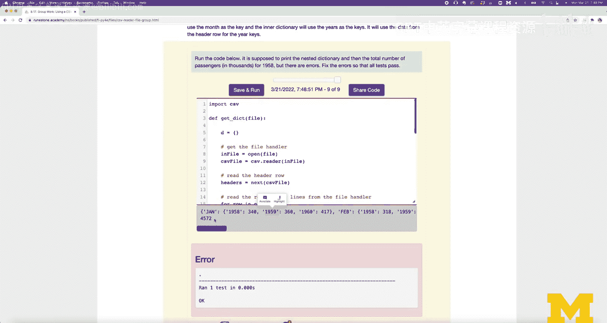

# 创造性编程：26：修复年度总计函数 🐛



在本节课中，我们将学习如何调试一个从CSV文件读取数据并计算年度总计的函数。我们将逐步分析代码中的问题，并修复它们，最终使函数能够正确运行。

---

## 概述

我们有一个从CSV文件读取数据的函数，目标是创建一个字典，其中键是年份，值是各月份的数值列表。然而，当前代码存在几个错误，导致无法正确生成字典和计算年度总计。本节将引导你逐一识别并修复这些问题。

## 导入CSV模块

首先，我们需要导入CSV模块来处理CSV文件。这是读取文件数据的基础步骤。

```python
import csv
```

## 创建空字典

在读取数据之前，我们初始化一个空字典，用于存储后续从文件中提取的数据。

```python
data_dict = {}
```

## 读取文件并创建CSV阅读器

我们打开文件并创建一个CSV阅读器对象。这里需要注意阅读器对象名称的大小写。

```python
with open('data.csv', 'r') as file:
    csv_reader = csv.reader(file)
```

上一节我们介绍了如何导入模块和初始化数据结构，本节中我们来看看如何从CSV文件中读取数据。

## 处理表头行

CSV文件的第一行通常是表头，包含了列名（如月份和年份）。我们需要正确读取并处理这些表头。

以下是处理表头的步骤：
*   读取第一行作为表头。
*   去除每个表头项可能存在的多余空格和引号。

```python
headers = next(csv_reader)
cleaned_headers = [header.strip().strip('"') for header in headers]
```

## 遍历数据行并填充字典

处理完表头后，我们遍历文件的剩余行，将数据填充到之前创建的字典中。

以下是填充字典的步骤：
*   遍历CSV阅读器中的每一行。
*   将年份（来自处理后的表头）作为字典的键。
*   将该年份对应的各月数据（转换为整数）作为值存入列表。

```python
for row in csv_reader:
    for i, year in enumerate(cleaned_headers[1:]):  # 跳过“月份”列
        if year not in data_dict:
            data_dict[year] = []
        # 假设行中第一个元素是月份，后续是各年数据
        data_dict[year].append(int(row[i+1]))
```

## 调试与修复错误

在运行初始代码时，我们遇到了错误。让我们来逐一分析并修复。

首先，创建CSV阅读器时对象名应为小写 `reader`，而不是 `Reader`。

```python
# 错误示例
csv_Reader = csv.Reader(file)
# 正确示例
csv_reader = csv.reader(file)
```

其次，在遍历行时，我们应循环 `csv_reader` 对象，而不是原始文件对象 `file`。

```python
# 错误示例
for row in file:
# 正确示例
for row in csv_reader:
```

最后，我们发现从表头读取的年份字符串包含了额外的引号和空格，导致字典键匹配失败。我们需要在将年份用作键之前对其进行清理。

```python
# 清理前的表头可能类似：' "1958" '
# 使用 .strip().strip('"') 进行清理
cleaned_year = year.strip().strip('"')
```

## 计算年度总计

字典正确填充数据后，计算某个年份的总计就变得简单了。我们只需获取该年份对应的列表，并使用 `sum()` 函数求和。

```python
def get_total_for_year(data_dict, year):
    """
    计算给定年份的总计。
    参数:
        data_dict (dict): 数据字典
        year (str): 指定的年份
    返回:
        int: 该年份所有月份数据的总和
    """
    return sum(data_dict.get(year, []))
```




## 总结


本节课中我们一起学习了如何调试一个数据处理的函数。我们修复了CSV阅读器对象名称的大小写错误、更正了数据遍历的对象，并清理了表头字符串中的多余字符。通过这些步骤，我们成功构建了数据字典，并实现了计算年度总计的功能。调试是一个系统化的过程，关键在于仔细阅读错误信息、检查数据流，并逐步验证代码的每个部分。