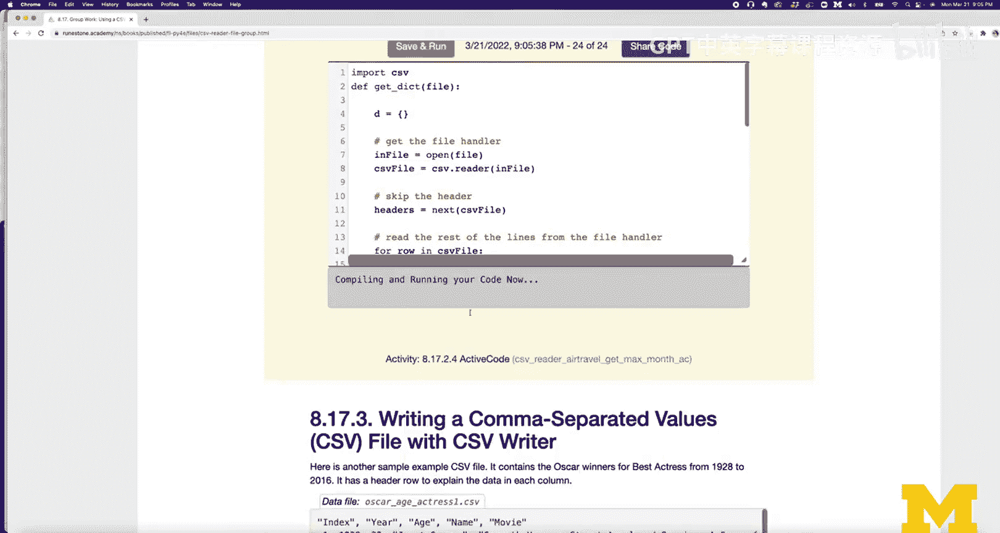

# 27：修正最大月份错误 🐛

在本节课中，我们将学习如何调试并修复一个名为 `get_max_month` 的函数。该函数旨在从CSV数据文件中找出降雨量最高的月份，但在运行过程中出现了多个错误。我们将逐步分析这些错误，并逐一修正它们。

## 概述与问题定位

首先，我们尝试运行代码，遇到了第一个错误：`CSB is not defined`。这表明代码中引用了未定义的变量或模块。

检查代码顶部，发现没有导入必要的 `csv` 模块。因此，我们需要添加 `import csv` 语句来导入该模块。修正后，这个错误消失了。

## 修正CSV读取器错误

接下来，代码报错：`CSV reader expects at least one argument got zero`。这意味着在创建 `csv.reader` 对象时，没有传入必要的参数。

查看代码，`csv.reader` 应该接收一个已打开的文件对象作为参数。修正方法是将正确的文件对象 `in_file` 传递给 `csv.reader`。

## 修正数据读取逻辑

随后，代码在 `skipping the header` 部分遇到了问题。错误提示 `length of values equal equal 4` 表明逻辑有误。

分析发现，代码中错误地引用了 `values` 变量，而实际上应该使用 `row` 变量来获取行的长度。同时，月份信息也应该从 `row` 中提取，而不是 `values`。我们修正了这些引用。

## 修正表头处理

接着，出现了 `header is not defined` 的错误。检查代码发现，变量名拼写不一致，代码中使用了 `headers`（复数），但引用时却用了 `header`（单数）。我们将引用统一修正为 `headers`。

此外，表头是从错误的对象（`in_file` 作为字符串）读取的。正确的做法是从 `csv.reader` 对象 `csv_file` 中读取表头行。

修正后，我们发现表头内容仍然异常，包含了额外的空格和双引号。因此，我们需要对每个表头字符串进行处理，使用 `.strip()` 方法去除首尾空格和双引号。

## 修正最大值计算逻辑

尽管上述修正完成，单元测试仍然失败，提示“September does not equal August”。这表明计算最大降雨量月份的逻辑有误。

我们检查了数据读取部分，月份和年份的对应关系看起来是正确的。问题出在后续查找最大值的逻辑上。

初始代码创建了一个空字典，并试图用 `lambda` 表达式按字典的键（`t[0]`）排序。然而，我们需要的是按字典的值（即降雨量）进行排序，以找到最大值。因此，应将排序的 `key` 参数改为 `lambda t: t[1]`，这样就能根据降雨量数值正确排序并找到最大值。

完成此修正后，所有单元测试都通过了。

## 总结

本节课中，我们一起调试并修复了 `get_max_month` 函数的多个错误。我们学习了：

1.  导入必要的Python模块（`import csv`）。
2.  正确初始化 `csv.reader` 对象。
3.  准确引用变量（如 `row` 而非 `values`）。
4.  保持变量名一致。
5.  从正确的数据源读取并清洗数据（处理表头）。
6.  修正核心算法逻辑，确保按正确的值（降雨量）进行排序以找到最大值。

通过这个练习，我们实践了系统化调试代码的流程：运行代码、阅读错误信息、定位问题根源，并实施针对性修正。