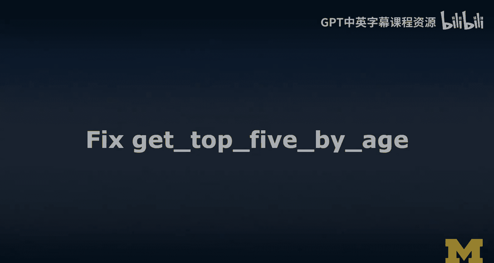
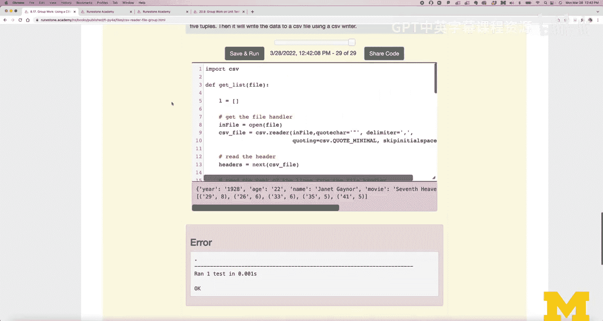

# 28：修复年龄前五错误 🐛

在本节课中，我们将学习如何调试和修复一个Python脚本中的错误。该脚本旨在读取一个包含女演员信息的CSV文件，统计每个年龄出现的次数，并将结果写入新的CSV文件。我们将逐步分析错误信息并修正代码。

---

上一节我们介绍了调试的基本概念，本节中我们来看看一个具体的调试案例。

## 问题描述与目标

脚本的目标是遍历一个关于女演员信息的文件，返回一个字典，其中包含年龄（age）以及在该年龄获奖的女演员（actresses）数量。

以下是输入文件的结构示例。文件包含一个标题行，列名分别为：`index`、`year`、`age`和`Whitname movie`。随后是数据行。请注意，电影标题（movie title）可能包含逗号，这正是我们需要使用CSV读取器的原因之一。

## 运行代码与错误分析

当我们尝试运行初始代码时，遇到了第一个错误。

**错误1：** `CSF file is not defined on line 13`
*   **分析：** 第13行引用了`CSF_file`，但查看上方代码发现变量名是`CSV_file`，存在拼写不一致。
*   **修复：** 将第13行的`CSF_file`统一更正为`CSV_file`。

修复第一个错误后，我们再次运行代码，遇到了第二个错误。

**错误2：** `CSF files 16`
*   **分析：** 第16行再次出现了对变量`CSF_file`的错误引用或拼写变化。
*   **修复：** 将第16行的引用也更正为`CSV_file`。

继续运行，我们遇到了第三个错误。

**错误3：** `values is not defined on line 20`
*   **分析：** 第20行的条件判断`if len(values) == 5`中，变量`values`未定义。根据上下文，这里应该判断的是当前行`row`的长度。
*   **修复：** 将`len(values)`更正为`len(row)`。

修正后再次运行，遇到了第四个错误。

**错误4：** `no attribute right on a CSB writer`
*   **分析：** 第46行尝试写入数据时，使用了错误的方法名`right`。CSV写入器的正确方法名是`writerow`。
*   **修复：** 将`writer.right(row)`更正为`writer.writerow(row)`。

## 调试步骤总结

以下是本次调试过程中识别和修复的主要问题列表：

1.  **变量名拼写不一致：** 将`CSF_file`统一更正为`CSV_file`。
2.  **未定义变量：** 将条件判断中的`values`更正为`row`。
3.  **方法名错误：** 将写入器的`right`方法更正为`writerow`方法。

完成以上修正后，代码即可成功运行。

---

本节课中我们一起学习了如何通过阅读错误信息、定位代码行以及逻辑推理来逐步调试程序。我们修复了变量名拼写错误、未定义变量引用以及错误的方法调用，最终使脚本能够正确执行其统计功能。