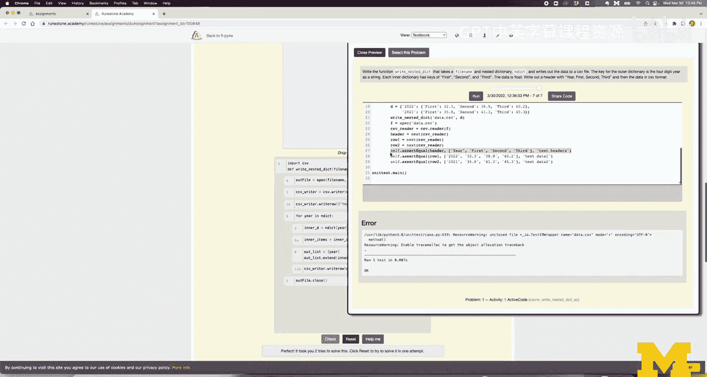

# 创造性编程：29：CSV写入单元测试 📝


在本节课中，我们将学习如何为那些不返回任何值，但会产生“副作用”（例如写入文件）的函数编写单元测试。我们将以测试一个将嵌套字典写入CSV文件的函数为例，学习如何通过读取生成的文件来验证函数的行为是否正确。

---

上一节我们介绍了如何测试返回值的函数。本节中我们来看看，如果一个函数不返回任何值，我们该如何测试它。这类函数通常会产生某种“副作用”，比如修改数据、打印信息或写入文件。我们的测试目标就是验证这个“副作用”是否按预期发生。

具体到本例，我们将测试一个写入CSV文件的函数。测试思路是：先调用函数写入文件，然后读取该文件，最后验证文件内容是否符合预期。

以下是测试一个写入CSV文件的函数的基本步骤：

1.  **准备测试数据**：创建一个嵌套字典作为函数的输入。
2.  **执行待测函数**：调用函数，将数据写入指定的CSV文件。
3.  **读取并验证结果**：打开被写入的CSV文件，读取其内容，并与预期值进行比较。

让我们通过代码来具体实现这个测试流程。

```python
import unittest
import csv

# 假设这是我们要测试的函数
def write_dict_to_csv(filename, data_dict):
    """将嵌套字典写入CSV文件。"""
    with open(filename, 'w', newline='') as csvfile:
        # 假设字典的键作为表头，值作为第一行数据（简化示例）
        writer = csv.writer(csvfile)
        headers = list(data_dict.keys())
        writer.writerow(headers)
        writer.writerow([data_dict[h] for h in headers])

class TestCSVWrite(unittest.TestCase):
    """测试CSV写入功能的测试类。"""

    def test_write_dict_to_csv(self):
        """测试 write_dict_to_csv 函数。"""
        # 1. 准备测试数据
        test_data = {'Name': 'Alice', 'Age': 30, 'City': 'New York'}
        test_filename = 'test_output.csv'

        # 2. 执行待测函数（不接收返回值）
        write_dict_to_csv(test_filename, test_data)

        # 3. 读取并验证结果
        with open(test_filename, 'r', newline='') as csvfile:
            reader = csv.reader(csvfile)
            # 读取表头
            header = next(reader)
            # 读取数据行
            row = next(reader)

        # 使用 assertEqual 断言验证内容
        self.assertEqual(header, ['Name', 'Age', 'City'])
        self.assertEqual(row, ['Alice', '30', 'New York'])

        # （可选）测试完成后清理生成的文件
        import os
        os.remove(test_filename)

# 如果直接运行此脚本，则执行测试
if __name__ == '__main__':
    unittest.main()
```

在上面的代码中，我们首先定义了一个待测试的函数 `write_dict_to_csv`。接着，我们创建了一个继承自 `unittest.TestCase` 的测试类 `TestCSVWrite`。在测试方法 `test_write_dict_to_csv` 中，我们遵循了“准备-执行-验证”的步骤。最后，我们使用 `assertEqual` 来断言文件内容是否与预期完全一致。



---


本节课中我们一起学习了如何为具有“副作用”的函数（特别是文件写入操作）编写单元测试。核心方法是**执行函数后，读取其产生的效果（如文件内容），并与预期结果进行比对**。通过这种方式，我们可以确保那些不直接返回值的函数也能被可靠地测试和验证。