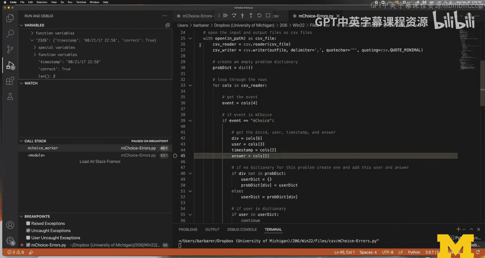
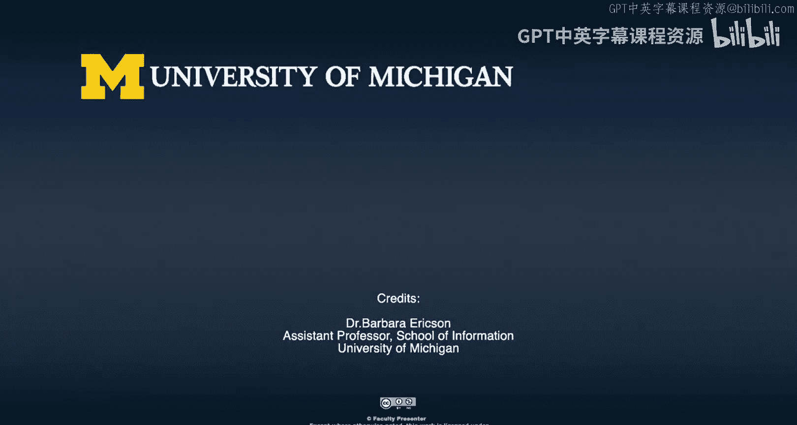

# 30：VS Code 调试器深度探索 🔍


在本节课中，我们将深入学习如何使用 Visual Studio Code 的调试器来诊断和修复代码中的问题。我们将通过一个处理电子书日志文件数据的实际例子，演示如何设置断点、单步执行代码、检查变量状态，从而高效地定位错误。

---

## 概述

我们将分析一个来自电子书系统的日志文件片段，该文件记录了用户回答多选题的情况。我们的目标是编写代码来统计有多少个不同的唯一问题、有多少人尝试了这些问题，以及最终有多少人答对了。在运行初始代码时，我们遇到了断言错误，这表明我们的统计结果与预期不符。接下来，我们将使用 VS Code 调试器来一步步探究问题所在。

## 日志数据结构

首先，我们需要理解日志数据的格式。每一行日志都包含多个字段，以下是一个示例：

```
6 1 8 [日期时间] [用户ID] MChoice [答案信息] [是否正确] [唯一问题ID] ...
```

对于多选题，我们主要关心的信息包括：用户给出的答案、该答案是否正确，以及该问题的唯一标识符（例如 `Q2_2Q_1`）。我们已经提取了一个小的日志片段，并基于此编写了测试用例。

## 初始问题与调试准备

当我们运行初始代码时，遇到了一个断言错误：预期有 3 个唯一问题，但代码只统计出 1 个。这显然有问题，是使用调试器的绝佳时机。

我们在代码中设置两个断点：
1.  第一个断点设在读取并解析日志数据之后，目的是检查我们是否正确提取了各个字段。
2.  第二个断点设在计算用户正确率的核心逻辑附近，以便观察数据是如何被处理和统计的。

在 VS Code 中，只需点击行号左侧的灰色区域即可设置或取消断点。

## 调试过程：定位第一个错误

启动调试后，程序在第一个断点处暂停。我们检查此时变量的值，特别是 `div`（问题唯一ID）字段。

我们发现 `div` 的值是 `12`，但这并不是我们期望的问题ID。通过观察数据数组的索引，我们意识到在分割日志行时，索引计算出现了偏差。我们错误地将索引 `5` 的数据当作了 `div`，而它实际应该是索引 `6` 的数据。

**修正后的字段索引对应关系应为：**
```python
# 假设 data 是分割后的列表
timestamp = data[2]
user_id = data[3]
event_type = data[4]
answer_info = data[5]
div_id = data[6]  # 修正后的索引
correct = data[7]
```

修正这个索引错误后，我们保存代码并重新运行。现在，`div` 字段能正确显示为类似 `Q2_2Q_1` 的问题ID了。

## 调试过程：单步执行与深入函数

修正第一个错误后，我们继续调试。使用 **“单步跳过”** 按钮逐行执行，不进入函数内部。我们看到 `answer`、`correct` 等变量被正确赋值。

当执行到条件判断 `if div not in problem_dictionary:` 时，由于字典初始为空，条件为真，程序进入相应的代码块。这里调用了 `add_answer` 函数。

为了理解 `add_answer` 函数内部的逻辑，我们这次使用 **“单步进入”** 按钮。调试器会跳转到该函数的定义处并暂停。

在函数内部，我们可以：
*   **单步执行**：观察它如何初始化字典、设置键值对。
*   **检查变量**：在调试侧边栏或通过鼠标悬停查看 `correct` 等变量的实时值。
*   **使用“单步跳出”**：在理解函数逻辑后，可以直接执行完该函数并返回到调用处。

## 高效使用断点与继续执行

在循环体中设置断点时，调试器会在每次循环迭代时都暂停，这可能很低效。我们可以：
1.  在循环开始后设置一个断点，检查一轮迭代的数据是否正确。
2.  确认逻辑无误后，**移除**该断点。
3.  点击 **“继续”** 按钮，程序将一直运行，直到遇到下一个剩余的断点或程序结束。

这种方法允许我们灵活地控制调试节奏，快速跳过已知正常的代码段，直接聚焦于可能存在问题的部分。

---



## 总结

本节课我们一起深入探索了 VS Code 调试器的核心功能。我们学习了：
*   如何根据错误信息设置断点。
*   如何使用 **单步跳过**、**单步进入** 和 **继续** 来控制调试流程。
*   如何在调试过程中检查变量的值，以验证逻辑是否正确。
*   如何通过动态管理断点来提高调试效率。




调试是一个强大的技能，它能帮助你深入理解代码的执行过程，并快速定位逻辑错误。掌握这些调试技巧，将使你在面对复杂代码问题时更加从容自信。