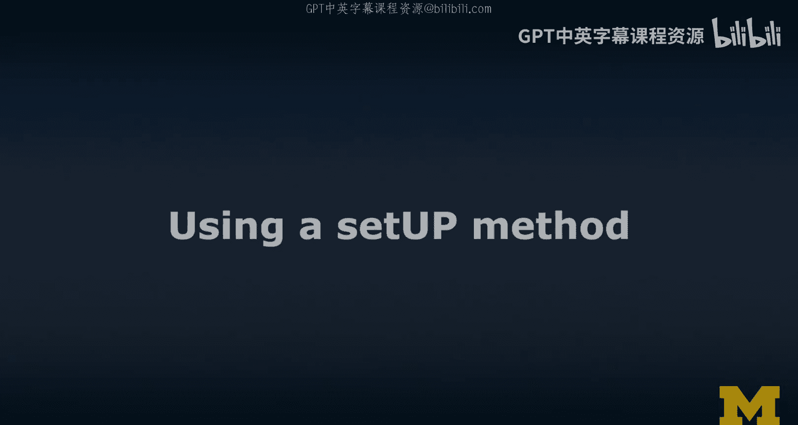
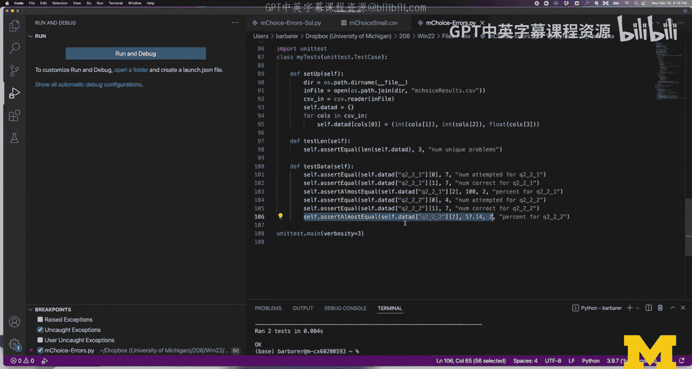

# 31：setup方法应用 🧪

在本节课中，我们将学习如何在处理CSV文件时创建单元测试。我们将重点探讨测试类中的 `setup` 方法，它如何在每个测试用例运行前被调用，以及如何利用它来准备测试数据。

---

上一节我们介绍了单元测试的基本概念，本节中我们来看看一个具体的应用场景：测试处理CSV文件的代码。

假设我们有一段代码，用于处理一个包含多选题及其答案的日志文件数据。我们的目标是统计其中有多少个不同的唯一多选题，每个问题有多少人尝试回答，以及最终有多少人回答正确。在修复代码后，我们需要确保它能通过一系列单元测试。

让我们仔细查看这些单元测试。这里特别需要注意的是 `setup` 方法。在你的测试用例类中，可以选择性地定义一个 `setup` 方法。这个方法会在**每一个**测试用例运行**之前**被调用。例如，它会在运行 `test_length` 之前被调用，也会在运行 `test_data` 之前被调用。

在 `setup` 方法中，我们通常执行一些准备工作。在这个例子里，代码会读取一个CSV文件的数据，并将其存储在一个字典中。我们使用 `self.data_d` 来引用这个字典。在单元测试的类中，`self` 代表当前类的实例对象，因此 `self.data_d` 是为该对象添加的一个属性。

随后，在每个具体的测试用例方法中，我们都可以直接使用 `self.data_d` 来访问这些预先准备好的数据。这样，我们就可以进行各种断言检查，例如检查字典的长度是否为3，或者检查某个问题ID对应的数据是否正确。

以下是编写此类测试时需要注意的几个要点：

*   **整数比较**：比较整数值时，可以使用 `assertEqual`。
*   **浮点数比较**：比较可能为浮点数的值时，应使用 `assertAlmostEqual`。这个方法允许你指定要比较的两个值，以及精确到小数点后多少位。

通过这种方式，我们可以在使用CSV读取器和写入器时，有效地编写和运行单元测试。

---

本节课中我们一起学习了如何在单元测试中应用 `setup` 方法来为测试准备CSV数据。我们了解了 `setup` 方法在每个测试前的执行机制，以及如何使用 `self` 在测试用例间共享准备好的数据。同时，我们也回顾了针对整数和浮点数进行断言检查的正确方法。