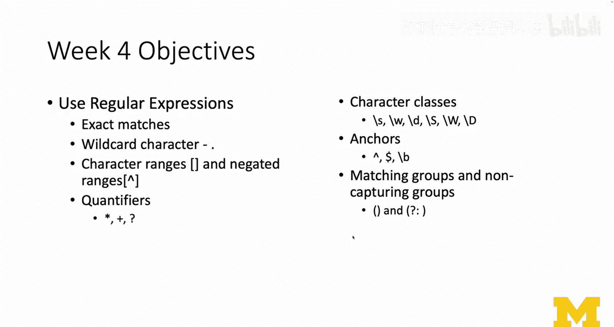

# 32：正则表达式入门指南 🧩

在本节课中，我们将要学习如何使用正则表达式。正则表达式是一种强大的工具，它能让我们轻松地搜索文本或验证文本格式，例如检查密码是否符合规则，或在文件中查找特定内容。

## 什么是正则表达式？ 🤔

正则表达式是一系列字符，它们能非常简洁地指定如何匹配文本。正则表达式主要有两个用途：一是验证文本格式（例如密码或电子书中的填空题），二是查找文本（例如在文件中搜索特定模式）。

上一节我们介绍了正则表达式的定义和用途，本节中我们来看看正则表达式的一些核心组成部分。

## 正则表达式的核心概念

以下是正则表达式中一些常用的匹配模式：

*   **精确匹配**：直接匹配指定的字符。例如，正则表达式 `cat` 匹配字符串中的 “cat”。
*   **通配符**：句点 `.` 可以匹配除换行符外的任意单个字符。
*   **字符范围**：使用方括号 `[]` 指定一个字符集合。例如，`[a-z]` 匹配任意一个小写字母。
*   **否定范围**：在方括号内使用 `^` 表示“除了”。例如，`[^0-9]` 匹配任意一个非数字字符。
*   **量词**：指定前面元素出现的次数。
    *   `*` 匹配0次或多次。
    *   `+` 匹配1次或多次。
    *   `?` 匹配0次或1次（即可选）。
*   **字符类**：一些预定义的快捷方式。
    *   `\s` 匹配任何空白字符（如空格、制表符）。
    *   `\S` 匹配任何非空白字符。
    *   `\w` 匹配字母、数字或下划线。
    *   `\W` 匹配非字母、数字或下划线的字符。
*   **锚点**：指定匹配发生的位置。
    *   `^` 匹配字符串的开头。
    *   `$` 匹配字符串的结尾。
    *   `\b` 匹配单词边界。

了解了基本匹配模式后，我们需要注意一个特殊的符号：圆括号。

## 需要注意的符号：圆括号

在正则表达式中，圆括号 `()` 用于定义“捕获组”，它不仅能将模式分组，还会记住匹配的内容以供后续使用。如果只想分组而不需要捕获，可以使用非捕获组语法 `(?:...)`。

本节课中我们一起学习了正则表达式的基础知识，包括其定义、用途以及核心的匹配模式，如通配符、量词、字符类和锚点。我们还了解了圆括号在分组和捕获中的作用。掌握这些概念将帮助你更高效地处理文本搜索和验证任务。