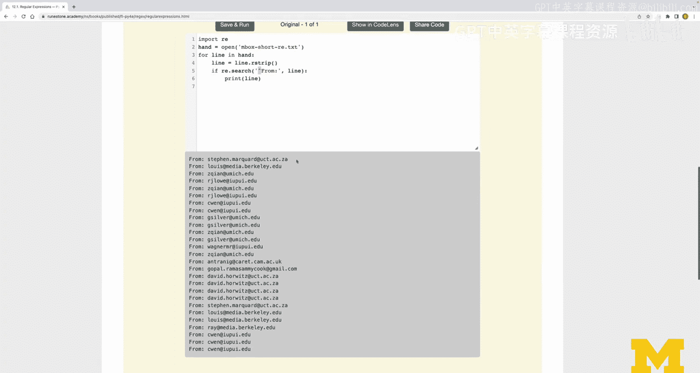

# 33：正则表达式入门 🧩


在本节课中，我们将深入学习正则表达式，并了解如何使用它们来精确地查找和处理文本数据。

## 深入探索正则表达式

上一节我们介绍了正则表达式的基本概念，本节中我们来看看一个具体的应用实例。

这是一个非常简单的例子，它只是在文本中查找特定的字符。代码从文件中读取内容，并检查每一行是否包含“From:”这个字符串。如果包含，就打印出该行。

```python
# 示例：查找包含“From:”的行
import re

with open('example.txt', 'r') as file:
    for line in file:
        if re.search('From:', line):
            print(line)
```

运行这段代码，我们会得到类似“From: someone@example.com”这样的结果。我们可以从这行文本中提取出电子邮件地址。例如，我们可以使用字符串的`split`方法在冒号处分割，然后去除多余的空格，从而得到邮箱地址。

但是，有更简便的方法来完成这个任务。此外，当前的代码并不能确保“From:”只出现在一行的开头，而且它也没有完全展示正则表达式的强大功能，因为仅用普通的字符串查找也能实现同样的效果。

## 使用特殊字符进行精确匹配

为了更精确地匹配，我们可以使用特殊字符。例如，使用脱字符`^`可以指定只匹配字符串的开头。

```python
# 示例：只匹配以“From:”开头的行
import re

with re.search('^From:', line):
    print(line)
```

这样做，我们得到的结果可能会略有不同，但本质上我们仍然可以使用字符串分割来提取邮箱部分。然而，正则表达式的真正优势在于，它能让我们编写更复杂的模式，以精确地定位我们想要的信息片段。

以下是正则表达式中一些常用的特殊字符及其功能：

*   `^`：匹配字符串的开头。
*   `$`：匹配字符串的结尾。
*   `.`：匹配任意单个字符（除了换行符）。
*   `*`：匹配前面的字符零次或多次。
*   `+`：匹配前面的字符一次或多次。
*   `?`：匹配前面的字符零次或一次。
*   `[]`：匹配括号内的任意一个字符。
*   `|`：表示“或”的关系。




## 总结


本节课中我们一起学习了正则表达式的基础应用。我们从一个简单的文本查找例子开始，了解了如何使用`re.search`进行基本匹配。接着，我们引入了脱字符`^`来指定匹配必须发生在行首，这展示了正则表达式在精确控制匹配位置方面的能力。掌握这些特殊字符是编写高效、精准文本匹配模式的关键。在后续的学习中，我们将继续探索如何组合这些字符，以构建更强大的正则表达式模式。