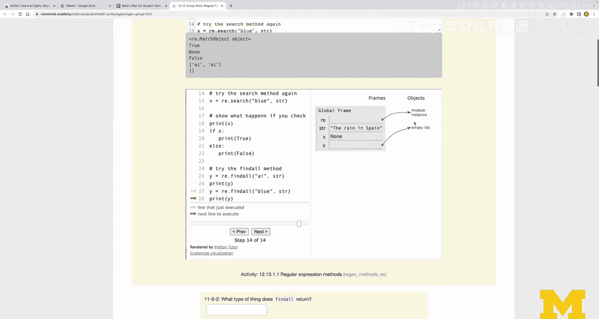

# 创造性编程：34：`search`与`find_all`的区别 🔍


在本节课中，我们将要学习Python正则表达式库中`search`方法与`find_all`方法的核心区别。我们将通过具体的代码示例，清晰地展示它们各自的行为和输出结果。


## 导入正则表达式库

首先，我们需要导入Python的正则表达式库`re`。这是使用正则表达式功能前必须进行的操作。

```python
import re
```

## 创建示例字符串

接下来，我们创建一个用于搜索的示例字符串。

```python
string = "The rain in Spain stays mainly in the plain."
```

## 使用`search`方法

上一节我们导入了必要的库并准备了数据，本节中我们来看看`search`方法的行为。`search`方法用于在字符串中搜索第一个匹配指定模式的位置。

以下是使用`search`方法查找“AI”的步骤：

```python
x = re.search("AI", string)
print(x)
```

执行上述代码，会输出一个匹配对象（Match Object），它告诉我们匹配到的内容及其位置。例如，它可能显示在索引5处找到了“AI”。

我们可以利用这个结果进行条件判断：

```python
if x:
    print(True)
else:
    print(False)
```

如果搜索一个不存在的模式，例如“blue”，`search`方法会返回`None`。

```python
x = re.search("blue", string)
print(x)  # 输出：None
if x:
    print(True)
else:
    print(False)  # 输出：False
```

## 使用`find_all`方法

了解了`search`方法后，我们再来看看`find_all`方法。`find_all`方法会返回字符串中所有匹配指定模式的子串，并以列表形式呈现。

以下是使用`find_all`方法查找所有“AI”的步骤：

```python
all_matches = re.findall("AI", string)
print(all_matches)
```

在我们的示例字符串中，“AI”出现了两次，因此`findall`会返回一个包含两个元素的列表。

如果搜索一个不存在的模式，`find_all`方法会返回一个空列表。

```python
all_matches = re.findall("blue", string)
print(all_matches)  # 输出：[]
```

## 核心区别总结

本节课中我们一起学习了`search`与`find_all`的核心区别。




*   **`re.search(pattern, string)`**：在字符串中搜索**第一个**匹配项。如果找到，返回一个**匹配对象（Match Object）**；如果未找到，返回 **`None`**。
*   **`re.findall(pattern, string)`**：在字符串中搜索**所有**匹配项。如果找到，返回一个包含所有匹配子串的**列表（List）**；如果未找到，返回一个**空列表 `[]`**。


简单来说，`search`用于查找“是否有”以及“第一个在哪里”，而`find_all`用于查找“一共有哪些”。