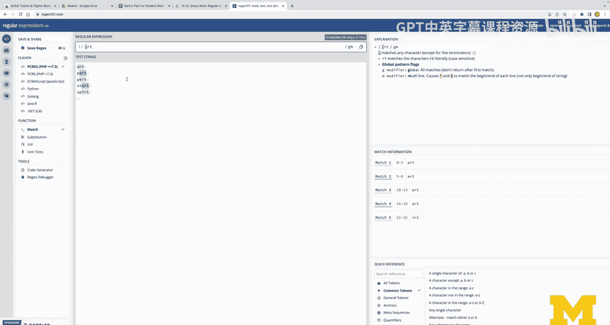

# 创造性编程：123：正则表达式101工具使用指南 🛠️

在本节课中，我们将学习如何使用在线工具 `regex101.com` 来测试和构建正则表达式。这能帮助我们在将正则表达式写入Python代码之前，先验证其功能是否正确。

## 概述

正则表达式是一种强大的文本匹配工具。在编写复杂的匹配规则时，直接写代码调试可能比较困难。幸运的是，我们可以利用在线工具来可视化地构建和测试正则表达式，`regex101.com` 就是其中一个优秀的工具。

上一节我们介绍了正则表达式的基本概念，本节中我们来看看如何利用工具来辅助开发。

## 使用 regex101.com 进行测试

该工具允许你在一个界面中输入正则表达式和测试字符串，并实时看到匹配结果。

### 1. 精确匹配

最简单的正则表达式就是精确的字符匹配。如果你不使用任何具有特殊含义的元字符，那么正则表达式将直接匹配这些字符本身。

例如，输入正则表达式 `art`。
*   它会匹配字符串中连续出现的 “a”、“r”、“t” 这三个字符。
*   在测试字符串 “I can recognize art” 中，它会匹配到 “art” 这个词。
*   在 “part” 中，它也会匹配到结尾的 “art”。
*   在 “spirit” 中，则没有任何匹配，因为其中没有连续的 “art” 字符。

**核心概念**：无特殊字符的正则表达式进行**精确匹配**。

### 2. 使用特殊字符：点号（.）

正则表达式的强大之处在于其特殊字符（元字符）。其中一个最常用的元字符是点号 `.`。

**公式/含义**：`.` 匹配**除换行符外**的任意单个字符。

现在，我们将正则表达式改为 `.rt`。
*   这个模式的意思是：任意一个字符，后面紧跟着 “r” 和 “t”。
*   在测试字符串中：
    *   “art” 会被匹配（`a` 匹配 `.`）。
    *   “ert” 会被匹配（`e` 匹配 `.`）。
    *   “irt” 会被匹配（`i` 匹配 `.`）。
*   因此，所有以 “rt” 结尾的三字母单词都会被高亮显示。

以下是 `.` 元字符的匹配示例列表：
*   `art` 中的 `a` 匹配 `.`
*   `ert` 中的 `e` 匹配 `.`
*   `irt` 中的 `i` 匹配 `.`

通过这个例子，你可以直观地看到元字符如何扩展了匹配模式。

## 总结

本节课中我们一起学习了 `regex101.com` 这个在线工具的基本用法。我们了解到：
1.  它可以作为正则表达式的“演练场”，在编写代码前进行测试。
2.  不使用特殊字符时，正则表达式执行精确匹配。
3.  点号 `.` 是一个基础且重要的元字符，用于匹配几乎任何单个字符。

掌握这个工具将极大地提升你编写和调试正则表达式的效率。这就是正则表达式工具的基础使用方法。

