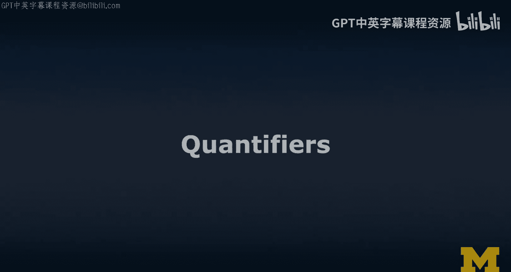
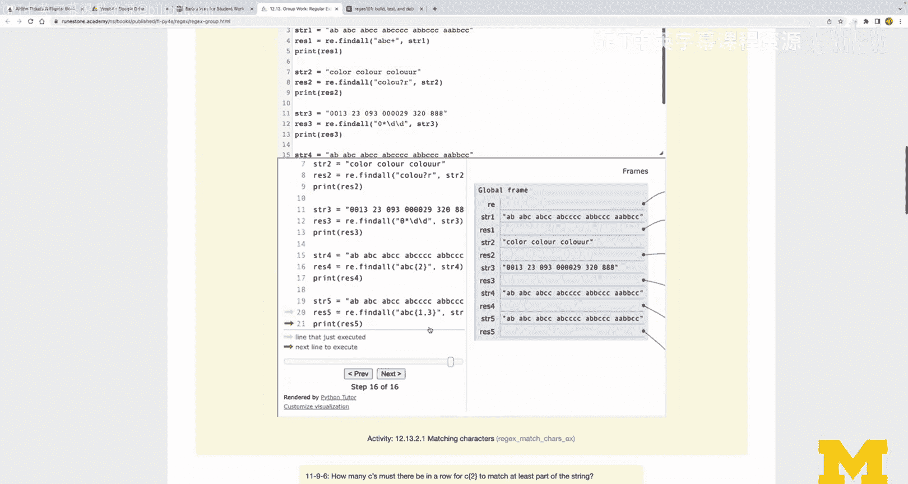

# 36：量词应用解析 🔍


在本节课中，我们将学习正则表达式中量词（Quantifiers）的使用。量词用于指定其左侧表达式需要匹配的次数，是构建灵活匹配模式的关键工具。



## 导入库与准备数据

首先，我们需要导入Python的`re`库，并声明一个用于测试的字符串。

```python
import re

text = "ABC ABCC ABCCC A B"
```

## 量词 `+`：匹配一次或多次

上一节我们介绍了基础的正则表达式匹配，本节中我们来看看如何使用量词`+`。`+`表示其左侧的字符必须出现**一次或多次**。

以下是使用`+`的示例：

```python
pattern1 = r"ABC+"
result1 = re.findall(pattern1, text)
print(result1)  # 输出: ['ABC', 'ABCC', 'ABCCC']
```

在这个例子中，模式`ABC+`匹配了“ABC”、“ABCC”和“ABCCC”，但没有匹配“A B”。因为模式要求字母`C`至少出现一次。

## 量词 `?`：匹配零次或一次

接下来，我们探讨量词`?`。它表示其左侧的字符是**可选的**，可以出现零次或一次。

以下是使用`?`的示例：

```python
pattern2 = r"colou?r"
text2 = "color colour colouur"
result2 = re.findall(pattern2, text2)
print(result2)  # 输出: ['color', 'colour']
```

模式`colou?r`匹配了“color”和“colour”，但没有匹配“colouur”。因为`?`只允许字母`u`出现零次或一次。

## 量词 `*`：匹配零次或多次

现在，让我们看看量词`*`。它表示其左侧的字符可以出现**零次或多次**。

以下是使用`*`的示例：

```python
pattern3 = r"\d*"
text3 = "123 45 6"
result3 = re.findall(pattern3, text3)
print(result3)  # 输出: ['123', '', '45', '', '6', '']
```

模式`\d*`匹配了所有数字序列，甚至包括空字符串（因为`*`允许零次匹配）。`\d`是一个特殊字符，代表任何数字（0-9）。

## 量词 `{n}`：匹配恰好n次

有时我们需要精确匹配特定次数，这时可以使用花括号`{}`。`{n}`表示其左侧的字符必须出现**恰好n次**。

以下是使用`{n}`的示例：

```python
pattern4 = r"\d{2}"
text4 = "1 12 123 1234"
result4 = re.findall(pattern4, text4)
print(result4)  # 输出: ['12', '12', '34']
```

模式`\d{2}`只匹配恰好由两个数字组成的序列，如“12”和“34”。

## 量词 `{m,n}`：匹配m到n次

最后，我们介绍范围量词`{m,n}`。它表示其左侧的字符可以出现**m到n次（包含m和n）**。

以下是使用`{m,n}`的示例：

```python
pattern5 = r"C{1,3}"
text5 = "C CC CCC CCCC"
result5 = re.findall(pattern5, text5)
print(result5)  # 输出: ['C', 'CC', 'CCC', 'CCC']
```

模式`C{1,3}`匹配了包含1到3个字母`C`的序列。对于“CCCC”，它匹配了前三个`C`（“CCC”）。

---




本节课中我们一起学习了正则表达式中五种核心量词的用法：
*   `+` 匹配**一次或多次**。
*   `?` 匹配**零次或一次**（可选）。
*   `*` 匹配**零次或多次**。
*   `{n}` 匹配**恰好n次**。
*   `{m,n}` 匹配**m到n次**。


掌握这些量词能帮助你构建更精确、更灵活的正则表达式模式。